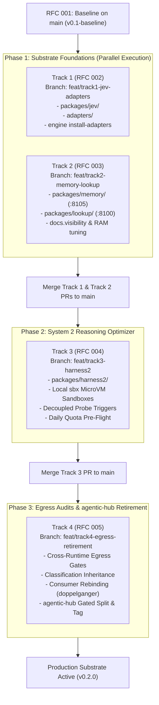

# Multi-Track Implementation Plan: Cognitive Engine Substrate & Reasoning

- **Document Type**: Multi-Track Engineering Implementation Plan & Execution DAG
- **Date**: 2026-10-26
- **Authors**: Aleksandr Korolev ([@rockad](https://github.com/rockad)), Antigravity Pair Architect
- **Target Reviewers**: [@Doc-Cr](https://github.com/Doc-Cr), Aleksandr Korolev ([@rockad](https://github.com/rockad))
- **Baseline Architecture**: [RFC 001: Cognitive Engine Architecture](../rfc/001-harness2-jev-unified-cognitive-substrate.md) (`v0.1-baseline` on `main`)
- **Child Track Specifications**:
  - Track 1: [RFC 002: System 1 — TypeSafe Jev Coprocessor & Multi-Harness Adapters](../rfc/002-system1-jev.md)
  - Track 2: [RFC 003: Memory & Lookup Substrates](../rfc/003-memory-lookup.md)
  - Track 3: [RFC 004: System 2 — Google Harness² Recursive Reasoning Optimizer](../rfc/004-system2-harness2.md)
  - Track 4: [RFC 005: Cross-Runtime Egress Gates & agentic-hub Retirement Protocol](../rfc/005-egress-retirement.md)

---

## 1. Executive Summary & Clarification Outcomes

Following the formal `/clarify` architectural review and incorporated feedback from collaborator [@Doc-Cr](https://github.com/Doc-Cr), the Cognitive Engine substrate execution roadmap is partitioned into four decoupled, modular tracks. This multi-track implementation plan defines the dependency graph, technical scopes, feature branching strategy, and GitHub review workflows.

### Core Architectural Decisions & Clarified Outcomes

- **4 Modular Child RFC Tracks (RFCs 002 through 005)**:
  - Decouples large, complex subsystem designs into focused, reviewable specifications.
  - Centralizes shared invariants, licensing boundaries, and monorepo topology in [RFC 001](../rfc/001-harness2-jev-unified-cognitive-substrate.md).
- **Independent Feature Branching Model**:
  - Each track develops on an independent feature branch created directly from `main`:
    - `feat/track1-jev-adapters`
    - `feat/track2-memory-lookup`
    - `feat/track3-harness2`
    - `feat/track4-egress-retirement`
  - Merges directly back to `main` via discrete Pull Requests with automated test verification.
- **Root CLI Multiplexer & Polyglot Workspaces**:
  - Bun workspace (`package.json`) manages TypeScript packages (`packages/jev/`, `adapters/`, `cli/`).
  - Python `uv` workspace (`pyproject.toml`) manages Python 3.12 packages (`packages/memory/`, `packages/lookup/`, `packages/harness2/`).
  - Standalone compiled executable binary (`bin/engine` / Makefile) provides high-level orchestration (`engine up`, `engine status`, `engine memory`, `engine jev`).
- **Substrate-First Parallel Execution DAG**:
  - Phase 1: Tracks 1 and 2 execute concurrently in parallel to lay the foundational System 1 coprocessor and native memory/lookup daemons.
  - Phase 2: Track 3 implements System 2 (Harness² recursive optimizer) on top of the validated System 1 judge and sandbox substrate.
  - Phase 3: Track 4 executes cross-runtime egress testing, privacy audits, consumer rebinding, and gated retirement of legacy `agentic-hub` plugins.

---

## 2. Substrate-First Execution Dependency Graph (DAG)



---

## 3. Detailed Breakdown by Track

### 3.1 Track 1 (RFC 002): System 1 — TypeSafe Jev Coprocessor & Multi-Harness Adapters

- **Target Branch**: `feat/track1-jev-adapters`
- **Specification**: [RFC 002: System 1 Coprocessor](../rfc/002-system1-jev.md)
- **Runtime & License**: TypeScript / Bun | MIT
- **Target Directories**: `packages/jev/`, `adapters/`, `cli/`
- **Key Deliverables**:
  - **TypeSafe Jev Core (`packages/jev`)**:
    - Sub-second probabilistic model tier dispatch (`jev_dispatch`, `jev_route`).
    - Binary quality gatekeeping and diff acceptance (`jev_judge`).
    - Free-tier offloading coprocessor (`jev_execute_free`, `jev_agent_free`) saving Gemini/Claude quota.
    - Model tier ceiling governance (clamping subagents to parent tier; strict user gate for Pro tier).
    - Next-gen model tier governance: Full support for Gemini 4 Argon and Claude Fable 5.1 as Tier 3 (`pro`) with `gemini-argon-wtu-weekly` quota mapping (see [§7](#7-2026-10-29-antigravity--gemini-4-argon-hardening-specifications)).
  - **Dual-Mode Transport**:
    - Default: FastMCP stdio transport for zero-latency direct integration with CLI harnesses.
    - Supervised Daemon: Streamable HTTP transport on `127.0.0.1:8115/mcp` managed via `engine up`.
  - **Multi-Harness Adapters (`adapters/`)**:
    - Google Antigravity sidecar integration and MCP registration (`~/.gemini/config/mcp_config.json`).
    - Production-hardened Antigravity integration: Real `ANTIGRAVITY_*` env detection, live `PreInvocation` pre-flight dispatch, and fail-soft non-blocking hooks (see [§7](#7-2026-10-29-antigravity--gemini-4-argon-hardening-specifications)).
    - Claude Code native plugin package (`.claude-plugin/plugin.json`) and MCP registration (no custom session hooks, aligning with the 2026-10-27 settings consolidation).
    - OpenCode V2 plugin bundle and event interceptors.
    - Turnkey installer command: `engine install-adapters`.
- **Invariants & Gates**:
  - Blocks `openrouter/free` offloading when handling private workspaces or under `zdr: strict`.
  - Enforces `@Doc-Cr` alias routing.
  - Incorporates the 2026-10-29 Antigravity & Gemini 4 Argon hardening fixes (see [§7](#7-2026-10-29-antigravity--gemini-4-argon-hardening-specifications)).

---

### 3.2 Track 2 (RFC 003): Memory & Lookup Substrates

- **Target Branch**: `feat/track2-memory-lookup`
- **Specification**: [RFC 003: Memory & Lookup Substrates](../rfc/003-memory-lookup.md)
- **Runtime & License**: Python 3.12 / uv | AGPL-3.0 (`packages/memory`) + MIT (`packages/lookup`)
- **Target Directories**: `packages/memory/`, `packages/lookup/`
- **Key Deliverables**:
  - **`packages/memory` (Native Upstream `basic-memory`, AGPL-3.0)**:
    - Runs upstream-maintained `basic-memory` package natively in Python via `uv` without Docker.
    - Binds strictly to `127.0.0.1:8105/mcp` during staging to avoid port conflicts with legacy daemons.
    - Exposes upstream FastMCP tools (`read_note`, `write_note`, `search_notes`, `list_notes`, `delete_note`, `build_context`).
    - Tuned hybrid retrieval parameters:
      - `BASIC_MEMORY_RERANKER_CANDIDATES=5–10`
      - `BASIC_MEMORY_RERANKER_MAX_DOCUMENT_CHARS=500–1000`
      - Bounded resident memory strictly under **2–3 GB RAM** while maintaining 9/10 context accuracy.
    - Out-of-tree persistent storage at `~/.local/share/cognitive-engine/memory/`.
  - **`packages/lookup` (Companion Archive & Transcript Search, MIT)**:
    - Runs natively on `127.0.0.1:8100/mcp`.
    - Preserves the 4 standard Lookup tools (`search_archive`, `get_document`, `refresh_index`, `archive_stats`).
    - Full-text SQLite FTS5 search indexing session transcripts and external knowledge archives.
    - Enforces `docs.visibility` classification (`open`, `gated`, `unstated`, `mixed`) for strict classification inheritance.
  - **Process-Boundary AGPL Containment**:
    - `packages/memory` communicates strictly across standard process/MCP loopback boundaries, cleanly confining AGPL-3.0 to its subpackage.

---

### 3.3 Track 3 (RFC 004): System 2 — Google Harness² Recursive Reasoning Optimizer

- **Target Branch**: `feat/track3-harness2`
- **Specification**: [RFC 004: System 2 Reasoning Optimizer](../rfc/004-system2-harness2.md)
- **Runtime & License**: Python 3.12 / uv | Apache-2.0
- **Target Directories**: `packages/harness2/`
- **Key Deliverables**:
  - **Task-Level Recursion (*Propose–Probe–Compose*)**:
    - Proposes candidate prompt/tool/context mutations across allowed dimensions without ground truth.
    - Behavioral contrast composer synthesizes candidate outputs into human-reviewable proposals.
  - **Strict Local MicroVM Execution (`sbx`)**:
    - Parallel candidate execution runs exclusively inside local Docker Sandboxes via standalone `sbx` CLI.
    - Zero cloud sandboxing; zero off-host code or credential movement.
  - **Fail-Closed Sandbox Fallback**:
    - If the `sbx` runtime is unavailable, candidate probing fails closed immediately.
    - Optional `mkdtemp` worktree mode generates diffs for inspection only and never executes untrusted code.
  - **Decoupled Probe Triggers**:
    - Probing is completely decoupled from routing confidence metrics.
    - Fires strictly on:
      - Post-task verification failure (`jev_judge` returns `FAIL` or score < 0.50).
      - Execution retry limit exhausted in the agent loop.
      - Explicit on-demand request (`/probe <task>` or `engine probe`).
  - **Daily Quota Pre-Flight Check**:
    - Pre-flights `free_model_daily_requests` from `GET /api/v1/key` before triggering candidate sweeps.
    - Throttles or skips sweeps when OpenRouter daily quota is constrained.
  - **Protected Invariant Set**:
    - Guardrails, Egress/ZDR policies, Session ceilings, Lifecycle hooks, and the human gate on composer are immune to mutation.
  - **Continual Experience Learning**:
    - Proposes reflection entries into out-of-tree domain libraries at `~/.local/share/cognitive-engine/experiences/<domain>/`.
    - Requires human sign-off before committing to permanent storage.

---

### 3.4 Track 4 (RFC 005): Cross-Runtime Egress Gates & agentic-hub Retirement Protocol

- **Target Branch**: `feat/track4-egress-retirement`
- **Specification**: [RFC 005: Egress & Retirement Protocol](../rfc/005-egress-retirement.md)
- **Runtime & License**: Polyglot (TypeScript / Python / Shell) | MIT
- **Target Directories**: Cross-repository (`cognitive-engine/`, `agentic-hub/`, `doppelganger/`)
- **Key Deliverables**:
  - **Cross-Runtime Egress Firewall**:
    - Unified outbound egress and ZDR policy validation enforced symmetrically across TypeScript (`packages/jev`) and Python (`packages/harness2`, `packages/lookup`).
    - Classification inheritance: Content derived from memory or transcripts inherits the strictest source classification; unclassified content defaults to restricted.
  - **Pre-Retirement Verification Gates**:
    - All unit, integration, schema, and latency test suites pass across Tracks 1, 2, and 3.
    - Memory footprint stays verified under 2–3 GB RAM under sustained query load.
    - Dual port binding verified (`:8105` and `:8100` on `127.0.0.1`).
    - Local `sbx` probe isolation and fail-closed behavior verified.
    - Client configuration updated in `~/.gemini/config/mcp_config.json`.
  - **Phased agentic-hub Retirement Protocol**:
    - Freeze and deprecation notices added to `agentic-hub/plugins/jev/` and `agentic-hub/plugins/memory/`.
    - Consumer rebinding in `doppelganger` (`.mcp.json`, shell wrappers `jev-mode`, `memory.sh`).
    - Surgical removal of retired plugins from `agentic-hub`.
    - Reposition `agentic-hub` as the peripheral-only registry (`chrome-devtools`, `gitea`, `google-workspace`, `local-transcribe`).
    - Tag release `v2.4.0-split` in `agentic-hub`.

---

## 4. Workstream Summary & Execution Matrix

| Stream | Track | Branch | Scope / File Targets | Description | Lead Subagent | Recommended Tier |
|---|---|---|---|---|---|---|
| **WS1** | **Track 1** | `feat/track1-jev-adapters` | `packages/jev/`, `adapters/`, `cli/` | Migrate Jev core, stdio/HTTP transports, and Antigravity / Claude / OpenCode adapters | `code-engineer` | `flash_lite` |
| **WS2** | **Track 2** | `feat/track2-memory-lookup` | `packages/memory/`, `packages/lookup/` | Package native `basic-memory` on `:8105` and companion `lookup` on `:8100` with `docs.visibility` | `code-engineer` | `flash_lite` |
| **WS3** | **Track 3** | `feat/track3-harness2` | `packages/harness2/` | Package Harness² optimizer, local `sbx` microVMs, fail-closed prober, and daily quota pre-flight | `code-engineer` | `flash_lite` |
| **WS4** | **Track 4** | `feat/track4-egress-retirement` | `cognitive-engine/`, `doppelganger/`, `agentic-hub/` | Cross-runtime egress gates, consumer rebinding, and gated surgical retirement of legacy plugins | `system-operator` | `flash_lite` |

---

## 5. Review & PR Protocol for Collaboration with @Doc-Cr

To ensure seamless peer review with collaborator [@Doc-Cr](https://github.com/Doc-Cr) on GitHub:

1. **Branch Hygiene**:
   - Feature branches must branch directly from `origin/main` (`git checkout -b feat/trackX-... origin/main`).
   - Keep commits atomic and semantic (`feat:`, `fix:`, `refactor:`, `docs:`, `test:`).
2. **Pull Request Protocol**:
   - Open PRs against `main` on GitHub (`rockad/cognitive-engine`).
   - Title format: `feat(trackX): <short summary> [RFC 00X]` (e.g. `feat(track1): migrate typesafe jev and multi-harness adapters [RFC 002]`).
   - Mention `@Doc-Cr` in the PR description with:
     - Reference to the corresponding child RFC and implementation plan section.
     - Summary of changes and test execution output.
     - Specific architectural verification questions.
3. **Automated Verification Gates**:
   - Prior to requesting review or merging, ensure local tests pass:
     - Bun workspace: `bun test` (0 errors).
     - Python workspace: `uv run pytest` (0 errors).
     - Egress test suite: `bun run test:egress` and `uv run pytest tests/test_egress.py`.
4. **Merge Sequencing**:
   - Track 1 and Track 2 PRs can be reviewed and merged independently in Phase 1.
   - Track 3 merges after Phase 1 is validated on `main`.
   - Track 4 executes as the final cutover PR.

---

## 6. Dual-Harness Cross-Delegation (Antigravity + Claude Code Pro)

To maximize development velocity and conserve Gemini Pro quota, implementation leverages a **Dual-Harness Architecture** combining **Claude Code (Sonnet 5.5 & Opus 5.5 via prepaid Pro subscription)** and **Google Antigravity (Flash/Medium Orchestrator)**.

### 6.1 Division of Responsibilities

| Subsystem / Concern | Primary Harness | Model Tier | Rationale |
|---|---|---|---|
| **Deep Code Implementation** (`packages/jev`, `packages/harness2`, adapters) | **Claude Code** | Claude Sonnet 5.5 or Opus 5.5 | High-fidelity multi-file coding, algorithmic prompt synthesis; burns **zero Gemini quota** (prepaid Claude Pro). |
| **Architectural Governance & Pre-Flight Dispatch** | **Antigravity** | Gemini 3.8 Flash | Session orchestrator, multi-track dependency tracking, invariant enforcement. |
| **Verification Gates & Quality Acceptance** | **Antigravity** | Gemini 3.8 Flash + `jev_judge` | Runs test suites (`bun test`, `uv run pytest`), diff validation, and binary quality gating. |
| **Git, PRs & Review Coordination with @Doc-Cr** | **Antigravity** | Gemini 3.8 Flash | Branch checkout, semantic commits, PR management, and GitHub review updates. |
| **Session State & Cross-Harness Continuity** | **Unified Memory** | Recall (:8110) & Lookup (:8100) | Synchronizes state via `session-handoff:cognitive-engine` across both harnesses. |

### 6.2 Operating Modes

#### Mode A: Concurrent Track Ownership (Parallel Branches)
- **Claude Code**: Implements **Track 1** (`feat/track1-jev-adapters` in Bun/TS).
- **Antigravity**: Implements **Track 2** (`feat/track2-memory-lookup` in Python/uv).
- **Independence**: Both run simultaneously on disjoint feature branches without merge conflicts or context collisions.

#### Mode B: Dual-Harness Ping-Pong (Implement in Claude Code, Verify in Antigravity)
1. **Briefing Phase (Antigravity)**:
   - Antigravity scaffolds a self-contained, clipboard-ready **Harness Prompt Brief** specifying:
     - Target files and exact method/type signatures.
     - RFC invariants and constraint bounds.
     - Verification command lines (`bun test`, `pytest`).
   - Updates `session-handoff:cognitive-engine` in Recall / disk cache.
2. **Coding Phase (Claude Code)**:
   - Aleksandr launches Claude Code in `~/projects/cognitive-engine` on the target branch.
   - Pastes the briefing prompt; Claude Code (Sonnet/Opus) writes the implementation, refactors, and runs local checks.
3. **Verification & Quality Gate Phase (Antigravity)**:
   - Aleksandr returns to Antigravity.
   - Antigravity inspects `git status` and `git diff`.
   - Runs test suites (`engine test`, `bun test`, `uv run pytest`).
   - Runs `jev_judge` quality gate on the diff.
   - Verifies security invariants (ZDR rules, AGPL process boundaries, standalone `sbx` isolation).
   - Generates semantic commits and pushes the branch for [@Doc-Cr](https://github.com/Doc-Cr) review.

### 6.3 Context & Session Sharing Protocol
- **Shared Repository Disk State**: Both harnesses operate directly on `~/projects/cognitive-engine`.
- **Clipboard-Ready Prompt Templates**: Antigravity formats self-contained markdown prompts with embedded schemas so Claude Code has complete context upon session start.
- **Cross-Harness Memory**: Both harnesses query `session-handoff:cognitive-engine` and search indexed session logs via `lookup` on `127.0.0.1:8100`.

---

## 7. 2026-10-29 Antigravity & Gemini 4 Argon Hardening Specifications

During production validation on 2026-10-29, four critical edge cases were identified and hardened across the live Jev coprocessor and Antigravity hook architecture. These hardening requirements must be ported directly into `packages/jev/` and `adapters/antigravity/` during Track 1 implementation.

### 7.1 Fix 1: `PreInvocation` Hook SSE Socket / Event-Loop Hang (`adapters/antigravity/` & Pre-Flight Runner)

- **Affected Subsystems**:
  - `adapters/antigravity/`
  - `packages/jev/src/pre-invocation.ts`
  - `adapters/antigravity/src/hook.ts`
- **Root Cause**:
  - Calling HTTP daemons such as `fetch('http://127.0.0.1:8110/mcp')` (or port `:8105/mcp` in Track 2) using `Promise.race` without an explicit `AbortController` leaves Server-Sent Events (SSE) HTTP stream sockets open in Bun's event loop.
  - Even after `console.log` emits the hook response payload, Bun keeps the runtime process active waiting for open socket handles to close.
  - Antigravity's hook supervisor (`prehooks.go:43`) waits up to its 5-second hard timeout and then terminates the hook process via `SIGKILL`.
  - The `SIGKILL` abruptly drops buffered stdout before Antigravity can ingest it, silently losing pre-flight recommendations while introducing an unacceptable 5-second stall on every agent turn.
- **Requirements for `cognitive-engine`**:
  - **Explicit Abort Binding**:
    - Every outbound HTTP fetch to local daemon endpoints must bind an `AbortController`.
    - The controller must be aborted inside a `finally` block immediately after response processing.
  - **Explicit Process Termination**:
    - Call `process.exit(0)` explicitly on all hook completion and error recovery paths to guarantee the runtime event loop terminates cleanly.
  - **Fail-Soft Shell Guard**:
    - In `adapters/antigravity/`, wrap the pre-flight invocation command with a 3.5-second timeout shell guard:
      ```bash
      timeout 3.5 bun run /path/to/hook.ts || exit 0
      ```
    - This ensures any hung subprocess fails soft with exit code 0 well before Antigravity's 5.0-second hard kill ceiling.

### 7.2 Fix 2: Live `PreInvocation` Pre-Flight Dispatch & Telemetry Parity with Claude Code (`adapters/antigravity/`)

- **Affected Subsystems**:
  - `adapters/antigravity/`
  - `packages/jev/src/telemetry.ts`
  - Hook runners
- **Root Cause**:
  - Unlike Claude Code's `UserPromptSubmit` hook (`onUserPromptSubmit`), which dynamically inspects the user prompt, runs a 1500ms `callJev` dispatch, records telemetry, and injects tier guidance, Antigravity's `PreInvocation` script previously only printed a static reminder string.
  - The script did not read `stdin` (`lastUserInput`, `invocationNum`, `conversationId`) and never invoked `callJev`.
  - Because no dispatch telemetry was recorded in `jev_telemetry.jsonl`, subsequent multi-file edits in Antigravity tripped the `PreToolUse` write guard (`jev-pre-tool.sh`), which blocks consecutive edits without a preceding dispatch event.
- **Requirements for `cognitive-engine`**:
  - **Non-Blocking `stdin` Reader**:
    - Implement a non-blocking `stdin` stream reader with a 50ms timeout to safely handle empty streams or interactive TTY invocations without blocking.
  - **Protocol Tag Sanitization**:
    - Strip Antigravity protocol wrapper tags such as `<USER_REQUEST>` and `<ADDITIONAL_METADATA>` before evaluating the prompt.
  - **Turn-1 Dispatch Evaluation**:
    - Trigger a 1500ms-bounded `callJev` dispatch specifically when `invocationNum === 1` (the initial turn of a user request).
  - **Telemetry Logging**:
    - Record the pre-flight dispatch event to `jev_telemetry.jsonl` with:
      - `tool: "jev_dispatch"`
      - `toolOrHook: "PreInvocation"`
      - Recommended execution tier and calibrated confidence score.
    - This satisfies the `PreToolUse` consecutive edit guard.
  - **Direct Step Injection**:
    - Inject the calibrated cost-tiered recommendation (`[JEV PRE-FLIGHT] ...`) directly into the hook's `injectSteps` array in stdout JSON.

### 7.3 Fix 3: Next-Gen Model Tier Ceiling & Quota Bucket Mapping (`packages/jev/src/core/governance.ts`)

- **Affected Subsystems**:
  - `packages/jev/src/core/governance.ts`
  - `packages/jev/src/core/config.ts`
  - Quota view resolution
- **Root Cause**:
  - `modelTierRank()` only checked for string occurrences of `pro`, `opus`, and `expensive`, defaulting any unrecognized model to rank `2` (`flash`).
  - Next-generation frontier models—specifically `"Gemini 4 Argon (Medium)"`, `"Gemini 4 Argon (High)"`, and `"Claude Fable 5.1"`—erroneously evaluated to rank `2`.
  - When running inside a Gemini 4 Argon session, `clampTierToSessionCeiling()` assigned `ceilingRank = 2` (`ceilingTier: 'flash'`), which caused subagents recommended for `pro` to be clamped down to `flash`.
  - Furthermore, Gemini 4 Argon tracks quota via a dedicated weekly bucket (`gemini-argon-wtu-weekly`) in `quota-state.json` rather than the legacy `gemini-weekly` bucket.
- **Requirements for `cognitive-engine`**:
  - **Frontier Model Tier 3 Ranking**:
    - Update `modelTierRank()` in `governance.ts` so `argon`, `fable`, and `deep` return rank `3`:
      ```typescript
      if (
        t.includes('pro') ||
        t.includes('argon') ||
        t.includes('opus') ||
        t.includes('fable') ||
        t.includes('expensive') ||
        t === 'deep'
      ) {
        return 3;
      }
      ```
  - **Tier Normalization**:
    - Update `normalizeTier()` in `config.ts` to map `argon` and `fable` variants to `'deep'`.
  - **Explicit Pro Override Expansion**:
    - In `clampTierToSessionCeiling()`, expand `explicitProOverride` to include:
      - `argon`
      - `gemini argon`
      - `fable`
      - `claude fable`
  - **Argon Quota Bucket Resolution**:
    - In `readQuotaView()`, check whether `active_model` contains `argon`.
    - When active, resolve weekly remaining quota from `gemini-argon-wtu-weekly` to ensure correct derivation of quota strategy (`normal`, `conserve`, `free_only`).

### 7.4 Fix 4: Antigravity Environment Detection & Concrete Model Resolution (`packages/jev/src/core/config.ts`)

- **Affected Subsystems**:
  - `packages/jev/src/core/config.ts`
  - `adapters/antigravity/`
- **Root Cause**:
  - `detectActiveHarness()` checked only `ANTIGRAVITY_CLI`, `GEMINI_CLI`, and `CORTEX_SESSION`.
  - Google Antigravity actually exports the following runtime environment variables:
    - `ANTIGRAVITY_AGENT=1`
    - `ANTIGRAVITY_APP_DATA_DIR`
    - `ANTIGRAVITY_LS_ADDRESS`
    - `ANTIGRAVITY_LS_VERSION`
    - `ANTIGRAVITY_CONVERSATION_ID`
    - `ANTIGRAVITY_PROJECT_ID`
  - Because none of these matched, `detectActiveHarness()` fell back to `'cli'`.
  - As a result, `getHarnessModels()` resolved the generic CLI model mapping (`concreteModel: "typesafe/jev-router"`).
  - Passing `"typesafe/jev-router"` to Antigravity's `invoke_subagent` caused the `PreToolUse` hook (`jev-pre-tool.sh`) to reject the call, as `"typesafe/jev-router"` is not a valid Antigravity `Model` enum (`inherit`, `flash_lite`, `flash`, `pro`).
- **Requirements for `cognitive-engine`**:
  - **Comprehensive Environment Variable Inspection**:
    - Update `detectActiveHarness()` in `config.ts` to inspect all genuine Antigravity variables:
      - `process.env.ANTIGRAVITY_AGENT`
      - `process.env.ANTIGRAVITY_APP_DATA_DIR`
      - `process.env.ANTIGRAVITY_LS_ADDRESS`
      - `process.env.ANTIGRAVITY_LS_VERSION`
      - `process.env.ANTIGRAVITY_CONVERSATION_ID`
      - `process.env.ANTIGRAVITY_PROJECT_ID`
      - `process.env.ANTIGRAVITY_CLI`
      - `process.env.GEMINI_CLI`
      - `process.env.CORTEX_SESSION`
  - **Entrypoint Fallback Detection**:
    - When executed as an MCP server without inherited environment variables, inspect `process.argv` for the MCP server script and verify recent mtime on `~/.gemini/antigravity-cli/quota-state.json`.
  - **Explicit Harness Registration**:
    - In `engine install-adapters`, configure `mcpServers.jev.env` in `~/.gemini/config/mcp_config.json` with an explicit environment override:
      ```json
      "env": {
        "JEV_HARNESS": "antigravity"
      }
      ```
  - **Strict Model Enum Mapping**:
    - Ensure `getHarnessModels('antigravity')` strictly returns valid Antigravity model identifiers:
      - `free`: `'openrouter/free'`
      - `cheap`: `'flash_lite'`
      - `standard`: `'flash'`
      - `deep`: `'pro'`

