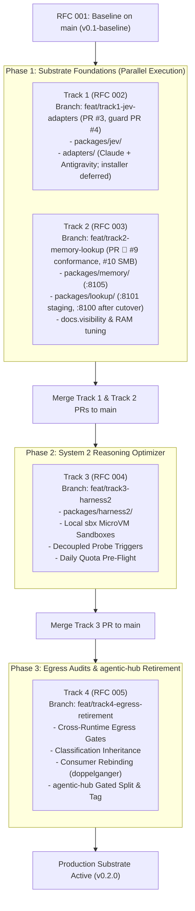

# Multi-Track Implementation Plan: Cognitive Engine Substrate & Reasoning

- **Document Type**: Multi-Track Engineering Implementation Plan & Execution DAG
- **Date**: 2026-10-26
- **Authors**: Aleksandr Korolev ([@rockad](https://github.com/rockad)), Antigravity Pair Architect
- **Target Reviewers**: [@Doc-Cr](https://github.com/Doc-Cr), Aleksandr Korolev ([@rockad](https://github.com/rockad))
- **Baseline Architecture**: [RFC 001: Cognitive Engine Architecture](../rfc/001-harness2-jev-unified-cognitive-substrate.md) (`v0.1-baseline` on `main`)
- **Child Track Specifications**:
  - Track 1: [RFC 002: System 1 — TypeSafe Jev Coprocessor & Multi-Harness Adapters](../rfc/002-system1-jev.md)
  - Track 2: [RFC 003: Memory & Lookup Substrates](../rfc/003-memory-lookup.md)
  - Track 3: [RFC 004: System 2 — Google Harness² Recursive Reasoning Optimizer](../rfc/004-system2-harness2.md)
  - Track 4: [RFC 005: Cross-Runtime Egress Gates & agentic-hub Retirement Protocol](../rfc/005-egress-retirement.md)
  - Track 3 follow-up: [RFC 006: Subscription Proposer Channels (Stage 3) and sbx for Model Sessions](../rfc/006-subscription-channels-and-sbx-model-sessions.md)
- **Companion Plans (2026-11-02)**: [Checks plan](2026-11-02-checks-plan.md) (merge checklist, item-6 leftovers, recurring checks), [Experiments plan](2026-11-02-experiments-plan.md) (pre-registered experiments EXP-1 to EXP-5)
- **Reconciled against the repository**: 2026-11-02 (see [Appendix A](#appendix-a-reconciliation-2026-11-02))

---

## 1. Executive Summary & Clarification Outcomes

Following the formal `/clarify` architectural review and incorporated feedback from collaborator [@Doc-Cr](https://github.com/Doc-Cr), the Cognitive Engine substrate execution roadmap is partitioned into four decoupled, modular tracks. This multi-track implementation plan defines the dependency graph, technical scopes, feature branching strategy, and GitHub review workflows.

### Core Architectural Decisions & Clarified Outcomes

- **4 Modular Child RFC Tracks (RFCs 002 through 005)**:
  - Decouples large, complex subsystem designs into focused, reviewable specifications.
  - Centralizes shared invariants, licensing boundaries, and monorepo topology in [RFC 001](../rfc/001-harness2-jev-unified-cognitive-substrate.md).
- **Independent Feature Branching Model**:
  - Each track was planned on an independent feature branch created directly from `main`:
    - `feat/track1-jev-adapters`
    - `feat/track2-memory-lookup`
    - `feat/track3-harness2`
    - `feat/track4-egress-retirement`
  - Merges directly back to `main` via discrete Pull Requests with automated test verification.
  - **What happened (verified 2026-11-02):** Track 3 was built on top of Track 2, so the Track 3 PR is `feat/stage1-integration` (PR #5, base `main`) and `feat/track3-harness2` is one of the branches contained in it. Track 2 and its follow-ups have their own PRs (#8, #9, #10); the guard is PR #4 stacked on #3. `feat/track4-egress-retirement` does not exist (Track 4 is not started). The real stack is in [section 2.1](#21-actual-state-of-the-dag-2026-11-02).
- **Root CLI Multiplexer & Polyglot Workspaces**:
  - Bun workspace (`package.json`) manages TypeScript packages: `workspaces` is `packages/jev` and `adapters/*`. A `cli/` package was planned and does not exist in any branch.
  - Python `uv` workspace (`pyproject.toml`) manages Python 3.12 packages (`packages/memory/`, `packages/lookup/`, `packages/harness2/`).
  - Standalone compiled executable binary (`bin/engine` / Makefile) providing high-level orchestration (`engine up`, `engine status`, `engine memory`, `engine jev`) is **not built**: no `bin/`, `cli/` or `Makefile` exists in any branch. The `engine ...` commands named in this plan and the RFCs are the planned CLI work (also named in Track 1 as the reason the installer is deferred).
- **Substrate-First Parallel Execution DAG**:
  - Phase 1: Tracks 1 and 2 execute concurrently in parallel to lay the foundational System 1 coprocessor and native memory/lookup daemons.
  - Phase 2: Track 3 implements System 2 (Harness² recursive optimizer) on top of the validated System 1 judge and sandbox substrate. In practice Track 3 was built on top of Track 2 (its PR #5 carries the Track 2 commits until #8 and #9 merge) and does not touch `packages/jev`, so it did not wait for Track 1 to merge.
  - Phase 3: Track 4 executes cross-runtime egress testing, privacy audits, consumer rebinding, and gated retirement of legacy `agentic-hub` plugins.

---

## 2. Substrate-First Execution Dependency Graph (DAG)

### 2.1 Actual state of the DAG (2026-11-02)

Verified with `gh pr view` and `git merge-base --is-ancestor` on 2026-11-02. All eight PRs are open and nothing has merged. The planned phases above did not run as drawn: Track 3 was built on Track 2 and carries it.

| PR | Branch | Base | Head | Track and content | Merge order |
|---|---|---|---|---|---|
| #3 | `feat/track1-jev-adapters` | `main` | `61fd4a3` | Track 1: Jev core, Claude and Antigravity adapters, strict tools (WS1, WS6, WS9) | 1 |
| #4 | `fix/agent-guard-unknown-agents` | #3's branch | `fb9fb8d` | Track 1: workflow and agent guard, guard backlog (WS7); contains `feat/jev-workflow-guard` and `feat/guard-backlog` | 2 |
| #8 | `feat/track2-memory-lookup` | `main` | `1e7ff7a` | Track 2: native Memory launcher and Lookup (WS2) | 3 |
| #9 | `feat/mcp-conformance` | #8's branch | `d7c4f2e` | Cross-cutting: MCP conformance runner (WS5) | 4 |
| #5 | `feat/stage1-integration` | `main` | `9f12381` | Track 3: Harness² stage-1 pipeline, route filter, sbx, hint and rollouts. Contains the heads of #8 and #9 (so Track 2 and the runner show in its diff until those merge), not #10, not #3, not #4 | 5 |
| #6 | `feat/model-bench` | #5's branch | `888a4d4` | `tools/bench` model benchmark (23 files) | 6 |
| #10 | `feat/lookup-smb-sources` | #8's branch | `205a332` | Track 2 follow-up: SMB reads in userspace (S1-S5) | 7 |
| #7 | `docs/stage1-findings` | `main` | `19de968` | Docs; contains #10's head, so it is docs-only only after #10 lands | 8 |
| (open later) | `docs/future-plans` | #7's branch | this branch | RFC 006, checks plan, experiments plan, this reconciliation | 9 |

- **Order (agreed by the user):** #3, #4, #8, #9, #5, #6, #10, #7, then the `docs/future-plans` PR. Merge commits only, never squash. Children are retargeted to `main` after their parent merges.
- **Code does not conflict between the PRs.** #3 and #4 touch `packages/jev`, `adapters/`, docs, the root `package.json`, `bun.lock`, `README.md` and `LICENSE`, and (#4 only) `tools/probes/hook-canary`; #5, #6, #8, #9, #10 and #7 touch none of `packages/jev` and `adapters/` (checked with `git diff --name-only origin/main...origin/<branch>`). The dry-run merges in the Checks plan (section 2) report conflicts only in docs files. The shared conflict is documentation: this plan and RFC 002 (and RFC 003, RFC 004, the removed handoff files for the later ones). Resolution rules are in the [Checks plan](2026-11-02-checks-plan.md), section 3.9.
- **Not in any PR:** `feat/worktree-protocol` (`tools/wt`, `.githooks/pre-commit`, `AGENTS.md`; one commit, `d7f4e93`). It needs a decision whether it gets a PR (Checks plan L-e4).

#### 2.1.1 What blocks items 4 and 6 (summary; detail in RFC 006 section 4 and the Checks plan)

- **Item 4a, Stage 2 and Stage 3 proposer channels (RFC 006 Part A, EXP-1, EXP-2):**
  - Preparation can start now on a branch stacked on `feat/stage1-integration`; it cannot merge before #5, because it edits files that exist only in #5, and by the agreed order #5 comes after #3, #4, #8 and #9 (#3 and #4 are an ordering constraint, not a code dependency).
  - It is not blocked by #6, #10 or #7, nor by Track 4.
  - It IS blocked by user decisions (RFC 006 D1 to D10), by the user's typed approval of each real run, by a dollar cap for Stage 2, and by the unverified behaviour of the Claude CLI with a custom base URL (spike A-11).
  - The stage-1 runner must first be generalised (RFC 006 phase A4): at the PR #5 head `stage1.py` pins `ZDR = "strict"` and accepts only a local `opencode` channel.
- **Item 4b, sbx for model sessions (RFC 006 Part B, EXP-3):**
  - The code is in #5, so the real run needs no merge: the user runs it from a checkout of `feat/stage1-integration`.
  - Making sbx the default needs the run's result, the user's acceptance of the isolation shape, and one more read-only review of the fixes after round 3.
- **Item 6, small leftovers (Checks plan, section 4):**
  - Guard backlog tickets (G-1 to G-6) need #3 and #4 merged first, because the code is in #4.
  - Antigravity's optional review of `374b790..9f12381` is blocked by Antigravity quota (out, no date), not by a PR.
  - Run-directory cleanup and the marker-assumption check (`CLAUDE_PID`, `CLAUDE_JOB_DIR` absent from the user's own terminal) are the user's.
  - Branch cleanup and retargets happen after the merges they follow.
- **Track 4 (RFC 005):** blocked by the merges above plus the user and the real corpus; it is neither blocked by nor blocking RFC 006.

---

## 3. Detailed Breakdown by Track

### 3.1 Track 1 (RFC 002): System 1 — TypeSafe Jev Coprocessor & Multi-Harness Adapters

- **Target Branch**: `feat/track1-jev-adapters`
- **Specification**: [RFC 002: System 1 Coprocessor](../rfc/002-system1-jev.md)
- **Runtime & License**: TypeScript / Bun | MIT
- **Target Directories**: `packages/jev/`, `adapters/` (`cli/` was planned and does not exist; see section 1)
- **Status (2026-11-02)**: PR #3 (core, adapters, strict tools) and PR #4 (workflow and agent guard, stacked on #3) are open; neither is merged.
- **Key Deliverables**:
  - **TypeSafe Jev Core (`packages/jev`)**:
    - Sub-second probabilistic model tier dispatch (`jev_dispatch`, `jev_route`).
    - Binary quality gatekeeping and diff acceptance (`jev_judge`).
    - Free-tier offloading coprocessor (`jev_execute_free`, `jev_agent_free`) saving Gemini/Claude quota.
    - Model tier ceiling governance: subagent guard asks on ANY escalation above the session model (the earlier Claude Code subagent model rule was temporary and is not encoded as permanent).
  - **Dual-Mode Transport**:
    - Default: stdio transport (official TypeScript SDK; FastMCP is a Python library) for zero-latency direct integration with CLI harnesses. Tool arguments are strictly validated per [§3.5](#35-cross-cutting-mcp-selection--server-contract-2026-10-28).
    - Supervised Daemon: Streamable HTTP transport on `127.0.0.1:8115/mcp` managed via `engine up`.
  - **Multi-Harness Adapters (`adapters/`)**:
    - Google Antigravity sidecar integration and MCP registration (`~/.gemini/config/mcp_config.json`).
    - Claude Code native plugin package (`.claude-plugin/plugin.json`), MCP registration, and lifecycle hooks (`hooks/hooks.json`).
    - OpenCode V2 plugin bundle and event interceptors: committed in `adapters/opencode` but deferred (unverified against a live OpenCode; RFC 002 and PR #3 say it is expected to need an overhaul).
    - Turnkey installer command `engine install-adapters`: **deferred** to the `engine` CLI work (PR #3's adapter READMEs and RFC 002 say so; no installer code exists). The adapter READMEs document the manual steps.
- **Invariants & Gates**:
  - Blocks `openrouter/free` offloading when handling private workspaces or under `zdr: strict`.
  - Enforces `@Doc-Cr` alias routing.

#### 3.1.3 Workflow Guard Seam: Option A Dual-Hook Strategy (2026-10-28)

Empirical testing confirmed that Claude Code workflow-spawned subagents bypass the standard `Agent|Task` hook matcher. To enforce model tier ceilings without restricting workflow agility, Track 1 codifies the **Option A Dual-Hook Strategy**:
- **Dual-Hook Architecture**:
  - Primary Subagent Hook: `PreToolUse` on `Agent|Task` catches direct CLI subagent delegations.
  - Secondary Workflow Hook: `PreToolUse` on `Workflow` in `adapters/claude/hooks/hooks.json` intercepts workflow script execution.
- **Version-Aware Ranking & Model Tracking**:
  - Models ranked by `(family, version)` tuple. Aliases resolved deterministically (`opus` -> 5.5, `sonnet` -> 5.5, `fable` -> 5.1).
  - Session model tracked via `PostModelSwitch` state file with transcript-tail fallback. The fixtures README of PR #4 records that `PreModelSwitch` and `PostModelSwitch` never fired in headless (`-p`) runs, including `--resume --model`; the event schema is taken from the binary, not from a capture, so the transcript-tail fallback is what has been exercised.
  - Unknown models prompt (`ask`). Every `ask` and safety fallback is audited in `~/.config/jev/claude_decisions.jsonl`.
  - Never block Claude Code's "switch models when a message is flagged" safety fallbacks.
- **Workflow AST Parser (`packages/jev/src/workflow-guard.ts`)**:
  - Acorn JavaScript AST parser with a fail-closed visitor.
  - Statically resolves `script`, `scriptPath`, `name`, nested `workflow()`, and `agentType`.
  - Model omitted = inherits session model (allowed).
  - Aliases, spread arguments, computed keys, template literals with expressions, dynamic/unparseable model expressions, and parse errors all fail closed with `ask` naming the exact call site.
- **Verification Fixtures & Canary Protocol**:
  - Capture live payloads (`PreToolUse[Workflow]`, `PostModelSwitch`, `SubagentStart`) with a log-only canary hook.
  - Commit real payloads as test fixtures before implementing production logic.
- **Native Hook Failure Policy**:
  - Guard hooks use native `"onFailure": "block"` (Claude Code >= 2.1.295, as stated in `adapters/claude/README.md`; the version number itself is UNVERIFIED here). Headless-run verification that a crashing hook with `onFailure: "block"` blocks tool execution is recorded in the fixtures README of PR #4 (not re-run). Log-only hooks stay fail-open.
  - Tests at PR #4's head: `adapters/claude/tests/hooks.test.ts` asserts every `PreToolUse` guard entry has `onFailure: "block"` and no other event carries it; `packages/jev/tests/hook-entrypoint.test.ts` asserts a crashed hook process exits non-zero with no allow on stdout. No test starts Claude Code itself.
- **Implementation Ownership Division & Operational Rules**:
  - Claude Code owns: `hooks.json`, `guard.ts` (fail-closed, version-aware model ranking, active in `on` and `on-demand` for both harnesses), `packages/jev/src/workflow-guard.ts`, and `packages/jev/src/core/config.ts` (`validateJevConfig`, `inspectJevConfigFile`).
  - Antigravity owns: plugin agent definitions (`agentDefinitionModel`) and Antigravity hook path quoting (`adapters/antigravity/src/index.ts`).
  - Config Rule (User Decision): Do nothing when Jev is explicitly `off`; when config is malformed fail loudly (ask on every guarded call, stderr line, `config_malformed` audit event). Missing file or `{}` = unset = default `off`.
  - Known Limits: the Workflow guard asks for built-in agentTypes such as `Explore` (it has no static allow-list yet; the Agent/Task guard already allows built-ins, so the two guards differ; Checks plan G-1), resume gap (after `--resume --model X` transcript tail can show previous model until switch event), static analysis cannot prove dynamic runtime indirection.

---

### 3.2 Track 2 (RFC 003): Memory & Lookup Substrates

- **Target Branch**: `feat/track2-memory-lookup`
- **Status (2026-11-02)**: PR #8 (Memory launcher and Lookup, base `main`), PR #9 (conformance runner, stacked on #8) and PR #10 (SMB reads, stacked on #8) are open, unmerged, and have their own reviews. Track 2 is not independent of Track 3 in git: PR #5 carries the heads of #8 and #9 until they merge.
- **Specification**: [RFC 003: Memory & Lookup Substrates](../rfc/003-memory-lookup.md)
- **Runtime & License**: Python 3.12 / uv | AGPL-3.0 (`packages/memory`) + MIT (`packages/lookup`)
- **Target Directories**: `packages/memory/`, `packages/lookup/`
- **Key Deliverables**:
  - **`packages/memory` (Native Upstream `basic-memory`, AGPL-3.0)**:
    - Runs upstream-maintained `basic-memory` package natively in Python via `uv` without Docker.
    - Binds strictly to `127.0.0.1:8105/mcp` during staging to avoid port conflicts with legacy daemons.
    - Exposes upstream FastMCP tools (`read_note`, `write_note`, `search_notes`, `list_directory`, `delete_note`, `build_context`).
    - Tuned hybrid retrieval parameters:
      - `BASIC_MEMORY_RERANKER_CANDIDATES=5–10`
      - `BASIC_MEMORY_RERANKER_MAX_DOCUMENT_CHARS=500–1000`
      - Bounded resident memory strictly under **2–3 GB RAM** while maintaining 9/10 context accuracy.
    - Out-of-tree persistent storage at `~/.local/share/cognitive-engine/memory/`.
  - **`packages/lookup` (Companion Archive & Transcript Search, MIT)**:
    - Runs natively on `127.0.0.1:8100/mcp` once the legacy container is retired. The code default is `:8100` (`lookup/cli.py`); until the Track 4 cutover it is started with `--port 8101` (port policy below).
    - Preserves the 4 standard Lookup tools (`search_archive`, `get_document`, `refresh_index`, `archive_stats`).
    - Full-text SQLite FTS5 search indexing session transcripts and external knowledge archives.
    - Enforces `docs.visibility` classification (`open`, `gated`, `unstated`, `mixed`) for strict classification inheritance.
  - **Process-Boundary AGPL Containment**:
    - `packages/memory` communicates strictly across standard process/MCP loopback boundaries, cleanly confining AGPL-3.0 to its subpackage.

#### 3.2.1 Track 2 implementation findings & refinements (2026-10-28)

Full list with evidence in [RFC 003 §4](../rfc/003-memory-lookup.md). The ones that change the plan:

- **`packages/memory` is a launcher, not a fork.** It validates settings and `exec`s the pinned upstream `basic-memory mcp`. The reranker is off by default upstream, so the tuned configuration only exists because the launcher forces it; out-of-range bounds are refused, not clamped.
- **`packages/lookup` is a port of the Docker-era Lookup**, with the transport replaced by FastMCP and the Docker-only SMB mounting removed. Python 3.12 required replacing a 3.13+ stdlib call.
- **Follow-up built — shares declared in the manifest** (branch `feat/lookup-smb-sources`, cut from `feat/track2-memory-lookup`, **PR #10**; **S1–S5 done**, see the status lines below; the real-Samba check on host `core` passed on 2026-10-29, not re-run by this reconciliation; per-source document-count parity against the legacy container is still open and is a Track 4 gate). Native Lookup cannot mount network shares, so a manifest `[source.volume]` is indexed through a userspace SMB client with no host mount, root or FUSE. Decisions:
  - **Access layer:** a full filesystem seam (`walk`, `stat`, `open`) with `LocalFS` and `SmbFS` backends; manifest, pipeline, hashing and every extractor call it. The engine's `Path` becomes a small `VPath` that carries its filesystem, replacing `type(path)(d["path"])` with a lexical `src.contains_logical()`. The file digest comes from the same read the extractor performs.
  - **Path model:** `root` stays the *logical* mount path that is stored and shown (hits are marked `REMOTE`); an optional `subpath` selects a directory inside the share. Existing manifests and any migrated index keep working.
  - **Dependency:** `smbprotocol` (MIT, pure Python) is a core dependency of `cognitive-lookup`, imported lazily. **NTLM only**: Kerberos needs system krb5 libraries, which is the host setup this feature removes.
  - **Reused as-is:** the `[source.volume]` schema and `${ENV}` credential references (never inline values); an unreachable share still lets the daemon start, with rows kept and marked stale; reparse points are not followed and every document path is re-checked against its root.
  - **S2–S5 status (2026-10-28, done on `feat/lookup-smb-sources`, after S1):** `smb.py` adds `SmbFS` over `smbprotocol` (core dependency, imported lazily; NTLM only). Size, mtime and the reparse flag come from one listing per directory, so an unchanged share costs zero reads and zero extra network calls; reparse points are skipped and counted (`skipped_links`); unsafe path segments (`..`, backslash, `:`, NUL) are refused before any network call; a failed listing raises `SourceUnreachable` and deletes nothing, while the other sources still ingest. Credentials are `${VAR}` references checked at manifest load (a literal value or an unset variable names the problem; the value never appears in an error). **24 SMB tests against a real SMB server** plus a fake client, 271 repo-wide, README and RFC 003 updated. Findings: a dev-only dependency (impacket) shadowed the production `smbclient` import under `uv run pytest` and a broad `except Exception` disguised that as "share unreachable" (impacket now runs only in an isolated environment, handlers narrowed); `smbprotocol` caches sessions per host, port and user.
  - **Real-Samba check on host `core`**: Completed on host `core` (2026-10-29). Dedicated read-only account `ce-lookup-ro` provisioned; password stored in `~/.config/samba/ce-lookup-ro.pass` (0600); filesystem traversal ACLs and Samba read-only access applied. All 7 live SMB tests and `SmbFS` walk/stat/read_text client tests passed against `//core/knowledge-archive`. Status: **DONE**.
  - **S1 status (2026-10-28, done on `feat/lookup-smb-sources`):** `lookup/vfs.py` adds the `FileSystem` protocol, `LocalFS` (today's behaviour moved verbatim) and a duck-typed `VPath`; `Source.fs` routes `exists`, `contains` and `files()`, and the pipeline's containment check and content digest, through it. **All 197 existing Lookup tests pass unedited.** An in-memory backend ingests the same tree identically after the real tree is deleted, and a second pass over an unchanged tree performs zero reads (mutation-checked: severing the digest routing fails the parity test). Extractors needed no change. S2 (`SmbFS`) is next.
  - **Streams** (S-prefixed to avoid clashing with the matrix): S1 introduce the seam with `LocalFS` only, a pure refactor that keeps all existing Lookup tests green unedited and blocks the rest; S2 `SmbFS`; S3 manifest schema (`subpath`, `type` accepts `cifs`/`smb`) and loud errors on unset credential references; S4 tests (an in-memory `FakeFS`, the ledger/escape/visibility tests parametrized over both backends, one in-process SMB server integration test); S5 docs.
  - **Acceptance:** a second pass over an unchanged share performs zero file opens; the existing core `[source.volume]` block indexes from an SMB server with no host mount; `..`, absolute paths and reparse points are refused and counted; no credential appears in any log or error string; and the server passes the §3.5 conformance runner.
- **Port policy (resolves a contradiction in RFCs 001/003/005):** the legacy `lookup-lookup-1` container holds `127.0.0.1:8100` and serves the network-share sources that native Lookup cannot read yet, and the zero-retirement policy forbids stopping it first. So native Lookup **stages on `:8101`** (`lookup mcp --http --port 8101`) and rebinds to `:8100` at Track 4 cutover, after the legacy container is stopped and per-source document-count parity is verified.

---

### 3.3 Track 3 (RFC 004): System 2 — Google Harness² Recursive Reasoning Optimizer

- **Target Branch**: `feat/track3-harness2` (planned). The PR is `feat/stage1-integration` (PR #5, base `main`), which contains `feat/track3-harness2` and the other stage-1 branches; PR #6 (`feat/model-bench`) is stacked on it.
- **Status (2026-11-02)**: Stage 1 (local channel) built and proven by real runs for the plumbing; the improvement loop is unproven; Stages 2 and 3 not started (RFC 006, Experiments plan). PRs #5 and #6 are open and unmerged.
- **Specification**: [RFC 004: System 2 Reasoning Optimizer](../rfc/004-system2-harness2.md); follow-up [RFC 006](../rfc/006-subscription-channels-and-sbx-model-sessions.md)
- **Runtime & License**: Python 3.12 / uv | Apache-2.0
- **Target Directories**: `packages/harness2/`
- **Key Deliverables**:
  - **Upstream Consumption Invariant**:
    - Consumes upstream `google-research/harness2` directly as much as possible; adopts new upstream versions as they are released; uses its source only where direct use fails. Never rewritten or custom reimplemented.
    - Upstream is primary: Google Research / Google LLC, Apache-2.0; Xu et al. 2026, [arXiv:2610.14224](https://arxiv.org/abs/2610.14224). Foundational prompt evolution literature (*Promptbreeder*, *LLMs as Tool Makers*) are cited as related work only.
    - Consumes upstream as a pinned git dependency (commit SHA) in `pyproject.toml`, with a minimal fork only if forced.
  - **Task-Level Recursion (*Propose–Probe–Compose*)**:
    - Proposes candidate prompt/tool/context mutations across allowed dimensions without ground truth.
    - Behavioral contrast composer synthesizes candidate outputs into human-reviewable proposals.
  - **Dual-Engine Execution Isolation**:
    - Primary: Parallel candidate execution runs inside local Docker Sandboxes via standalone `sbx` CLI (`SbxRunner`, v0.50.1 verified live 2026-10-31; AUTO default for model-free untrusted execution).
    - Fallback: Ephemeral rootless Docker container sandbox (`--network none`, `--read-only`, zero off-host egress), used loudly when `sbx` is unavailable and, by default, for model sessions (an opt-in `sbx` route for model sessions exists: `COGNITIVE_HARNESS2_MODEL_SANDBOX=sbx`; see section 3.3.3 and RFC 006 Part B).
    - Host prerequisite: Rootless Docker is **installed and verified on host** (`unix:///run/user/1000/docker.sock`, `docker info` reports `name=rootless`). 21 real-daemon integration tests passed unskipped at slice 2 (2026-10-29); `packages/harness2/tests/test_docker_integration.py` has 25 test functions at PR #5's head (counted with `rg`; a fresh pass count was not taken for this reconciliation).
  - **Fail-Closed Sandbox Fallback**:
    - If neither `sbx` nor Docker is available, candidate probing fails closed immediately.
    - Optional `mkdtemp` worktree mode generates diffs for inspection only and never executes untrusted code.
  - **Decoupled Probe Triggers**:
    - Probing is completely decoupled from routing confidence metrics. Stagnation heuristics are dropped; triggers are exactly RFC 004 §2.3:
      - Advisory push via hook: Post-task verification failure (`jev_judge` returns `FAIL` or score < 0.50), or execution retry limit exhausted ($N \ge 3$) in the agent loop. Documented in `packages/harness2/hooks/harness2-advise.sh` (snippet in README, not installed).
      - Explicit pull tool: On-demand request via read-only `harness2_trigger` (`advise` = trigger fired; `ready` = true|false|null; `blockers` listed; zero execution, pure read), `/probe <task>` in chat, or `engine probe`.
  - **Daily Quota Pre-Flight Check**:
    - Pre-flights `free_model_daily_requests` from `GET /api/v1/key` before triggering candidate sweeps.
    - Throttles or skips sweeps when OpenRouter daily quota is constrained.
  - **Protected Invariant Set**:
    - Guardrails, Egress/ZDR policies, Session ceilings, Lifecycle hooks, and the human gate on composer are immune to mutation.
  - **Continual Experience Learning**:
    - Proposes reflection entries into out-of-tree domain libraries at `~/.local/share/cognitive-engine/experiences/<domain>/`.
    - Requires human sign-off before committing to permanent storage via CLI.

#### 3.3.1 Track 3 Status & Refinements: Slice 1 & Slice 2 Completed, Slice 3 Roadmap (2026-10-29)

- **Slice 1 Completed (`feat/track3-harness2`)**:
  - Implemented FastMCP server on `127.0.0.1:8120` with `host_origin_protection="auto"` from the first commit.
  - Verified 12/12 on the black-box MCP conformance runner (`tools/mcp_conformance.py`).
  - Added read-only offline `harness2_status` tool and `dry_run` support on `harness2_propose`.
  - Upstream pinned at `1cfe254e8d25b15f37048c3730134686abe60335` as an optional extra (`[tool.uv.sources]`, extra `upstream`).
- **Slice 2 Completed (`feat/track3-harness2`)**:
  - Ephemeral rootless Docker sandbox runner (`DockerRunner`) implemented with full command-line hardening (`--network none`, `--read-only`, `--cap-drop ALL`, `no-new-privileges`, `user 65534`, readonly bind mount).
  - 21 real rootless-Docker integration tests pass on this host daemon.
  - Decoupled triggers: `harness2_trigger` pull tool (read-only advise/ready check) and `hooks/harness2-advise.sh` (advisory push hook script). Stagnation trigger dropped per user decision.
  - NOTICE and README formally cite Google Research / Apache-2.0 upstream as primary; Promptbreeder and Tool Makers cited as related work only.
  - Flat package layout in `packages/harness2/src/cognitive_harness2/`.
- **Slice 3 Two Gated Steps (Upstream Wiring Roadmap)**:
  - **Slice 3a (Safety Seams)**: Wire `MUTABLE` <-> upstream `SurfaceSpec` default-deny, egress gate on the Proposer endpoint, `Substrate.preflight` -> `require_rootless_docker`, quota/ledger pre-flight. Zero model calls, zero execution. Subject to independent review and user gate.
  - **Slice 3b (Execution)**: `DockerRunner` as `Substrate.execute`, one capped dry-run, hard budget cap, `requires_human_approval` kept intact. Runs only on user's separate go.

#### 3.3.2 Slice 3b (Execution) Architectural Design & Workstreams (2026-10-29)

Governed by user decisions made via `/clarify` on 2026-10-29. Slice 3b wires upstream Harness² optimization to real execution under a hardened rootless container topology with allow-list proxying and loud-failure configuration validation:

1. **Proposer Channels & Uniform Policy**:
   - **Supported Channels**: Local (`opencode` -> loopback `ollama`, `gemma4-e4b-16k` after Stage 1; `gemma4:12b` does not load on the host GPU), agent provider (`claude` via Claude CLI, `agy` via Antigravity CLI), and `openrouter` (commercial models with ZDR).
   - **Declarative Channel Profiles (`proposer-channels.json`)**: Declares `kind`, `provider`, `endpoint`, `model`, `retention` (`local` | `zdr-attested` | `unknown`), `max_classification` (`open` < `gated` < `restricted`), `caps` {`sessions`, `wall_s`, `cost`}, and `approval` requirement.
   - **Loud-Failure Config Validation**: Any malformed, unparseable, or missing required field causes immediate fail-closed abort (identical to Jev config rules).
   - **ZDR Honest Disclosure**: ZDR represents the user's declaration and cannot be verified cryptographically against remote provider servers. Subscription tiers (Claude Code, Antigravity) default to `retention: unknown` and are restricted to `open` content.
   - **Ceiling Enforcement**: Sweeps inherit the strictest classification across all ingested sources. A channel is eligible only if `channel.max_classification >= sweep.classification` and its retention satisfies the active ZDR mode (`zdr: strict` prohibits `unknown`).
2. **Container Isolation with Host Unix-Socket Bridge & Forward Proxy Container**:
   - Proposer agent CLI sessions run inside rootless Docker containers reusing `DockerRunner` hardening: read-only root, tmpfs `HOME`, dropped capabilities, pids/memory/cpu limits, CLI mounted read-only.
   - **Rootlesskit Host-Loopback Constraint**: Under rootlesskit `gvisor-tap-vsock --disable-host-loopback`, host loopback (`127.0.0.1:11434`) is unreachable from inside containers via `127.0.0.1`, `172.17.0.1`, `10.0.2.2`, `192.168.127.1`, or `host.docker.internal:host-gateway`. Container `--network internal` has zero default route and zero egress.
   - **Host Unix-Socket Bridge Topology**: A lightweight host process bridges a single unix domain socket (`ollama.sock`) to `127.0.0.1:11434` (Ollama) and nothing else. The socket is bind-mounted into the forward proxy container only. The proxy container connects to both `--network internal` and an egress network, routing internal requests to the unix socket (local channels) or declared external endpoints, while keeping host daemons (`8100`, `8105`, `8115`, `8120`, Samba) completely isolated.
   - **Base Image**: Uses `ubuntu:26.04` (glibc 2.43 matching host; 40 MiB) with `debian:13-slim` (28 MiB) fallback. Distroless `distroless/cc-debian13` rejected due to lack of a shell required by Claude Code's `Bash` tool. `alpine:3` rejected due to musl incompatibility with glibc CLI binaries.
   - **Workspace Mounting (Same Absolute Path)**: Candidate workspace is bind-mounted read-write at the **same absolute path** inside the container as on the host, as agent tooling (`OPENCODE_PERMISSION`) hard-codes this path.
3. **Upstream Binding & Package Extensions**:
   - Upstream callers rely on duck typing (no `isinstance(p, Proposer)` checks). `packages/harness2` subclasses upstream's `Proposer` class, overriding `_claude_cli` and `_opencode` to redirect execution into the isolated container via `docker run --rm -i ...` at the same absolute workspace path.
   - Subclass overrides `env()` to drop forced Vertex AI configuration (`CLAUDE_CODE_USE_VERTEX=1`).
   - Upstream couplings to navigate: `spec.py:33` closed `CHANNELS` tuple workaround, `schedule.py:188-192` `_selector_for` explicit `selector_prop` passing, and `cli/run_sweep.py:151` direct `schedule.run_sweep` invocation.
   - Adds an `agy_cli` channel implementation alongside upstream's `claude_cli` and `opencode` (verified feasible via WS-0 spike: headless execution, read-only token injection, single endpoint `daily-cloudcode-pa.googleapis.com:443`).
   - Dotenv loading source: Upstream `config.py:21` sets `ROOT` to the clone directory when `pyproject.toml` sits beside the package, so `load_dotenv` reads `<clone>/.env`, NOT `$CWD/.env`.
   - Opencode binary version mismatch: Host binary is `opencode` v2.0.25 (lacks `--dir`/`--variant`, defaults to background daemon; `--standalone` runs foreground session). Overridden `_opencode` adapts command-line arguments and validates JSON event streaming during Stage 1 smoke test.
4. **Slot Table & Frontmatter Freezing**:
   - Mutable components: `c1` prompt, `c3` context_assembly, `c4` tool_description, `c5` decomposition_strategy (BODY ONLY), `c6` skills (BODY ONLY).
   - Denied: `c2` guardrails (slot and path stem), `c7` scripts, `c8` plugins/hooks.
   - In `c5` and `c6`, frontmatter keys (`model`, `tools`, `allowed-tools`, `permissions`) are strictly frozen to prevent privilege escalation.
5. **Execution Workstreams**:
   - **`WS-0` Spike**: **COMPLETE** (Antigravity & Claude Code). Verified: (a) Proposer duck typing subclassing without monkey-patching, (b) rootlesskit host-loopback constraint and host unix-socket bridge topology, (c) opencode v2 binary adaptation plan, (d) `ubuntu:26.04` base image, (e) headless non-interactive `agy` CLI container execution ($0 cost, single allow-list endpoint `daily-cloudcode-pa.googleapis.com:443`, read-only token injection `antigravity-oauth-token` mode 0400).
   - **`WS-D` Slot Table**: **COMPLETE** (Antigravity, branch `feat/3b-slot-table` head `1e5d591`). Implemented `guardrails` protected stem in `invariants.py`, `c6` mapping to `context_assembly` in `SLOT_COMPONENT`, and AST leading frontmatter freezing in `upstream_surface.py`.
   - **`WS-A` Channel Profile & Egress**: Implement `proposer-channels.json` schema, loud-failure validator, and per-channel egress filtering. **COMPLETE** (in PR #5: `channels.py`, `egress.py`, `egress_proxy.py`; the profile also accepts the `claude_cli` and `agy_cli` kinds).
   - **`WS-B` Container Image & Proxy**: Build `ubuntu:26.04` rootless Docker base image, configure host unix-socket bridge and allow-list forward proxy container, and implement container session runner. **COMPLETE** (in PR #5: `containers/proposer/`, `host_bridge.py`, `session_runner.py`).
   - **`WS-C` Proposer Subclass & Binding**: Subclass upstream `Proposer` with duck-typing couplings workaround, explicit `selector_prop`, direct `schedule.run_sweep` entry point, container runner binding, and `agy_cli` adapter. **COMPLETE for the local channel** (in PR #5: `contained_proposer.py`, which also builds the `claude_cli` and `agy_cli` command lines). Neither a `claude_cli` nor an `agy_cli` session has ever been run for real, and no code builds a `Credential` for them (RFC 006 Part A).
   - **`WS-E` Stage 1 Local Smoke Runner**: Execute Stage 1 smoke test ($k=1$, 3 sessions, 4 rollouts, demo task, `opencode` -> `ollama gemma4-e4b-16k`, 2 GB / 2 CPU / 45m wall cap, $0 cost). **COMPLETE: run #4 succeeded 2026-10-31** (see 3.3.3).
   - *Adversarial Gate*: Each workstream step undergoes read-only adversarial review by Antigravity on its own quota prior to human approval gates.

#### 3.3.3 Stage 1 Results and Open Items (2026-10-31, updated 2026-11-01)

Full write-up: [RFC 004 section 9](../rfc/004-system2-harness2.md).

- **Stage 1 DONE and verified by real runs** (local channel, opencode v2.0.25, `gemma4-e4b-16k`, $0): run #4 succeeded on 2026-10-31 (contained session -> egress proxy -> host bridge -> ollama; P=3 proposer sessions, R=4 solver rollouts; 7/7 reached the model; 127 s; clean teardown).
- **Lessons**: runs #1-#3 failed on the missing `NO_PROXY`, ollama's Host-header guard (fix: `harness2-proxy.internal` alias) and `gemma4:12b` not loading on the 8 GB GPU.
- **Model decision by pre-registered benchmark**: `gemma4:e4b` won (thinking ON; a 16k-context variant is required), `qwen3-4b-16k` second, `nemotron-3-nano:4b` third. Gemma is about 2x faster per sweep.
- **Route filter DONE**: allow-list `GET /api/tags`, `GET /v1/models`, `POST /v1/chat/completions`, `POST /v1/completions`, `POST /api/show`; the model is pinned to the approved model in the proxy; the denial log records method and path.
- **Test isolation DONE**: leak checks use per-run ids, not daemon-wide counts.
- **sbx DONE**: v0.50.1 verified live and now the AUTO default for model-free untrusted execution, with a loud Docker fallback. `docker` forces Docker, `sbx` fails closed, model sessions stay on Docker by default (the opt-in sbx model route is below), and both host-reach settings must be off.
- **Stage 1b DONE (hard task set)**: `sum-signed-hard`, a weak base harness, `--task-set {easy,hard}`. Three real runs (gemma x2, qwen x1) accepted no proposer edit. The INV proposer edited a `c7` script twice and the slot table refused it; the qwen proposers made no edit; the base harness was estimated at about half at k=1 (earlier estimate, superseded by the 0/8 measurement in stage 1c), so pass/fail at k=1 was noise. **The improvement loop is still unproven.**
- **Stage 1c DONE (hinted run, 8 rollouts, 2026-11-01)**: run `stage1-20261101T185011Z-d08d`, local `gemma4-e4b-16k`, hard task set, $0, `--rollouts 8 --proposer-hint on`. 14 of 21 planned sessions ran (3 proposers plus 11 solver rollouts) in 441 s; all exit 0, no timeouts, teardown clean; verdict `base-kept`. **Correction (2026-11-02, from `report.json` and `audit.jsonl`, counts only):** the earlier text said "no denied requests". Every one of the 14 sessions logged denied requests: 20 over the 3 proposer sessions and 56 over the 11 solver sessions, all `unix-route-model-denied` on `harness2-proxy.internal:11434`. They did not fail any session (all exit 0). What the denied requests were is UNVERIFIED (the proxy refuses a request whose body names a model other than the pinned one); Checks plan R-1 is the work item.
  - The baseline is now a measurement: `base1`..`base8` passed 0 of 8 (correct -1291.27). The unedited starting harness rolled 2 of 3 in the proposer-stage rollouts (`dom1`, `agg1` passed, `inv1` failed), not separable from luck.
  - The proposer hint (the runner's `ENVIRONMENT RULES` block, derived from the slot table) did not stop illegal edits: the INV proposer changed `scripts/calculate_total.py` and the DOM proposer `scripts/ledger_sum.py` (both `c7`); the slot table refused both, and a refusal discards the whole proposal including its legal parts. The AGG proposer made no change. No edited harness was adopted, so the 7 extra final rollouts did not run.
  - **No proposer edit has been adopted in any real run** (5 hard-set runs that started proposer sessions, across gemma and qwen: `a81f`, `1493`, `82cd`, `5ead`, `d08d`), and the loop is unproven. **Qualification found on 2026-11-02 from `audit.jsonl` (names and counts only; content not read):** in the interrupted run `a81f` (status `aborted`, `KeyboardInterrupt` during the third proposer) one proposer's `mutation_check` is `ok: true` with `changed: ["systemprompt.md"]` (slot `c1`), so a slot-table-legal edit WAS accepted by the check; the DOM candidate rollout `dom1` then ran on it and failed (`-302.27`, 2 of 3 criteria) while `inv1`, whose proposal had no change, passed (`-1291.27`). That run has no composed final and no selection, so it does not show an improvement or a regression; it shows a legal edit does occur and an unedited harness can pass the hard task by luck. The attribution of the edit to the DOM proposer is inferred from the one retained proposer workspace (UNVERIFIED). In `d08d` the AGG proposer's `mutation_check` is `ok: true` with `changed: []` (no edit).
  - **Decision (user, 2026-11-01): stop the improvement-loop experiments for now.** The plumbing (contained sessions, route filter and model pinning, approval gate, `sbx` route, slot table, harvest, teardown, audit) is accepted as proven. The loop is to be tested later with a smarter proposer: stage 2 (hosted model via OpenRouter, zdr strict, a dollar cap) needs a separate user go; stage 3 (Claude/Antigravity subscription channels) is deferred, with only the credential-delivery design note (`~/.agents/cognitive-engine-stage3-credential-delivery-design.md`) in existence. Options recorded, not chosen: keep a proposal's legal parts and drop only its forbidden files (deviates from upstream's whole-proposal refusal; needs a decision), a smarter proposer, stop.
  - The approval gate's Claude Code markers were narrowed on 2026-11-01 to the exact runtime variables (RFC 004 section 9.6), after a user's own `CLAUDE_CODE_PACKAGE_MANAGER_AUTO_UPDATE` setting refused a real terminal. At PR #5's head the code lists nine such variables: the seven in RFC 004 section 9.6 plus `CLAUDE_PID` and `CLAUDE_JOB_DIR`, which `stage1.py` and the README mark as an ASSUMPTION (both are present in the agent sessions it was built in, assumed absent from the user's own terminal; UNVERIFIED until the user checks, Checks plan L-c1).
  - The `sbx` model-session route exists and is opt-in (`COGNITIVE_HARNESS2_MODEL_SANDBOX=sbx`; unset, empty or `docker` is rootless Docker; any other value is refused; no fallback to Docker when `sbx` was asked for); not yet proven by a real stage-1 run on `sbx`. Two Opus 5.5 read-only passes plus a third round of fixes; the third-round fixes have no review by a stronger model (RFC 004 section 9.10).
- **Independent read-only verification** (requested as Fable 5.1, actually served by Sonnet 5.5; see RFC 004 section 9.10): no critical issue and no smuggling path. Fixed in the same body of work:
  - Jev Agent-guard unknown-agent hole (HIGH).
  - Approval gate hardening (honest limit: a same-user process can drive a pty; markers are refused; `/dev/tty` plus a nonce).
  - Model pinning in the proxy.
  - ACCESS-SUMMARY counters.
  - Non-interruptible teardown.
  - Slot table enforced on every task set.
  - Lower-severity items.
- **PR stack** (all eight open, none merged; verified 2026-11-02; table and order in [section 2.1](#21-actual-state-of-the-dag-2026-11-02)):
  - Merge order (agreed by the user): #3, #4, #8, #9, #5, #6, #10, #7, then the `docs/future-plans` PR.
  - #3 `feat/track1-jev-adapters` -> `main`; #4 guard (`fix/agent-guard-unknown-agents`) -> #3's branch.
  - #8 `feat/track2-memory-lookup` -> `main`; #9 `feat/mcp-conformance` and #10 `feat/lookup-smb-sources` -> #8's branch.
  - #5 harness2 (`feat/stage1-integration`) -> `main`, carrying the heads of #8 and #9 until they merge; #6 `feat/model-bench` -> #5's branch.
  - #7 docs (`docs/stage1-findings`) -> `main`, last of the seven; it contains #10's head, so it is docs-only after #10 lands. It overlaps RFC 002 and this plan with #3 and #4 (and RFC 003, RFC 004 and the removed handoff files with #5 and #10); the second to merge resolves (Checks plan section 3.9).
  - Children are retargeted to `main` after their parent merges. Merge commits only.
- **Open items**:
  - Improvement-loop experiments: stopped by user decision (2026-11-01). The mutable-files hint was tried (stage 1c) and did not stop illegal edits. To be resumed with a smarter proposer; keeping a proposal's legal parts is an unchosen option that would need a decision. Pre-registered design: [Experiments plan](2026-11-02-experiments-plan.md) (EXP-1 to EXP-5; none runs without the user's typed approval).
  - Stage 2 (OpenRouter, zdr strict, $ cap): the user's separate go plus a dollar number and a key-delivery decision (RFC 006 D9); the stage-1 runner must first accept a hosted proposer channel (RFC 006 phase A4). EXP-1 is the first test of the loop with a smarter proposer.
  - Stage 3 (Claude/Antigravity channels, zdr off, open content only): [RFC 006](../rfc/006-subscription-channels-and-sbx-model-sessions.md) Part A proposes a credential route in the egress proxy so the session never holds the credential; `agy` keeps a file credential because the proxy has no HTTP/2. Decisions D1 to D10 are the user's. Claude CLI behaviour with a custom base URL is UNVERIFIED (spike A-11). EXP-2.
  - `sbx` model-session route (opt-in): live-verified against a stub model on sbx v0.50.1; not yet proven by a real stage-1 run on `sbx`; RFC 006 Part B and EXP-3 define what flips the default.
  - `claude_cli` token delivery: RFC 006 Part A (still unsolved in code; not built).
  - Item 6 leftovers (guard backlog, Antigravity's review of `374b790..9f12381`, the independent look, run-directory cleanup, branch cleanup, the approval-gate marker assumption): [Checks plan](2026-11-02-checks-plan.md) section 4.
  - Guard backlog: click-through false positives on `this`/variable keys, the resume model gap, project configs, plus the Workflow-guard built-in `agentType` ask and the unclear `PostToolUse` payload for `jev_judge` (Checks plan G-1 to G-6).
  - Track 4.

---

### 3.4 Track 4 (RFC 005): Cross-Runtime Egress Gates & agentic-hub Retirement Protocol

- **Target Branch**: `feat/track4-egress-retirement` (planned; the branch does not exist)
- **Status (2026-11-02)**: Not started. It needs the user and the real corpus (share-source parity, Lookup cutover, consumer rebinding), and all gates below need the Track 1 to 3 PRs merged. In RFC 005 section 3 Phase 1 only the real-Samba check box is ticked; the other boxes (gate 3 included) are unticked in the repository text. RFC 006 neither blocks nor is blocked by Track 4.
- **Specification**: [RFC 005: Egress & Retirement Protocol](../rfc/005-egress-retirement.md)
- **Runtime & License**: Polyglot (TypeScript / Python / Shell) | MIT
- **Target Directories**: Cross-repository (`cognitive-engine/`, `agentic-hub/`, `doppelganger/`)
- **Key Deliverables**:
  - **Cross-Runtime Egress Firewall**:
    - Unified outbound egress and ZDR policy validation enforced symmetrically across TypeScript (`packages/jev`) and Python (`packages/harness2`, `packages/lookup`).
    - Classification inheritance: Content derived from memory or transcripts inherits the strictest source classification; unclassified content defaults to restricted.
  - **Pre-Retirement Verification Gates**:
    - All unit, integration, schema, and latency test suites pass across Tracks 1, 2, and 3.
    - Memory footprint stays verified under 2–3 GB RAM under sustained query load.
    - Dual port binding verified on `127.0.0.1` (`:8105`, and Lookup on `:8101` staging, `:8100` after cutover).
    - Share-source parity: native Lookup indexes the same network-share sources as the legacy container before it is stopped.
    - MCP server contract verified on every daemon (`:8105`, `:8101`, `:8115`, Harness²) by the black-box conformance runner ([§3.5](#35-cross-cutting-mcp-selection--server-contract-2026-10-28)).
    - Local `sbx` probe isolation and fail-closed behavior verified (the Docker fallback and fail-closed paths are implemented and tested in PR #5; RFC 005 gate 3 is still unticked).
    - Client configuration updated in `~/.gemini/config/mcp_config.json`.
  - **Phased agentic-hub Retirement Protocol**:
    - Freeze and deprecation notices added to `agentic-hub/plugins/jev/` and `agentic-hub/plugins/memory/`.
    - Consumer rebinding in `doppelganger` (`.mcp.json`, shell wrappers `jev-mode`, `memory.sh`).
    - Surgical removal of retired plugins from `agentic-hub`.
    - Reposition `agentic-hub` as the peripheral-only registry (`chrome-devtools`, `gitea`, `google-workspace`, `local-transcribe`).
    - Tag release `v2.4.0-split` in `agentic-hub`.

---

### 3.5 Cross-cutting: MCP selection & server contract (2026-10-28)

Decided with Aleksandr via `/clarify`, after a FastMCP vs official-SDK spike on Lookup ([RFC 003 §4](../rfc/003-memory-lookup.md), items 10–11) and a check of the TypeScript SDK 1.31.

| # | Decision |
|---|---|
| 1 | **Python servers use FastMCP**: Memory (upstream, pinned `fastmcp==4.1.3`), Lookup, and Harness² (RFC 004 §2.7). The official `MCPServer` was rejected because it silently ignores unknown arguments. |
| 2 | **Jev (TypeScript) moves to `McpServer.registerTool` with `z.object(...).strict()`** (typed handlers, SDK-generated JSON Schema, SDK validation). Chosen over a smaller `ajv` wrapper to reach the typed end state. It is larger and reshapes the registry tests, so it ships as its own commits on the Track 1 branch. |
| 3 | **One black-box conformance runner** (`tools/mcp_conformance.py`) enforces the contract below on every server, in both languages. Per-package tests remain as the fast inner loop. |

**Why this exists.** Two defects shipped because nothing enforced a shared contract: Lookup's HTTP daemon accepted a forged `Host` and a foreign `Origin`, and Jev accepts any tool arguments. Jev's handlers cast `args as {...}` and the low-level `Server` does not validate against `inputSchema`, so a typo'd, mistyped or missing argument is accepted, including on the `jev_execute_free*` tools that decide egress.

**The contract (every MCP daemon in this repo):**

1. Binds `127.0.0.1` only. There is no host option.
2. Refuses a forged `Host` (421/403) and a foreign `Origin` (403). `127.0.0.1` and `localhost` work.
3. Strict arguments: an unknown key, bad enum value, wrong type or missing required argument returns a tool error. Never silently ignored, never defaulted.
4. Stateless HTTP: no `Mcp-Session-Id`.
5. Liveness is `tools/list` or a TCP connect. `ping` was removed from the protocol (2026-07-28) and is not part of the contract.
6. The advertised `inputSchema` and the enforced validation come from one definition.

**Per-track consequences:**

- **Track 1 (Jev).** Migrate all 12 tools to `registerTool` with strict zod objects, via a small `defineTool()` helper that always applies `.strict()` (the raw-shape form silently drops unknown keys). Add the missing `Origin` check to the hand-written HTTP handler. Reshape the registry tests (`allTools` / `toolHandlers`) to read from the server; keep the `approvedTier`-absent assertion. RFC 002 acceptance gains "strict arguments" and "Origin refused" boxes on that branch.
- **Track 2.** Lookup already passes `host_origin_protection="auto"` and has tests pinning forged Host/Origin and misspelled-argument rejection; Memory's tests pin Host/Origin. Both are the runner's first two targets.
- **Track 3 (Harness²).** FastMCP, `host_origin_protection="auto"` from the first commit, and the runner in its tests.
- **Track 4.** The "client MCP configurations validated" gate runs the conformance runner against `:8105`, Lookup (`:8101` staging, `:8100` after cutover), `:8115` and Harness² before any `agentic-hub` retirement.

**The runner.** Python, official client plus `httpx`, runnable as `uv run tools/mcp_conformance.py <url | stdio command> --probe <spec>`. Each server supplies a small probe spec: one valid call, plus the argument and enum it should reject. It fails closed: a check it cannot perform is a failure, not a skip. Each package's test suite runs it against a daemon it starts on a free port.

**Sequencing.**

| Stream | Scope | Description | Role | Tier |
|---|---|---|---|---|
| WS5 | `tools/mcp_conformance.py`, `tools/probes/*.toml`, tests | Runner and probe specs; run against Memory and Lookup first | `qa_engineer` | `flash` |
| WS6 | `packages/jev/src/tools/*`, `packages/jev/src/server.ts`, tests | Strict `registerTool` migration plus `Origin` check; reshape registry tests | `code_engineer` | `flash` |
| WS7 | `plans/`, RFC 002 and 005 acceptance | Add the new acceptance boxes on their owning branches | `ghostwriter` | `openrouter_free` |

WS5 and WS6 are independent. **WS6 is done and committed on `feat/track1-jev-adapters` as part of PR #3** (decided by Aleksandr): `defineTool()` + `McpServer.registerTool` with strict zod for all 12 tools, the `Origin` check, a contract test that drives every tool from the registry, and RFC 002 updated; 307 tests passed at that commit (was 245; `3dd8b8d`'s message says so, not re-run). The push happened: `3dd8b8d` is in PR #3's history (head `61fd4a3`); PR #3's body still quotes the old 245 passed (a PR-text fix for the Checks plan). **WS5 is PR #9** (`feat/mcp-conformance`, stacked on #8); it needs no Jev changes. The runner's Jev probe spec (`tools/probes/jev.toml`) exists at PR #5's head; its run against `:8115` is not recorded in this reconciliation (UNVERIFIED), and PR #8 and #9 report 12/12 for Memory and Lookup only.

---

## 4. Workstream Summary & Execution Matrix

| Stream | Track | Branch | Scope / File Targets | Description | Lead Harness & Role | Recommended Tier |
|---|---|---|---|---|---|---|
| **WS1** | **Track 1** | `feat/track1-jev-adapters` | `packages/jev/`, `adapters/` (`cli/` never created) | **PR #3 open.** Migrate Jev core, stdio/HTTP transports, and Antigravity / Claude adapters; OpenCode committed but deferred; installer deferred | Claude Code (`code-engineer`) | `flash` |
| **WS2** | **Track 2** | `feat/track2-memory-lookup` | `packages/memory/`, `packages/lookup/` | **PR #8 open.** Package native `basic-memory` on `:8105` and companion `lookup` (code default `:8100`, staged on `:8101`) with `docs.visibility` | Antigravity (`code-engineer`) | `flash_lite` |
| **WS3** | **Track 3 (Slice 1)** | `feat/track3-harness2` | `packages/harness2/` | FastMCP daemon on `:8120`, read-only `harness2_status`, conformance 12/12, quota check, 129 tests | Claude Code (`code-engineer`) | `flash` |
| **WS4** | **Track 4** | `feat/track4-egress-retirement` (not created) | `cognitive-engine/`, `doppelganger/`, `agentic-hub/` | **Not started.** Cross-runtime egress gates, consumer rebinding, and gated surgical retirement of legacy plugins; needs the user and the real corpus | Antigravity (`system-operator`) | `flash_lite` |
| **WS5** | **Cross-cutting** | `feat/mcp-conformance` | `tools/` | **PR #9 open.** Black-box MCP conformance runner and per-server probe specs (12/12 reported for Memory and Lookup in PR #8/#9 and for Harness² at slice 1; Jev run not recorded) | Claude Code (`qa-engineer`) | `flash` |
| **WS6** | **Track 1 follow-up** | `feat/track1-jev-adapters` | `packages/jev/` | Strict `registerTool` migration for all 12 tools plus the `Origin` check (PR #3) | Claude Code (`code-engineer`) | `flash` |
| **WS7** | **Track 1 seam** | `feat/jev-workflow-guard` (contained in `fix/agent-guard-unknown-agents`, PR #4) | `adapters/claude/hooks/`, `packages/jev/src/workflow-guard.ts` | **PR #4 open.** Workflow Guard static AST inspector on `Workflow` tool closing subagent bypass hole | Claude Code (`code-engineer`) | `flash` |
| **WS8** | **Track 3 (Slice 2)** | `feat/track3-harness2` | `packages/harness2/src/cognitive_harness2/`, `NOTICE` | Ephemeral rootless Docker fallback (`--network none`, `--read-only`), failure triggers, upstream citation | Claude Code (`code-engineer`) | `flash` |
| **WS9** | **Track 1 review** | `feat/track1-jev-adapters` | `packages/jev/`, `adapters/` | PR #3 remediation, review coordination, and test suite verification | Antigravity (`code-engineer`) | `flash_lite` |
| **WS10** | **Tooling** | `feat/worktree-protocol` | `tools/wt`, `.githooks/pre-commit`, `AGENTS.md` | Repository-local worktree automation enforcing clean hub and isolated agent worktrees. One commit (`d7f4e93`); **in none of PRs #3 to #10** (no PR yet; Checks plan L-e4) | Antigravity (`code-engineer`) | `flash_lite` |
| **WS-0** | **Track 3 (Slice 3b spike)** | `feat/track3-harness2` | `packages/harness2/` | **Complete**: Spike verified Proposer duck typing, rootless unix-socket bridge, and headless `agy` CLI execution | Antigravity & Claude Code | `flash` |
| **WS-D** | **Track 3 (Slice 3b slot)** | `feat/3b-slot-table` | `packages/harness2/src/cognitive_harness2/` | **Complete**: Slot table mapping (`c6` to `context_assembly`), `guardrails` protected stem, and AST frontmatter freezing | Antigravity (`code-engineer`) | `flash` |
| **WS-A** | **Track 3 (Slice 3b policy)** | `feat/track3-harness2` | `packages/harness2/src/cognitive_harness2/` | **Complete (in PR #5).** Declarative `proposer-channels.json` schema, loud-failure validator, and per-channel egress filtering | Claude Code (`code-engineer`) | `flash` |
| **WS-B** | **Track 3 (Slice 3b runner)** | `feat/track3-harness2` | `packages/harness2/` | **Complete (in PR #5).** `ubuntu:26.04` rootless Docker base image, host unix-socket bridge, forward proxy container, and session runner | Claude Code (`code-engineer`) | `flash` |
| **WS-C** | **Track 3 (Slice 3b binding)** | `feat/track3-harness2` | `packages/harness2/` | **Complete for the local channel (in PR #5).** Upstream `Proposer` subclass with duck-typing couplings workaround, container runner binding; `agy_cli` and `claude_cli` command lines built, never run for real | Claude Code (`code-engineer`) | `flash` |
| **WS-E** | **Track 3 (Slice 3b smoke)** | `feat/track3-harness2` | `packages/harness2/` | **Complete**: Stage 1 run #4 succeeded 2026-10-31 (P=3, R=4, 7/7 reached the model, 127 s, $0). No accepted proposer edit yet | Claude Code (`code-engineer`) | `flash` |
| **WS-1b** | **Track 3 (Stage 1b)** | `feat/track3-harness2` | `packages/harness2/` | **Complete 2026-10-31**: hard task set (`sum-signed-hard`, weak base harness, `--task-set {easy,hard}`); 3 real runs (gemma x2, qwen x1), no proposer edit accepted yet (loop unproven; see 3.3.3). Open: none; see WS-1c |  Claude Code (`code-engineer`) | `flash` |
| **WS-1c** | **Track 3 (Stage 1c)** | `feat/track3-harness2` | `packages/harness2/` | **Complete 2026-11-01**: hinted run, 8 rollouts (`--task-set hard --rollouts 8 --proposer-hint on`); baseline 0/8; hint did not stop illegal `c7` edits; verdict `base-kept`. **Improvement-loop experiments stopped by user decision**; loop to be tested with a smarter proposer later (see 3.3.3) | Claude Code (`code-engineer`) | `flash` |
| **WS-RF** | **Track 3 (hardening)** | `feat/track3-harness2` | `packages/harness2/` | **Complete**: route allow-list (`GET /api/tags`, `GET /v1/models`, `POST /v1/chat/completions`, `POST /v1/completions`, `POST /api/show`), model pinned to the approved model, denial log with method and path | Claude Code (`code-engineer`) | `flash` |
| **WS-TI** | **Track 3 (tests)** | `feat/track3-harness2` | `packages/harness2/tests/` | **Complete**: per-run ids for leak checks on the shared rootless daemon | Claude Code (`qa-engineer`) | `flash` |
| **WS-SBX** | **Track 3 (sbx)** | `feat/track3-harness2` | `packages/harness2/` | **Complete**: `sbx` v0.50.1 verified live; now the AUTO default for model-free untrusted execution with loud Docker fallback (`docker` forces Docker, `sbx` fails closed); model sessions stay on Docker; both host-reach settings must be off | Claude Code (`code-engineer`) | `flash` |
| **Stage 2 / 3** | **Track 3 (gated)** | n/a | n/a | **User-gated, not started**: Stage 2 (OpenRouter, zdr strict, $ cap; the next test of the loop with a smarter proposer) needs a separate user go, a dollar number and a key-delivery decision, and the stage-1 runner must first accept a hosted channel (rows WS-S4 and WS-X below); Stage 3 (Claude/Antigravity channels, zdr off, open content only) is designed in RFC 006 Part A (rows WS-S1 to WS-S6) and needs the user's decisions D1 to D10 and `claude_cli` credential delivery | n/a | n/a |
| **WS-S1** | **Item 4a (RFC 006 A0, A1)** | none yet | docs; `packages/harness2/tests/` (stub spike) | Decisions D1 to D10 recorded; read the `claude gateway` documentation (D8); spike A-11: run the real `claude` binary in the container against a STUB endpoint, no credential (needs the user's go, D2) | Claude Code (`qa-engineer`) after the user's go | `flash` |
| **WS-S2** | **Item 4a (RFC 006 A2)** | `feat/stage3-credential-route` (proposed, from `feat/stage1-integration`) | `packages/harness2/src/cognitive_harness2/egress_proxy.py`, tests | Credential route in the egress proxy (placeholder in the session, bearer injected by the proxy, TLS upstream); new image tag; tests A-1, A-3, A-4, A-9 | Claude Code (`code-engineer`) | `flash` |
| **WS-S3** | **Item 4a (RFC 006 A3)** | same | `session_runner.py`, tests | `Credential(mode="proxy")` mounted into the proxy only, unlink after READY, tmpfs-only base; tests A-2, A-5, A-7, A-8 | Claude Code (`code-engineer`) | `flash` |
| **WS-S4** | **Item 4a (RFC 006 A4)** | same | `stage1.py`, `channels.py`, `substrate.py` | Stage-1 generalisation: hosted and subscription channels, `--zdr off`, `ExecutionGrant.zdr/retention`, input manifest, audit fields; tests A-6, A-10. Highest conflict risk (`stage1.py`, 2049 lines at `9f12381`); write last, rebase onto merged #5 | Claude Code (`code-engineer`) | `flash` |
| **WS-S5** | **Item 4a (RFC 006 A5)** | same | `contained_proposer.py`, tests | `agy_cli` lane under a file credential, or wait for HTTP/2 in the proxy; real run blocked by Antigravity quota | Claude Code; Antigravity for the real run | `flash` |
| **WS-S6** | **Item 4a (RFC 006 A6, EXP-2)** | n/a | n/a | First real, user-approved sweep with a dedicated token; user runs it | User | n/a |
| **WS-M1** | **Item 4b (RFC 006 B, EXP-3)** | none (run from a checkout of `feat/stage1-integration`) | n/a | Real stage-1 run on the sbx model route plus a same-day Docker control; no merge needed; user runs it at a terminal | User | n/a |
| **WS-M2** | **Item 4b (RFC 006 B)** | `feat/sbx-model-default` (proposed, from `feat/stage1-integration`) | `stage1.py`, `sbx_session.py` | Make the `stage1 plan` Docker and image checks conditional under sbx; after EXP-3 and the user's acceptance (B-1 to B-9), one small commit flipping the default | Claude Code (`code-engineer`) | `flash` |
| **WS-X** | **Item 4 (Experiments plan)** | n/a | `docs/plans/2026-11-02-experiments-plan.md`; later runner flags | EXP-1 (Stage 2), EXP-2 (Stage 3), EXP-3 (sbx), EXP-4 (keep-legal or retry), EXP-5 (difficulty band); each needs the user's typed approval at a terminal; EXP-5 needs an instance selector and a base-only mode that do not exist at `9f12381` | User runs; Claude Code prepares and analyses | n/a |
| **WS-K1** | **Item 6 (Checks plan section 3)** | n/a | n/a | Merge checklist per PR (envelope M-N.1 to M-N.5 plus per-PR rows) in the agreed order, docs conflict rules, retargets | Claude Code checks; User merges | n/a |
| **WS-K2** | **Item 6 (Checks plan section 4)** | n/a | `packages/jev/` (G-1 to G-6 tickets), `~/.agents`, run directories | Leftovers: guard backlog tickets (after #3 and #4 merge), Antigravity's optional review of `374b790..9f12381` (quota out), the independent look (L-b2 to L-b4), the marker assumption (L-c1), run-directory cleanup and branch cleanup (user deletes) | Claude Code; User; Antigravity | `flash` |
| **WS-K3** | **Item 6 (Checks plan sections 5 to 7)** | n/a | n/a | Recurring checks C-1 to C-9; reconciliation findings R-1 to R-11 (closed by Appendix A below where marked); RFC 006 acceptance checks A-1 to A-11 and B-1 to B-9 | Claude Code | `flash` |

---

## 5. Review & PR Protocol for Collaboration with @Doc-Cr

To ensure seamless peer review with collaborator [@Doc-Cr](https://github.com/Doc-Cr) on GitHub:

1. **Branch Hygiene & Stacked PR Delivery Strategy**:
   - Deliver via **Stacked PRs, bottom-up, using MERGE COMMITS (never squash)** to preserve granular commit history. The stack as opened (verified 2026-11-02; the earlier draft of this list put `feat/track3-harness2` on `feat/mcp-conformance` and omitted PR #5):
     - #3 `feat/track1-jev-adapters` -> `main`; #4 `fix/agent-guard-unknown-agents` (contains `feat/jev-workflow-guard` and `feat/guard-backlog`) -> `feat/track1-jev-adapters`, retargeted to `main` after #3 merges.
     - #8 `feat/track2-memory-lookup` -> `main`.
     - #9 `feat/mcp-conformance` and #10 `feat/lookup-smb-sources` -> `feat/track2-memory-lookup`, retargeted to `main` after #8 merges.
     - #5 `feat/stage1-integration` -> `main` (Track 3; contains the heads of #8 and #9 and the earlier stage-1 branches); #6 `feat/model-bench` -> `feat/stage1-integration`, retargeted to `main` after #5 merges.
     - #7 `docs/stage1-findings` -> `main`, last of the seven; then `docs/future-plans` (stacked on #7) -> `main`.
     - **Agreed merge order (user): #3, #4, #8, #9, #5, #6, #10, #7, then `docs/future-plans`.**
     - Retarget children to `main` after each upstream merge.
   - Keep commits atomic and semantic (`feat:`, `fix:`, `refactor:`, `docs:`, `test:`).
2. **Worktree Protocol (Repository-Local Automation)**:
   - Tooling for this repository only (nothing machine-wide or user-scope):
     - `AGENTS.md` repository rule: "never work in the hub; one agent, one worktree".
     - Standalone helper script `tools/wt` supporting `new`, `list`, `remove`, and `init` operations (refuses a dirty hub or a branch checked out elsewhere).
     - Local `.githooks/pre-commit` rejecting commits attempted directly in the primary worktree unless explicitly overridden with `CE_ALLOW_HUB=1`.
     - Git `core.hooksPath` configured per clone by `tools/wt init`.
     - *Status*: Implemented on branch `feat/worktree-protocol` (commit `d7f4e93`; `tools/wt`, `tools/tests/test_wt.sh`, `.githooks/pre-commit` and `AGENTS.md` exist on that branch only), 11/11 tests reported when it was written (not re-run here). It is in none of PRs #3 to #10, so `AGENTS.md` and `tools/wt` are not on `main` or in any open PR.
3. **Pull Request Protocol**:
   - Open PRs against designated target branches on GitHub (`rockad/cognitive-engine`).
   - Title format: `feat(trackX): <short summary> [RFC 00X]` (e.g. `feat(track1): migrate typesafe jev and multi-harness adapters [RFC 002]`).
   - Mention `@Doc-Cr` in the PR description with:
     - Reference to the corresponding child RFC and implementation plan section.
     - Summary of changes and test execution output.
     - Specific architectural verification questions.
4. **Automated Verification Gates**:
   - Prior to requesting review or merging, ensure local tests pass:
     - Bun workspace: `bun test` (0 errors).
     - Python workspace: `uv run pytest` (0 errors).
     - Conformance suite: `uv run tools/mcp_conformance.py <target>` (12/12 passed).
     - Egress test suites: Track 4 deliverable, neither command exists yet (`bun run test:egress` is not a script and no `tests/test_egress.py` exists). Today's egress tests are `packages/harness2/tests/test_egress_proxy.py` and `test_upstream_egress.py` (Python) and the egress tests under `packages/jev/tests` (TypeScript).
5. **Merge Sequencing**:
   - Follow the agreed order #3, #4, #8, #9, #5, #6, #10, #7 (then `docs/future-plans`) with merge commits; the per-PR checklist is the [Checks plan](2026-11-02-checks-plan.md) section 3.
   - Retarget child branches cleanly as each parent merges.
   - Track 4 executes as the final cutover PR.

---

## 6. Dual-Harness Cross-Delegation (Antigravity + Claude Code Pro)

To maximize development velocity and conserve Gemini Pro quota, implementation leverages a **Dual-Harness Architecture** combining **Claude Code (Sonnet 5.5 & Opus 5.5 via prepaid Pro subscription)** and **Google Antigravity (Flash/Medium Orchestrator)**.

### 6.1 Parallel Specialization Split

Following the approved architectural clarification, work is partitioned by specialized operational lanes:

| Subsystem / Concern | Primary Harness | Model Tier | Working Directory / Worktree | Rationale & Active Scope |
|---|---|---|---|---|
| **Deep Algorithmic Coding & AST Parsers** | **Claude Code** | Claude Sonnet 5.5 | Dedicated Worktree (`feat/track3-harness2` or Track 1) | Implements Workflow Guard static AST inspector (WS7) and Track 3 Slice 2 Docker fallback + triggers (WS8). Burns zero Gemini quota. |
| **Architectural Governance & PR Remediation** | **Antigravity** | Gemini 3.8 Flash | Dedicated Worktree (`/home/rockad/projects/cognitive-engine-track1`) | Coordinates PR #3 review remediations (WS9), multi-track dependency tracking, RFC alignment. |
| **Verification Gates & Quality Acceptance** | **Antigravity** | Gemini 3.8 Flash + `jev_judge` | Assigned Worktree | Runs test suites (`bun test`, `uv run pytest`), diff validation, and binary quality gating. |
| **Git, PRs & Review Coordination with @Doc-Cr** | **Antigravity** | Gemini 3.8 Flash | Assigned Worktree | Branch checkout, semantic commits, PR management, and GitHub review updates. |
| **Session State & Cross-Harness Continuity** | **Unified Memory** | Recall (:8110) & Lookup (:8100) | Live channel `~/.agents/antigravity-claude-bridge-cognitive-engine.md` (append-only; protocol in `~/.agents/agent-bridge-protocol.md`; shared tracker `~/.agents/cognitive-engine-tasklist.md`) | Synchronizes state across both harnesses through that channel only. The repo no longer carries a handoff file on this branch (PR #7 removes `HANDOFF.md` and `docs/handoffs/`; `origin/main` still has both until #7 merges). |

### 6.2 Dedicated Worktree Protocol

To guarantee zero race conditions between Antigravity and Claude Code:
- **Dedicated Directory Assignment**: Each harness works in an isolated worktree path on disk:
  - Antigravity Track 1 Worktree: `/home/rockad/projects/cognitive-engine-track1`
  - Claude Code Working Directory: Dedicated worktree created via `git worktree add ../cognitive-engine-<track> <branch>`
- **No Shared Working Trees**: Never run parallel edits or branch switches in the same worktree directory.
- **Git Push Coordination**: Push feature branches cleanly and notify the other harness via the live channel (`~/.agents/antigravity-claude-bridge-cognitive-engine.md`) before initiating dependent work.

### 6.3 Operating Modes

#### Mode A: Concurrent Track Ownership (Parallel Worktrees)
- **Claude Code**: Implemented WS7 (Workflow Guard, now PR #4) and WS8 (Track 3 Slice 2, now inside PR #5) in its dedicated worktrees (both complete as of 2026-11-02).
- **Antigravity**: Implemented WS9 (Track 1 PR #3 review remediation) in `/home/rockad/projects/cognitive-engine-track1` (that worktree exists and is at `61fd4a3`, PR #3's head).
- **Independence**: Both run simultaneously on disjoint feature branches without merge conflicts or context collisions.

#### Mode B: Dual-Harness Ping-Pong (Implement in Claude Code, Verify in Antigravity)
1. **Briefing Phase (Antigravity)**:
   - Antigravity scaffolds a self-contained, clipboard-ready **Harness Prompt Brief** in the live channel (`~/.agents/antigravity-claude-bridge-cognitive-engine.md`) specifying target files, invariants, and tests.
2. **Coding Phase (Claude Code)**:
   - Claude Code launches in its dedicated worktree, implements the brief, runs local checks, and commits.
3. **Verification & Quality Gate Phase (Antigravity)**:
   - Antigravity inspects diffs, runs test suites, executes `jev_judge`, and coordinates PR review with [@Doc-Cr](https://github.com/Doc-Cr).

### 6.4 Context & Session Sharing Protocol
- **Shared Repository State**: Both harnesses share git state (branches and the remote) and nothing else. Each works in its own worktree (section 6.2); the hub checkout `~/projects/cognitive-engine` is not worked in by either, and an agent never touches another harness's uncommitted files. (An earlier version said both harnesses operate directly on the hub, which contradicts section 6.2 and the worktree rule.)
- **Clipboard-Ready Prompt Templates**: Antigravity formats self-contained markdown prompts with embedded schemas so Claude Code has complete context upon session start.
- **Cross-Harness Memory**: Both harnesses query `session-handoff:cognitive-engine` and search indexed session logs via `lookup` on `127.0.0.1:8100`.

### 6.5 Dynamic Workflows & Jev Integration (Follow-Up Plan)

When using dynamic multi-agent workflows in Claude Code, Jev participates in the workflow loop to judge subagent suitability, recommend model tiers, and gate quality.
- **Overshadowing Analysis & Seam Design**: Dedicated follow-up architecture plan established in [docs/plans/2026-10-28-claude-workflows-jev-integration-plan.md](2026-10-28-claude-workflows-jev-integration-plan.md).
- **Guiding Invariant**: Jev operates as an **asynchronous advisory coprocessor** (providing probabilistic sizing, free-tier offloading, and milestone `jev_judge` gates) rather than a rigid synchronous execution interceptor, preserving Claude Code's emergent workflow adaptation and avoiding latency amplification or context pollution.

---

## Appendix A: Reconciliation 2026-11-02

Every status claim, workstream row, checkbox, PR or branch name, test count, model or version claim and open item in this plan was checked against the repository and the run records on 2026-11-02, and the three companion documents ([RFC 006](../rfc/006-subscription-channels-and-sbx-model-sessions.md), [Checks plan](2026-11-02-checks-plan.md), [Experiments plan](2026-11-02-experiments-plan.md)) were checked against this plan and each other.

**Method and limits.**

- Read-only. `git fetch origin`, then `git`, `gh pr view` and `gh pr list` for #3 to #10, `rg` and `git show origin/<branch>:<path>` for code at `origin/feat/stage1-integration` (`9f12381`), `origin/fix/agent-guard-unknown-agents` (`fb9fb8d`), `origin/feat/track1-jev-adapters` (`61fd4a3`), `origin/feat/lookup-smb-sources` (`205a332`) and `origin/docs/stage1-findings` (`19de968`); `jq` over `report.json` and `audit.jsonl` of the stage-1 run directories (counts, labels and file names only; no prompt or model text was read); the tracker `~/.agents/cognitive-engine-tasklist.md` and the design note were read only.
- No test suite, daemon, container, sbx sandbox or model was run. Test counts are therefore quoted from commit messages and PR bodies and marked as such.
- A claim is `confirmed` when a command or file named in the evidence column shows it, `corrected` when it was false, stale or incomplete and the text changed, and `unverified` when it could not be checked from here (the evidence column says why).

### A.1 Claim table

| # | Claim | Where | Verdict | Evidence | What changed |
|---|---|---|---|---|---|
| 1 | Child RFC list is RFCs 002 to 005 | Header | corrected | `ls docs/rfc` shows 006 | Added RFC 006, the companion plans and the reconciliation date |
| 2 | Baseline is `v0.1-baseline` on `main` | Header | confirmed | `git tag -l` | none |
| 3 | Four track branches, each created from `main` | Section 1 | corrected | `git branch -r`: no `feat/track4-egress-retirement`; `feat/track3-harness2` is an ancestor of `feat/stage1-integration` | Section 1 states the real PR branches |
| 4 | Tracks merge to `main` via discrete PRs | Section 1 | corrected | `gh pr view 3..10`: eight PRs, three stacked on others | Section 2.1 table and merge order |
| 5 | Bun workspace manages `packages/jev`, `adapters`, `cli` | Section 1 | corrected | `package.json` `workspaces` = `packages/jev`, `adapters/*`; no `cli/` in any ref | `cli/` marked planned, not built |
| 6 | uv workspace manages memory, lookup, harness2 | Section 1 | confirmed | `pyproject.toml` `[tool.uv.workspace]` at `9f12381` | none |
| 7 | Compiled `bin/engine` / Makefile with `engine up` etc. | Section 1 | corrected | `git ls-tree` on `main`, #3, #4, #5, #7: no `cli/`, `bin/`, `Makefile` | Marked not built |
| 8 | Phase 2 builds Track 3 on the validated Track 1 judge | Section 1 | corrected | `git merge-base --is-ancestor`: #8 and #9 heads are in #5; `git diff --name-only origin/main...origin/feat/stage1-integration` has no `packages/jev` or `adapters` file | Phase 2 bullet says Track 3 sits on Track 2 |
| 9 | DAG node lists `engine install-adapters` and Lookup on `:8100` | Section 2 | corrected | `adapters/antigravity/README.md` at #3: "no installer yet"; `lookup/cli.py` default 8100, plan port policy stages on 8101 | Diagram nodes edited |
| 10 | Jev stdio default, Streamable HTTP on `127.0.0.1:8115/mcp` | 3.1 | confirmed | `packages/jev/README.md` and `src/index.ts` at #3 | none |
| 11 | Claude plugin manifest, MCP registration and hooks file | 3.1 | confirmed | `adapters/claude/.claude-plugin/plugin.json`, `.mcp.json`, `hooks/hooks.json` at #3 | none |
| 12 | OpenCode V2 plugin is a deliverable | 3.1 | corrected | `adapters/opencode/` exists at #3; RFC 002 and #3's plan text say deferred, unverified | Marked committed but deferred |
| 13 | `engine install-adapters` is a deliverable | 3.1 | corrected | `adapters/antigravity/README.md` at #3; `rg install-adapters` finds only docs and README text | Marked deferred |
| 14 | Subagent guard asks on any escalation above the session model | 3.1 | confirmed | `packages/jev/README.md` at #4 ("asks before a subagent runs on a model above the session's") | none |
| 15 | Aliases `opus` and `sonnet` map to 5.5, `fable` to 5.1 | 3.1.3 | confirmed | `packages/jev/src/models.ts` at #4 `ALIASES` | none |
| 16 | `Agent\|Task` and `Workflow` `PreToolUse` hooks, `onFailure: "block"` | 3.1.3 | confirmed | `jq` of `adapters/claude/hooks/hooks.json` at #4 (both PreToolUse entries `block`; PostToolUse, SessionStart, PostModelSwitch have none). At #3 only the `PreToolUse` key exists | none |
| 17 | `onFailure` needs Claude Code >= 2.1.295 | 3.1.3 | unverified | `adapters/claude/README.md` at #4 states it; the CLI release notes were not read | Source named in the text |
| 18 | A unit test kills the hook process to assert a block | 3.1.3 | corrected | `adapters/claude/tests/hooks.test.ts` checks the manifest; `packages/jev/tests/hook-entrypoint.test.ts` checks a crashed process exits non-zero with no allow; neither starts Claude Code | Text names the real tests |
| 19 | Session model tracked via `PostModelSwitch` with a transcript fallback | 3.1.3 | corrected | `packages/jev/tests/fixtures/payloads/README.md` at #4: the event "never fired in `-p`" | Added the fixtures finding |
| 20 | Built-in agentTypes ask (no allow-list) | 3.1.3 | corrected | `packages/jev/README.md` line on built-ins: the Workflow guard asks, the Agent/Task guard passes `Explore` etc. | Text names which guard |
| 21 | Claude Code owns hooks/guard files, Antigravity owns agent definitions and path quoting | 3.1.3 | unverified | An organisational claim; no git evidence either way | none |
| 22 | The earlier subagent model rule was temporary, not encoded as permanent | 3.1 | unverified | Depends on user decisions 6 and 7 in the bridge; the guard code matches the "asks above session model" behaviour (row 14) | none |
| 23 | `packages/memory` is a launcher over pinned upstream basic-memory on `:8105` | 3.2 | confirmed | `packages/memory/pyproject.toml` description and `settings.py` `PORT = 8105` at #5 | none |
| 24 | Reranker bounds, 2 to 3 GB RAM bound, out-of-range refused not clamped | 3.2, 3.2.1 | unverified | Not measured or run here | none |
| 25 | Lookup has 4 tools: `search_archive`, `get_document`, `refresh_index`, `archive_stats` | 3.2 | confirmed | `rg 'def (search_archive\|get_document\|refresh_index\|archive_stats)'` in `lookup/mcp.py` at #5 | none |
| 26 | Lookup runs on `:8100`; stages on `:8101` until cutover | 3.2, 3.2.1 | corrected | Code default 8100 (`cli.py`, `mcp.py`); staging is `--port 8101`; RFC 001 D31 and RFC 003 agree | Clarified in 3.2 |
| 27 | SMB branch `feat/lookup-smb-sources` S1-S5 "not yet run against production `core` share" and, 6 lines later, real-Samba check DONE 2026-10-29 | 3.2.1 | corrected | Same bullet contradicted itself; RFC 005 Phase 1 box is ticked | First sentence aligned; PR #10 named; parity gate stays open |
| 28 | `smb.py`, `vfs.py` exist | 3.2.1 | confirmed | `git ls-tree` of `origin/feat/lookup-smb-sources`; not in #5 (`--is-ancestor` fails) | none |
| 29 | SMB tests: 24 against a real server, 197 Lookup tests unedited, 271 repo-wide | 3.2.1 | unverified | Historical counts from 2026-10-28; no suite run | Marked as not re-run |
| 30 | Real-Samba check on host `core` passed 2026-10-29 (7 live tests) | 3.2.1 | unverified | Needs host `core`; recorded in RFC 005 and the tracker; not re-run | Marked not re-run |
| 31 | Track 2 is independent of Track 3 | 3.2 / Section 1 | corrected | `git merge-base --is-ancestor`: #8 and #9 heads are in #5 | Track 2 status line |
| 32 | Track 3 branch is `feat/track3-harness2` | 3.3 | corrected | PR #5 head is `feat/stage1-integration` | Target branch note and status |
| 33 | `sbx` v0.50.1 is the AUTO default for model-free untrusted execution; Docker fallback loud | 3.3, 3.3.3 | confirmed | README "What stays on Docker" at #5; `VERIFIED_SBX_MODEL_VERSIONS = {"0.50.1"}` in `sbx_session.py`; RFC 004 9.7 | none |
| 34 | Docker is used "always for model sessions" | 3.3 | corrected | README "sbx model route" at #5: opt-in route exists | Text says "by default" |
| 35 | 21 real-daemon integration tests pass unskipped | 3.3 | corrected | 21 at slice 2; `rg -c '^def test_\|^async def test_'` gives 25 in `test_docker_integration.py` at #5 | Both numbers given; no run |
| 36 | Slice 1: FastMCP on `:8120`, 12/12 conformance, 129 tests | 3.3.1, matrix WS3 | unverified | `settings.py` `PORT = 8120` confirmed; 12/12 and 129 are historical, not re-run | none |
| 37 | Upstream pinned at `1cfe254e8d25b15f37048c3730134686abe60335` | 3.3.1 | confirmed | `packages/harness2/pyproject.toml` at #5 | none |
| 38 | WS-D on `feat/3b-slot-table` at `1e5d591` | 3.3.2 | confirmed | `git rev-parse origin/feat/3b-slot-table`; is an ancestor of #5 | none |
| 39 | WS-A, WS-B, WS-C listed without a completion state | 3.3.2, matrix | corrected | `channels.py`, `egress_proxy.py`, `host_bridge.py`, `session_runner.py`, `contained_proposer.py` exist at #5; stage-1 runs used them | Marked complete (local channel) |
| 40 | `agy_cli` adapter is part of WS-C | 3.3.2 | corrected | `contained_proposer.py` builds `agy_cli` and `claude_cli` command lines; `rg 'Credential('` finds no construction; no real run | Marked built, never run |
| 41 | Run #4: 7 sessions exit 0, 127 s, P=3 and R=4 | 3.3.3 | confirmed | `report.json` and `audit.jsonl` of `58c3`: exit codes `{"0":7}`, `sweep_end.wall_s` 127.687, 3 proposers and 4 solvers | none |
| 42 | Stage 1c: 14 of 21 sessions, 441 s, all exit 0, verdict `base-kept` | 3.3.3 | confirmed | `d08d`: 14 `session_end`, `wall_s` 440.924, exit codes `{"0":14}`, `selection.verdict` `base-kept` | none |
| 43 | Stage 1c had "no denied requests" | 3.3.3, RFC 004 9.11 | corrected | `d08d` `sessions_summary.denied_reasons` = `["unix-route-model-denied"]`; per-session `egress_denied` 4 or 8; proposers 20, solvers 56 | Both texts corrected; cause UNVERIFIED |
| 44 | Baseline `base1..base8` passed 0 of 8 | 3.3.3 | confirmed | `d08d` `pass_rates.base`: passed 0, n 8 | none |
| 45 | Unedited harness rolled 2 of 3 in proposer-stage rollouts (dom1, agg1 pass; inv1 fails) | 3.3.3 | confirmed | `d08d` `rollout_verdict` events | none |
| 46 | The INV and DOM proposers edited `c7` scripts, both refused; AGG made no change | 3.3.3 | confirmed | `d08d` three `mutation_check` events: `ok:false` with `scripts/ledger_sum.py` (`c7`); `ok:false` with `scripts/calculate_total.py` (`c7`); `ok:true`, `changed: []` | none |
| 47 | No proposer edit has been accepted in any of 5 real hard-set runs | 3.3.3 | corrected | Run `a81f` (aborted): a `mutation_check` `ok:true` with `["systemprompt.md"]` (`c1`); the `dom1` rollout failed, `inv1` passed. Runs `1493`, `82cd`, `5ead`, `d08d` show none accepted | Reworded to "adopted" with the qualification (Checks plan R-12) |
| 48 | Route filter allows exactly five method-and-path pairs; model pinned | 3.3.3 | confirmed | `egress_proxy.py` lines 101-105 and `MODEL_CHECKED` at #5 | none |
| 49 | Approval markers are "the exact runtime variables" (RFC 004 lists seven) | 3.3.3 | corrected | `stage1.py` line 609 lists nine; `CLAUDE_PID`, `CLAUDE_JOB_DIR` marked ASSUMED | Count and label added here and in RFC 004 9.6 |
| 50 | `sbx` model route is opt-in via `COGNITIVE_HARNESS2_MODEL_SANDBOX=sbx`; no fallback to Docker; `auto` does not exist | 3.3.3 | confirmed | harness2 README "Selecting it" at #5; `choose_model_runtime` in `sbx_session.py` | Details added |
| 51 | First "Fable 5.1" pass was actually served by Sonnet 5.5; two later passes ran on Opus 5.5 | 3.3.3 | unverified | Stated in RFC 004 9.10 and the task facts; the reviewer transcripts were not re-opened (Checks plan C-6) | none (kept as the model-attribution reference case, R-9) |
| 52 | PR stack: #3 to #6 and "Docs PR -> main after #5" | 3.3.3 | corrected | `gh pr view 3..10`: eight open PRs, titles `[merge N/9]` | Rewritten; merge order added |
| 53 | Open items list (stages 2 and 3, `claude_cli` token delivery, guard backlog, Track 4) | 3.3.3 | corrected | RFC 006, Experiments plan, Checks plan now exist; `stage1.py` prerequisites for Stage 2 | Pointers and prerequisites added |
| 54 | Stage 2 / 3 "user-gated, not started" | Matrix | corrected | Incomplete: `stage1.py` line 73 `ZDR = "strict"`, preflight needs `opencode` + `local`, line 766 refuses non-local solver | Row rewritten; WS-S1..S6, WS-M1..M2, WS-X added |
| 55 | Track 4 deliverables and gates (RFC 005) | 3.4 | confirmed | RFC 005 section 3 matches; only the real-Samba box is ticked | Status line added; branch marked not created |
| 56 | WS6: 307 tests pass, "needs a push to update the PR" | 3.5 | corrected | `3dd8b8d` is in #3's history and its message says 245 -> 307; #3's body still says 245 | Push done; PR body stale (Checks plan R-16) |
| 57 | WS5 conformance runner "12/12 verified across all daemons" | 3.5, matrix | corrected | #8 and #9 bodies: 12/12 on Memory and Lookup; Harness² at slice 1; no Jev run recorded; `tools/probes/jev.toml` exists | Wording narrowed |
| 58 | WS1..WS10 branches and states | Matrix | corrected | See rows 3, 5, 12, 13, 31, 39; WS7 branch is contained in `fix/agent-guard-unknown-agents`; WS10 branch is in no PR (`--is-ancestor` fails for #5 and #3) | PR numbers and states added |
| 59 | Matrix rows WS-1b, WS-1c, WS-RF, WS-TI, WS-SBX are complete | Matrix | confirmed | Run records (rows 41-47), `egress_proxy.py` (row 48), `sbx_session.py` (row 33) | none |
| 60 | Stacked-delivery list in section 5 (`feat/track3-harness2` on `feat/mcp-conformance`) | 5.1 | corrected | `--is-ancestor feat/track3-harness2 feat/mcp-conformance` fails; #5 is the Track 3 PR | List rewritten |
| 61 | `feat/worktree-protocol` implemented, 11/11 `test_wt.sh` | 5.2 | corrected | Branch exists (`d7f4e93`, 1 commit; `tools/wt`, `.githooks/pre-commit`, `AGENTS.md`, `tools/tests/test_wt.sh`); 11/11 not re-run; in none of #3 to #10 | Text says no PR |
| 62 | `bun run test:egress` and `uv run pytest tests/test_egress.py` | 5.4 | corrected | Root `package.json` scripts are `test`, `build`, `lint`; no `tests/test_egress.py` | Marked Track 4 deliverable; real tests named |
| 63 | `bun test` and `uv run pytest` are the gates | 5.4 | confirmed | `package.json` `test`; `pyproject.toml` `testpaths` | none |
| 64 | Model tiers and names in section 6 (Sonnet 5.5, Opus 5.5, Gemini 3.8 Flash) | 6.1 | unverified | Sonnet 5.5 is this session's model; Opus 5.5 from RFC 004 9.10; Gemini names not checkable | none |
| 65 | Antigravity worktree `/home/rockad/projects/cognitive-engine-track1` | 6.2 | confirmed | `git worktree list`: exists at `61fd4a3` (#3's head) | none |
| 66 | Mode A: Claude Code implements WS7 and WS8; Antigravity WS9 | 6.3 | corrected | All three are complete (#4, inside #5, #3) | Past tense and PR names |
| 67 | Live channel `~/.agents/antigravity-claude-bridge-cognitive-engine.md`; repo carries no handoff file | 6.1, 6.2 | corrected | File exists; `origin/main` still has `HANDOFF.md` and `docs/handoffs/`; #7 removes them | Qualified |
| 68 | "Both harnesses operate directly on `~/projects/cognitive-engine`" | 6.3 | corrected | Contradicts 6.2 and the worktree rule; `git worktree list` shows each agent in its own worktree | Reworded; heading renumbered (duplicate 6.3) |
| 69 | Follow-up workflows plan exists | 6.4 | confirmed | `docs/plans/2026-10-28-claude-workflows-jev-integration-plan.md` | Heading renumbered to 6.5 |
| 70 | Cross-harness note `session-handoff:cognitive-engine` in Recall | 6.4 | unverified | Recall server not queried | none |
| 71 | README: "Unified SQLite Memory", no Lookup, no RFC list | README | corrected | `packages/memory/pyproject.toml` description; `packages/lookup` exists at #5 | README rewritten (layout, RFC and plan index) |
| 72 | RFC 001 Track Status Matrix shows Track 3 "Proposed", Track 1/2 without PRs | RFC 001 section 6 | corrected | `gh pr view` | Rows updated; RFC 006 row and mermaid node added |
| 73 | RFC 005 file paths `packages/jev/src/egress.ts`, `packages/harness2/core/egress.py` | RFC 005 2.1 | corrected | `git ls-tree`: `packages/jev/src/core/egress.ts`; `packages/harness2/src/cognitive_harness2/egress.py` | Paths fixed |
| 74 | RFC 006 section 2.3 table (ZDR pin, preflight, solver refusal, `Credential` 0444, secret prefixes, 0444 file) | RFC 006 | confirmed | `stage1.py` lines 73, 314, 766; `session_runner.py` `Credential`, `0o444`; `upstream_egress.py` `_SECRET_PREFIXES` | none |
| 75 | RFC 006 section 4.1: #5 contains #8 and #9, not #10; #6 is 69 commits behind and 23 files; stage1.py 2049 lines | RFC 006 | confirmed | `--is-ancestor`; `git rev-list --count origin/feat/model-bench..origin/feat/stage1-integration` = 69; `git diff --stat` 23 files; `wc -l` 2049 | none |
| 76 | RFC 006 section 3.2: `stage1 plan` requires Docker and the image regardless of runtime | RFC 006 | confirmed | `stage1.py` preflight: `docker` and `image` checks are unconditional, `model_runtime` is separate | none |
| 77 | Claude CLI accepts a custom base URL with OAuth | RFC 006 | unverified | Needs the real binary against a stub (spike A-11, user go D2) | none |
| 78 | RFC 006 D1 to D8 equal the design note's eight decisions | RFC 006 | confirmed | `~/.agents/cognitive-engine-stage3-credential-delivery-design.md` section 8 | none |
| 79 | Checks plan PR snapshot (heads, bases) | Checks plan 2 | confirmed | `gh pr view` heads `61fd4a3`, `fb9fb8d`, `9f12381`, `888a4d4`, `19de968`, `1e7ff7a`, `d7c4f2e`, `205a332` | #5 and #6 mergeability updated from UNKNOWN to MERGEABLE |
| 80 | Checks plan dry-run results (#3 alone against #5 and #7 conflicts only in the plan and RFC 002) | Checks plan 2 | confirmed | `git merge-tree --write-tree --name-only` re-run for those two pairs | none (other pairs not re-run) |
| 81 | Checks plan: 5446 passed / 7 skipped; 1204 pass for #4 | Checks plan K-1, K-8 | unverified | #4's body says 1203 pass and 1 skip; 5446 is a user fact; no suite run | Discrepancy already noted in K-1 |
| 82 | Checks plan R-1 counts (20 proposer, 56 solver denied) | Checks plan 6 | confirmed | `jq` over `d08d/audit.jsonl` `session_end` | Status updated |
| 83 | Checks plan R-5 (nine markers) | Checks plan 6 | confirmed | `stage1.py` line 609, `test_stage1.py` lines 392 and 444 | RFC 004 9.6 fixed |
| 84 | Checks plan G-6 "plugin lookup ignores `enabledPlugins`" | Checks plan 4.1 | corrected | README at #4 describes an `enabledPlugins`-ordered search that still finds disabled plugins; #4's body says "ignores" | G-6 rewritten |
| 85 | Checks plan: 11 run directories under `~/.local/state/cognitive-engine/harness2-stage1` | Checks plan 4.5 | confirmed | `ls` lists 11 names equal to the list in the plan | none |
| 86 | Checks plan C-4 stale-phrase pattern | Checks plan 5 | corrected | Pattern lacked five phrases of the standing list | Pattern replaced |
| 87 | Experiments plan reference data (walls, medians, maxima, sessions) | Experiments plan 3 | confirmed | `jq` over `58c3`, `82cd`, `d08d` `audit.jsonl`: 127.7 / 246.5 / 440.9 s; solver medians 11.2 / 23.0 / 27.6; proposer medians 20.5 / 36.4 / 38.4 | none |
| 88 | Experiments plan: "no proposer edit accepted in 5 runs" | Experiments plan 1 | corrected | Row 47 | Qualified |
| 89 | Experiments plan: six of nine hard instances use CRLF; token sizes; Fisher table | Experiments plan 3, 8 | unverified | Content and instance files were not read; the Fisher table is arithmetic stated as hand-checked | none |
| 90 | Merge order #3, #4, #8, #9, #5, #6, #10, #7 and PR titles `[merge N/9]` | All | confirmed | `gh pr view` titles and bodies of #3 to #10 carry the same table | none |
| 91 | Handoff location (`~/.agents` only) | Checks plan 3.9 | confirmed | `ls ~/.agents`; `git ls-tree origin/docs/stage1-findings` has no `HANDOFF.md` | none |
| 92 | Jev guard backlog items G-1 to G-5 and the unclear `jev_judge` `PostToolUse` payload | Checks plan 4.1 | unverified | The code exists on #4; whether each item is still open needs the tests it names | Tracked as G-1 to G-5, status in the Checks plan |

### A.2 Tally and what remains unverified

Counts are over the table rows in A.1.

- Claims checked: 92 rows (some rows bundle several closely related statements from the same sentence or table).
- Confirmed: 37.
- Corrected: 41.
- Unverified: 14 (rows 17, 21, 22, 24, 29, 30, 36, 51, 64, 70, 77, 81, 89, 92).

The unverified items, with what would settle each:

- Row 17: Claude Code release that introduced `onFailure` (read the release notes).
- Rows 21 and 22: ownership split and the "temporary rule" statement (the user's records).
- Row 24: reranker bounds and the RAM bound (run the Memory suite and a sustained query load).
- Rows 29, 30, 36, 81: test counts and the real-Samba check (run the suites under the shared lock; needs host `core`).
- Row 51: model attribution of the review passes (open the reviewer transcripts, Checks plan C-6).
- Row 64: Gemini model names (Antigravity's records).
- Row 70: the `session-handoff:cognitive-engine` Recall note (query Recall).
- Row 77: the Claude CLI with a custom base URL (RFC 006 spike A-11, the user's go).
- Row 89: CRLF count, token sizes, Fisher table (read instance files, recompute with the runner's `fisher_two_sided`).
- Row 92: whether each guard-backlog item is still open (Checks plan G-1 to G-5).
- The cause of the denied requests in row 43 (what the 76 denied requests were) and the attribution of the `a81f` edit to the DOM proposer (row 47) are inside corrected rows and remain UNVERIFIED.

### A.3 Stale-phrase check result

Command, run on `docs/future-plans` after the corrections:

`rg -n -i "clean-room|No upstream package is wrapped|DeepMind|no custom session hooks|fail-open shell wrapper|HANDOFF.md|docs/handoffs|about half|half the time|Fable 5.1" docs README.md`

- `clean-room`, `No upstream package is wrapped`, `DeepMind`, `no custom session hooks`, `fail-open shell wrapper`: no hit except the search command itself, written in this appendix and in Checks plan C-4. Intentional (self-references).
- `half the time` (RFC 004 section 9.4, Checks plan M-5.j and R-8): the quoted PR #5 body sentence and the note that it is superseded by the measured 0 of 8. Intentional historical notes.
- `Fable 5.1` (RFC 004 section 9.10, this plan section 3.3.3, Checks plan, RFC 006): every hit is the correction note that the first review was requested on Fable 5.1 and served by Sonnet 5.5. Intentional.
- `about half` (RFC 004 section 9.4 and 9.11, this plan section 3.3.3, Checks plan M-5.j and R-8, Experiments plan section 8): every hit says the estimate was superseded by the measured 0 of 8, or names the PR #5 body sentence that still has to be edited. Intentional historical notes.
- `HANDOFF.md` and `docs/handoffs` (Checks plan sections 2, 3.7 to 3.9, and this plan section 6.1): rules for resolving the merge conflicts with the removed files and the statement that `origin/main` still carries them until #7 merges. Intentional.

[RFC 001 section 6](../rfc/001-harness2-jev-unified-cognitive-substrate.md) and the [README](../../README.md) now list RFC 006 and the plans, so no RFC index lacks it.
