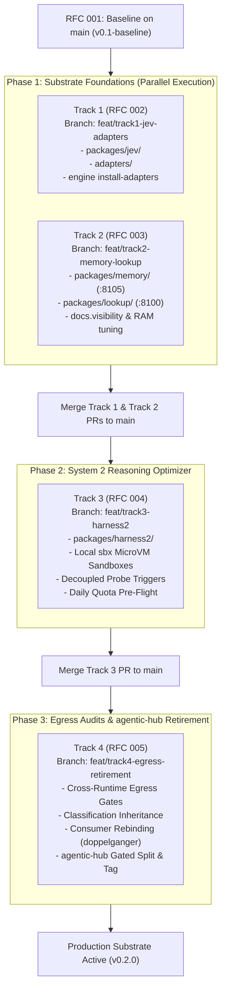

# Multi-Track Implementation Plan: Cognitive Engine Substrate & Reasoning

- **Document Type**: Multi-Track Engineering Implementation Plan & Execution DAG
- **Date**: 2026-10-26
- **Authors**: Aleksandr Korolev ([@rockad](https://github.com/rockad)), Antigravity Pair Architect
- **Target Reviewers**: [@Doc-Cr](https://github.com/Doc-Cr), Aleksandr Korolev ([@rockad](https://github.com/rockad))
- **Baseline Architecture**: [RFC 001: Cognitive Engine Architecture](../rfc/001-harness2-jev-unified-cognitive-substrate.md) (`v0.1-baseline` on `main`)
- **Child Track Specifications**:
  - Track 1: [RFC 002: System 1 — TypeSafe Jev Coprocessor & Multi-Harness Adapters](../rfc/002-system1-jev.md)
  - Track 2: [RFC 003: Memory & Lookup Substrates](../rfc/003-memory-lookup.md)
  - Track 3: [RFC 004: System 2 — Google Harness² Recursive Reasoning Optimizer](../rfc/004-system2-harness2.md)
  - Track 4: [RFC 005: Cross-Runtime Egress Gates & agentic-hub Retirement Protocol](../rfc/005-egress-retirement.md)

---

## 1. Executive Summary & Clarification Outcomes

Following the formal `/clarify` architectural review and incorporated feedback from collaborator [@Doc-Cr](https://github.com/Doc-Cr), the Cognitive Engine substrate execution roadmap is partitioned into four decoupled, modular tracks. This multi-track implementation plan defines the dependency graph, technical scopes, feature branching strategy, and GitHub review workflows.

### Core Architectural Decisions & Clarified Outcomes

- **4 Modular Child RFC Tracks (RFCs 002 through 005)**:
  - Decouples large, complex subsystem designs into focused, reviewable specifications.
  - Centralizes shared invariants, licensing boundaries, and monorepo topology in [RFC 001](../rfc/001-harness2-jev-unified-cognitive-substrate.md).
- **Independent Feature Branching Model**:
  - Each track develops on an independent feature branch created directly from `main`:
    - `feat/track1-jev-adapters`
    - `feat/track2-memory-lookup`
    - `feat/track3-harness2`
    - `feat/track4-egress-retirement`
  - Merges directly back to `main` via discrete Pull Requests with automated test verification.
- **Root CLI Multiplexer & Polyglot Workspaces**:
  - Bun workspace (`package.json`) manages TypeScript packages (`packages/jev/`, `adapters/`, `cli/`).
  - Python `uv` workspace (`pyproject.toml`) manages Python 3.12 packages (`packages/memory/`, `packages/lookup/`, `packages/harness2/`).
  - Standalone compiled executable binary (`bin/engine` / Makefile) provides high-level orchestration (`engine up`, `engine status`, `engine memory`, `engine jev`).
- **Substrate-First Parallel Execution DAG**:
  - Phase 1: Tracks 1 and 2 execute concurrently in parallel to lay the foundational System 1 coprocessor and native memory/lookup daemons.
  - Phase 2: Track 3 implements System 2 (Harness² recursive optimizer) on top of the validated System 1 judge and sandbox substrate.
  - Phase 3: Track 4 executes cross-runtime egress testing, privacy audits, consumer rebinding, and gated retirement of legacy `agentic-hub` plugins.

---

## 2. Substrate-First Execution Dependency Graph (DAG)

---

## 3. Detailed Breakdown by Track

### 3.1 Track 1 (RFC 002): System 1 — TypeSafe Jev Coprocessor & Multi-Harness Adapters

- **Target Branch**: `feat/track1-jev-adapters`
- **Specification**: [RFC 002: System 1 Coprocessor](../rfc/002-system1-jev.md)
- **Runtime & License**: TypeScript / Bun | MIT
- **Target Directories**: `packages/jev/`, `adapters/`, `cli/`
- **Key Deliverables**:
  - **TypeSafe Jev Core (`packages/jev`)**:
    - Sub-second probabilistic model tier dispatch (`jev_dispatch`, `jev_route`).
    - Binary quality gatekeeping and diff acceptance (`jev_judge`).
    - Free-tier offloading coprocessor (`jev_execute_free`, `jev_agent_free`) saving Gemini/Claude quota.
    - Model tier ceiling governance (clamping subagents to parent tier; strict user gate for Pro tier).
  - **Dual-Mode Transport**:
    - Default: FastMCP stdio transport for zero-latency direct integration with CLI harnesses.
    - Supervised Daemon: Streamable HTTP transport on `127.0.0.1:8115/mcp` managed via `engine up`.
  - **Multi-Harness Adapters (`adapters/`)**:
    - Google Antigravity sidecar integration and MCP registration (`~/.gemini/config/mcp_config.json`).
    - Claude Code native plugin package (`.claude-plugin/plugin.json`) and MCP registration (no custom session hooks, aligning with the 2026-10-27 settings consolidation).
    - OpenCode V2 plugin bundle and event interceptors.
    - Turnkey installer command: `engine install-adapters`.
- **Invariants & Gates**:
  - Blocks `openrouter/free` offloading when handling private workspaces or under `zdr: strict`.
  - Enforces `@Doc-Cr` alias routing.

---

### 3.2 Track 2 (RFC 003): Memory & Lookup Substrates

- **Target Branch**: `feat/track2-memory-lookup`
- **Specification**: [RFC 003: Memory & Lookup Substrates](../rfc/003-memory-lookup.md)
- **Runtime & License**: Python 3.12 / uv | AGPL-3.0 (`packages/memory`) + MIT (`packages/lookup`)
- **Target Directories**: `packages/memory/`, `packages/lookup/`
- **Key Deliverables**:
  - **`packages/memory` (Native Upstream `basic-memory`, AGPL-3.0)**:
    - Runs upstream-maintained `basic-memory` package natively in Python via `uv` without Docker.
    - Binds strictly to `127.0.0.1:8105/mcp` during staging to avoid port conflicts with legacy daemons.
    - Exposes upstream FastMCP tools (`read_note`, `write_note`, `search_notes`, `list_notes`, `delete_note`, `build_context`).
    - Tuned hybrid retrieval parameters:
      - `BASIC_MEMORY_RERANKER_CANDIDATES=5–10`
      - `BASIC_MEMORY_RERANKER_MAX_DOCUMENT_CHARS=500–1000`
      - Bounded resident memory strictly under **2–3 GB RAM** while maintaining 9/10 context accuracy.
    - Out-of-tree persistent storage at `~/.local/share/cognitive-engine/memory/`.
  - **`packages/lookup` (Companion Archive & Transcript Search, MIT)**:
    - Runs natively on `127.0.0.1:8100/mcp`.
    - Preserves the 4 standard Lookup tools (`search_archive`, `get_document`, `refresh_index`, `archive_stats`).
    - Full-text SQLite FTS5 search indexing session transcripts and external knowledge archives.
    - Enforces `docs.visibility` classification (`open`, `gated`, `unstated`, `mixed`) for strict classification inheritance.
  - **Process-Boundary AGPL Containment**:
    - `packages/memory` communicates strictly across standard process/MCP loopback boundaries, cleanly confining AGPL-3.0 to its subpackage.

---

### 3.3 Track 3 (RFC 004): System 2 — Google Harness² Recursive Reasoning Optimizer

- **Target Branch**: `feat/track3-harness2`
- **Specification**: [RFC 004: System 2 Reasoning Optimizer](../rfc/004-system2-harness2.md)
- **Runtime & License**: Python 3.12 / uv | Apache-2.0
- **Target Directories**: `packages/harness2/`
- **Key Deliverables**:
  - **Task-Level Recursion (*Propose–Probe–Compose*)**:
    - Proposes candidate prompt/tool/context mutations across allowed dimensions without ground truth.
    - Behavioral contrast composer synthesizes candidate outputs into human-reviewable proposals.
  - **Strict Local MicroVM Execution (`sbx`)**:
    - Parallel candidate execution runs exclusively inside local Docker Sandboxes via standalone `sbx` CLI.
    - Zero cloud sandboxing; zero off-host code or credential movement.
  - **Fail-Closed Sandbox Fallback**:
    - If the `sbx` runtime is unavailable, candidate probing fails closed immediately.
    - Optional `mkdtemp` worktree mode generates diffs for inspection only and never executes untrusted code.
  - **Decoupled Probe Triggers**:
    - Probing is completely decoupled from routing confidence metrics.
    - Fires strictly on:
      - Post-task verification failure (`jev_judge` returns `FAIL` or score < 0.50).
      - Execution retry limit exhausted in the agent loop.
      - Explicit on-demand request (`/probe <task>` or `engine probe`).
  - **Daily Quota Pre-Flight Check**:
    - Pre-flights `free_model_daily_requests` from `GET /api/v1/key` before triggering candidate sweeps.
    - Throttles or skips sweeps when OpenRouter daily quota is constrained.
  - **Protected Invariant Set**:
    - Guardrails, Egress/ZDR policies, Session ceilings, Lifecycle hooks, and the human gate on composer are immune to mutation.
  - **Continual Experience Learning**:
    - Proposes reflection entries into out-of-tree domain libraries at `~/.local/share/cognitive-engine/experiences/<domain>/`.
    - Requires human sign-off before committing to permanent storage.

---

### 3.4 Track 4 (RFC 005): Cross-Runtime Egress Gates & agentic-hub Retirement Protocol

- **Target Branch**: `feat/track4-egress-retirement`
- **Specification**: [RFC 005: Egress & Retirement Protocol](../rfc/005-egress-retirement.md)
- **Runtime & License**: Polyglot (TypeScript / Python / Shell) | MIT
- **Target Directories**: Cross-repository (`cognitive-engine/`, `agentic-hub/`, `doppelganger/`)
- **Key Deliverables**:
  - **Cross-Runtime Egress Firewall**:
    - Unified outbound egress and ZDR policy validation enforced symmetrically across TypeScript (`packages/jev`) and Python (`packages/harness2`, `packages/lookup`).
    - Classification inheritance: Content derived from memory or transcripts inherits the strictest source classification; unclassified content defaults to restricted.
  - **Pre-Retirement Verification Gates**:
    - All unit, integration, schema, and latency test suites pass across Tracks 1, 2, and 3.
    - Memory footprint stays verified under 2–3 GB RAM under sustained query load.
    - Dual port binding verified (`:8105` and `:8100` on `127.0.0.1`).
    - Local `sbx` probe isolation and fail-closed behavior verified.
    - Client configuration updated in `~/.gemini/config/mcp_config.json`.
  - **Phased agentic-hub Retirement Protocol**:
    - Freeze and deprecation notices added to `agentic-hub/plugins/jev/` and `agentic-hub/plugins/memory/`.
    - Consumer rebinding in `doppelganger` (`.mcp.json`, shell wrappers `jev-mode`, `memory.sh`).
    - Surgical removal of retired plugins from `agentic-hub`.
    - Reposition `agentic-hub` as the peripheral-only registry (`chrome-devtools`, `gitea`, `google-workspace`, `local-transcribe`).
    - Tag release `v2.4.0-split` in `agentic-hub`.

---

## 4. Workstream Summary & Execution Matrix

| Stream | Track | Branch | Scope / File Targets | Description | Lead Subagent | Recommended Tier |
|---|---|---|---|---|---|---|
| **WS1** | **Track 1** | `feat/track1-jev-adapters` | `packages/jev/`, `adapters/`, `cli/` | Migrate Jev core, stdio/HTTP transports, and Antigravity / Claude / OpenCode adapters | `code-engineer` | `flash_lite` |
| **WS2** | **Track 2** | `feat/track2-memory-lookup` | `packages/memory/`, `packages/lookup/` | Package native `basic-memory` on `:8105` and companion `lookup` on `:8100` with `docs.visibility` | `code-engineer` | `flash_lite` |
| **WS3** | **Track 3** | `feat/track3-harness2` | `packages/harness2/` | Package Harness² optimizer, local `sbx` microVMs, fail-closed prober, and daily quota pre-flight | `code-engineer` | `flash_lite` |
| **WS4** | **Track 4** | `feat/track4-egress-retirement` | `cognitive-engine/`, `doppelganger/`, `agentic-hub/` | Cross-runtime egress gates, consumer rebinding, and gated surgical retirement of legacy plugins | `system-operator` | `flash_lite` |

---

## 5. Review & PR Protocol for Collaboration with @Doc-Cr

To ensure seamless peer review with collaborator [@Doc-Cr](https://github.com/Doc-Cr) on GitHub:

1. **Branch Hygiene**:
   - Feature branches must branch directly from `origin/main` (`git checkout -b feat/trackX-... origin/main`).
   - Keep commits atomic and semantic (`feat:`, `fix:`, `refactor:`, `docs:`, `test:`).
2. **Pull Request Protocol**:
   - Open PRs against `main` on GitHub (`rockad/cognitive-engine`).
   - Title format: `feat(trackX): <short summary> [RFC 00X]` (e.g. `feat(track1): migrate typesafe jev and multi-harness adapters [RFC 002]`).
   - Mention `@Doc-Cr` in the PR description with:
     - Reference to the corresponding child RFC and implementation plan section.
     - Summary of changes and test execution output.
     - Specific architectural verification questions.
3. **Automated Verification Gates**:
   - Prior to requesting review or merging, ensure local tests pass:
     - Bun workspace: `bun test` (0 errors).
     - Python workspace: `uv run pytest` (0 errors).
     - Egress test suite: `bun run test:egress` and `uv run pytest tests/test_egress.py`.
4. **Merge Sequencing**:
   - Track 1 and Track 2 PRs can be reviewed and merged independently in Phase 1.
   - Track 3 merges after Phase 1 is validated on `main`.
   - Track 4 executes as the final cutover PR.
