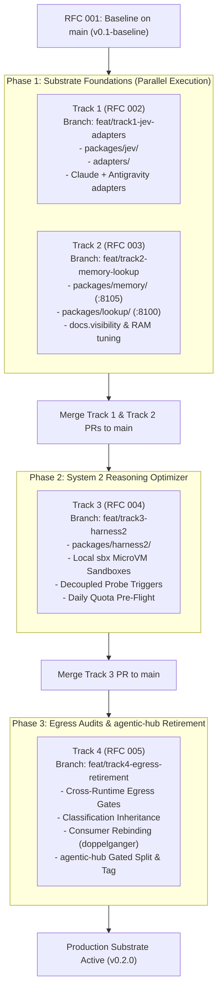

# Multi-Track Implementation Plan: Cognitive Engine Substrate & Reasoning

- **Document Type**: Multi-Track Engineering Implementation Plan & Execution DAG
- **Date**: 2026-10-26
- **Authors**: Aleksandr Korolev ([@rockad](https://github.com/rockad)), Antigravity Pair Architect
- **Target Reviewers**: [@Doc-Cr](https://github.com/Doc-Cr), Aleksandr Korolev ([@rockad](https://github.com/rockad))
- **Baseline Architecture**: [RFC 001: Cognitive Engine Architecture](../rfc/001-harness2-jev-unified-cognitive-substrate.md) (`v0.1-baseline` on `main`)
- **Child Track Specifications**:
  - Track 1: [RFC 002: System 1 — TypeSafe Jev Coprocessor & Multi-Harness Adapters](../rfc/002-system1-jev.md)
  - Track 2: [RFC 003: Memory & Lookup Substrates](../rfc/003-memory-lookup.md)
  - Track 3: [RFC 004: System 2 — Google Harness² Recursive Reasoning Optimizer](../rfc/004-system2-harness2.md)
  - Track 4: [RFC 005: Cross-Runtime Egress Gates & agentic-hub Retirement Protocol](../rfc/005-egress-retirement.md)

---

## 1. Executive Summary & Clarification Outcomes

Following the formal `/clarify` architectural review and incorporated feedback from collaborator [@Doc-Cr](https://github.com/Doc-Cr), the Cognitive Engine substrate execution roadmap is partitioned into four decoupled, modular tracks. This multi-track implementation plan defines the dependency graph, technical scopes, feature branching strategy, and GitHub review workflows.

### Core Architectural Decisions & Clarified Outcomes

- **4 Modular Child RFC Tracks (RFCs 002 through 005)**:
  - Decouples large, complex subsystem designs into focused, reviewable specifications.
  - Centralizes shared invariants, licensing boundaries, and monorepo topology in [RFC 001](../rfc/001-harness2-jev-unified-cognitive-substrate.md).
- **Independent Feature Branching Model**:
  - Each track develops on an independent feature branch created directly from `main`:
    - `feat/track1-jev-adapters`
    - `feat/track2-memory-lookup`
    - `feat/track3-harness2`
    - `feat/track4-egress-retirement`
  - Merges directly back to `main` via discrete Pull Requests with automated test verification.
- **Root CLI Multiplexer & Polyglot Workspaces**:
  - Bun workspace (`package.json`) manages TypeScript packages (`packages/jev/`, `adapters/`, `cli/`).
  - Python `uv` workspace (`pyproject.toml`) manages Python 3.12 packages (`packages/memory/`, `packages/lookup/`, `packages/harness2/`).
  - Standalone compiled executable binary (`bin/engine` / Makefile) provides high-level orchestration (`engine up`, `engine status`, `engine memory`, `engine jev`).
- **Substrate-First Parallel Execution DAG**:
  - Phase 1: Tracks 1 and 2 execute concurrently in parallel to lay the foundational System 1 coprocessor and native memory/lookup daemons.
  - Phase 2: Track 3 implements System 2 (Harness² recursive optimizer) on top of the validated System 1 judge and sandbox substrate.
  - Phase 3: Track 4 executes cross-runtime egress testing, privacy audits, consumer rebinding, and gated retirement of legacy `agentic-hub` plugins.

---

## 2. Substrate-First Execution Dependency Graph (DAG)

---

## 3. Detailed Breakdown by Track

### 3.1 Track 1 (RFC 002): System 1 — TypeSafe Jev Coprocessor & Multi-Harness Adapters

- **Target Branch**: `feat/track1-jev-adapters`
- **Specification**: [RFC 002: System 1 Coprocessor](../rfc/002-system1-jev.md)
- **Runtime & License**: TypeScript / Bun | MIT
- **Target Directories**: `packages/jev/`, `adapters/`, `cli/`
- **Key Deliverables**:
  - **TypeSafe Jev Core (`packages/jev`)**:
    - Sub-second probabilistic model tier dispatch (`jev_dispatch`, `jev_route`).
    - Binary quality gatekeeping and diff acceptance (`jev_judge`).
    - Free-tier offloading coprocessor (`jev_execute_free`, `jev_agent_free`) saving Gemini/Claude quota.
    - Model tier ceiling governance: `jev_dispatch` clamps its advice to the parent tier; enforcement is the hook below, not the tool.
  - **Dual-Mode Transport**:
    - Default: MCP SDK stdio transport for zero-latency direct integration with CLI harnesses.
    - Supervised Daemon: Streamable HTTP transport on `127.0.0.1:8115/mcp` managed via `engine up`.
  - **Multi-Harness Adapters (`adapters/`)**:
    - Google Antigravity sidecar integration and MCP registration (`~/.gemini/config/mcp_config.json`).
    - Claude Code native plugin package (`.claude-plugin/plugin.json`), MCP registration, and one narrow `PreToolUse` subagent guard (the other `agentic-hub` hooks were not ported; hooks are not prohibited and may be added where a workflow needs one).
    - Antigravity gets the same narrow guard (`invoke_subagent`, any Pro-class model needs approval); both share `packages/jev/src/guard.ts`. The guard fails closed once Jev mode is `on` and fires under Claude Code `bypassPermissions`.
    - OpenCode V2 plugin bundle: deferred (committed, unverified, needs overhaul).
    - Turnkey installer `engine install-adapters`: deferred to the `engine` CLI work; adapter READMEs document manual steps.
- **Invariants & Gates**:
  - Blocks `openrouter/free` offloading when handling private workspaces or under `zdr: strict`.

#### 3.1.1 Track 1 implementation findings & refinements (2026-10-27)

Outcomes from building and reviewing `feat/track1-jev-adapters`; they refine the deliverables above.

- **The hook is the only enforcement point.** `jev_dispatch` is a tool the agent calls and the agent chooses every argument, so its tier clamp is advice. An `approvedTier` argument was tried and removed for that reason, and the old prompt-text override phrases ("deep reasoning", "claude opus", …) were removed from the clamp. The only approval is the user answering the hook's prompt.
- **Guard hardening.** It also reads the `model:` in the subagent's definition file (`.claude/agents/<name>.md`) when the call sets none; treats any Pro-class Antigravity model name as Pro; asks when the session model is unknown for an opus-class request; and asks instead of passing silently on unreadable input or internal errors.
- **`bypassPermissions` verified.** A hook `ask` is not auto-approved by bypass mode (tested with a throwaway hook under `claude -p`: the call was blocked, same as `deny`). The interactive prompt itself was not observed; confirm once in a live bypass session.
- **Mode gating updated (2026-10-28 review decision).** The Subagent Tier Ceiling Guard is **ACTIVE in both `on` and `on-demand`** (only disabled when mode is explicitly `off`). Delegations made in `on-demand` do not go unguarded.
  - **Difference between `on-demand` and `on`**:
    - **`on-demand` (Passive Safety Coprocessor)**: Tools are available for on-demand invocations; the `PreToolUse` subagent ceiling guard is active (preventing accidental runaway Pro/Opus burns); zero mandatory pre-flight interception or forced judging ceremonies.
    - **`on` (Aggressive Proactive Enforcement)**: Tier ceiling guard is active; mandatory pre-flight dispatch (`jev_dispatch`) on non-trivial tasks; mandatory `jev_judge` quality gates on diffs; mandatory free-tier offloading for text/summaries to `openrouter/free` ($0 cost); automatic clamping to `flash_lite` when quota <20%.
    - **`off` (Dormant)**: MCP disabled, zero token overhead, zero hook enforcement.
- **OpenCode deferred.** The lean V2 plugin is committed but unverified against a live OpenCode and is expected to need an overhaul (the old `agentic-hub` plugin was decommissioned). Out of the Track 1 review.
- **Installer deferred.** No `engine install-adapters` yet; adapter READMEs document manual steps. The Antigravity adapter exposes pure merge functions (`installMcpConfig`, `jevHooksEntry`) for the future CLI.
- **Transport.** The server uses the official MCP TypeScript SDK (stdio default, stateless streamable HTTP on `127.0.0.1:8115/mcp`, loopback `Host` check), not FastMCP.
- **Claude plugin shape.** `.claude-plugin/plugin.json` + `.mcp.json` + `hooks/hooks.json`; the MCP command and the hook resolve through `COGNITIVE_ENGINE_HOME`, which has no default so a missing value fails loudly.
- **Port notes.** Claude session/prompt hooks and the commit script were not carried over. Discovery, mode and egress tests were made independent of the harness running them (they failed inside any Claude Code session). The `@Doc-Cr` alias rule is Antigravity-only and is not part of the engine.
- **Credentials.** Adapters write no keys; Jev reads `JEV_OPENROUTER_API_KEY` from `~/.config/zsh/secrets.env` or `~/.config/jev/env`.

#### 3.1.2 PR #3 Review Findings & Remediation Plan (from @Doc-Cr, 2026-10-28)

Adopted from [@Doc-Cr's PR #3 review](https://github.com/rockad/cognitive-engine/pull/3#issuecomment-3456382024):

1. **Remediate Hook Fail-Open on Launch Failure** (`adapters/claude/hooks/hooks.json`):
   - Wrap hook invocation in a shell check: if `$COGNITIVE_ENGINE_HOME` is unset, invalid, or the entrypoint file does not exist, echo an explicit JSON `ask` (`[jev] guard not found: COGNITIVE_ENGINE_HOME is unset or wrong`) instead of letting `bun` exit 1 (which Claude Code treats as non-blocking fail-open). Add a manifest unit test asserting this behavior.
2. **Support Plugin Subagents in Definition Lookup** (`guard.ts`):
   - Enhance `agentDefinitionModel` to parse namespaced plugin agents (`plugin-name:agent`) and resolve the model specification against installed plugin directories rather than returning `null`.
3. **Quote Antigravity Hook Path** (`adapters/antigravity/src/index.ts`):
   - Quote `$COGNITIVE_ENGINE_HOME` in the generated Antigravity hook command to prevent execution failure on checkout paths containing spaces.
4. **Catch Claude Top Tier (`fable`) in Antigravity Guard** (`guard.ts`, `governance.ts`):
   - Update `guard.ts:120` to also trigger an `ask` when `claudeModelRank(model) >= STRONG_RANK`, ensuring `fable` is not misclassified as flash rank (2).
5. **Enforce Tier Ceiling in Both `on` and `on-demand` Modes**:
   - Update `guard.ts` so that the Subagent Tier Ceiling Guard is active whenever Jev mode is `on` or `on-demand`, remaining silent only in `off`.

#### 3.1.3 Workflow Guard Seam: Option A Dual-Hook Strategy (2026-10-28)

Empirical testing confirmed that Claude Code workflow-spawned subagents bypass the standard `Agent|Task` hook matcher. To enforce model tier ceilings without restricting workflow agility, Track 1 codifies the **Option A Dual-Hook Strategy**:
- **Dual-Hook Architecture**:
  - Primary Subagent Hook: `PreToolUse` on `Agent|Task` catches direct CLI subagent delegations.
  - Secondary Workflow Hook: `PreToolUse` on `Workflow` in `adapters/claude/hooks/hooks.json` intercepts workflow script execution.
- **Static AST Inspection (`packages/jev/src/workflow-guard.ts`)**:
  - Parses the workflow script AST before launch, scanning for model overrides (`opus`, `fable`, `pro`).
  - Evaluates requested subagent model tiers against the active session tier ceiling.
- **Fail-Closed Policy on Dynamic Expressions**:
  - Statically verifiable model requests exceeding the ceiling trigger an interactive `ask` prompt or rejection.
  - Dynamic model expressions (e.g. variables, function returns, or unresolvable arguments) fail closed (`ask` prompt to the user) to prevent unmonitored model escalation.

---

### 3.2 Track 2 (RFC 003): Memory & Lookup Substrates

- **Target Branch**: `feat/track2-memory-lookup`
- **Specification**: [RFC 003: Memory & Lookup Substrates](../rfc/003-memory-lookup.md)
- **Runtime & License**: Python 3.12 / uv | AGPL-3.0 (`packages/memory`) + MIT (`packages/lookup`)
- **Target Directories**: `packages/memory/`, `packages/lookup/`
- **Key Deliverables**:
  - **`packages/memory` (Native Upstream `basic-memory`, AGPL-3.0)**:
    - Runs upstream-maintained `basic-memory` package natively in Python via `uv` without Docker.
    - Binds strictly to `127.0.0.1:8105/mcp` during staging to avoid port conflicts with legacy daemons.
    - Exposes upstream FastMCP tools (`read_note`, `write_note`, `search_notes`, `list_notes`, `delete_note`, `build_context`).
    - Tuned hybrid retrieval parameters:
      - `BASIC_MEMORY_RERANKER_CANDIDATES=5–10`
      - `BASIC_MEMORY_RERANKER_MAX_DOCUMENT_CHARS=500–1000`
      - Bounded resident memory strictly under **2–3 GB RAM** while maintaining 9/10 context accuracy.
    - Out-of-tree persistent storage at `~/.local/share/cognitive-engine/memory/`.
  - **`packages/lookup` (Companion Archive & Transcript Search, MIT)**:
    - Runs natively on `127.0.0.1:8100/mcp`.
    - Preserves the 4 standard Lookup tools (`search_archive`, `get_document`, `refresh_index`, `archive_stats`).
    - Full-text SQLite FTS5 search indexing session transcripts and external knowledge archives.
    - Enforces `docs.visibility` classification (`open`, `gated`, `unstated`, `mixed`) for strict classification inheritance.
  - **Process-Boundary AGPL Containment**:
    - `packages/memory` communicates strictly across standard process/MCP loopback boundaries, cleanly confining AGPL-3.0 to its subpackage.

---

### 3.3 Track 3 (RFC 004): System 2 — Google Harness² Recursive Reasoning Optimizer

- **Target Branch**: `feat/track3-harness2`
- **Specification**: [RFC 004: System 2 Reasoning Optimizer](../rfc/004-system2-harness2.md)
- **Runtime & License**: Python 3.12 / uv | Apache-2.0
- **Target Directories**: `packages/harness2/`
- **Key Deliverables**:
  - **Task-Level Recursion (*Propose–Probe–Compose*)**:
    - Proposes candidate prompt/tool/context mutations across allowed dimensions without ground truth.
    - Behavioral contrast composer synthesizes candidate outputs into human-reviewable proposals.
  - **Strict Local MicroVM Execution (`sbx`)**:
    - Parallel candidate execution runs exclusively inside local Docker Sandboxes via standalone `sbx` CLI.
    - Zero cloud sandboxing; zero off-host code or credential movement.
  - **Fail-Closed Sandbox Fallback**:
    - If the `sbx` runtime is unavailable, candidate probing fails closed immediately.
    - Optional `mkdtemp` worktree mode generates diffs for inspection only and never executes untrusted code.
  - **Decoupled Probe Triggers**:
    - Probing is completely decoupled from routing confidence metrics.
    - Fires strictly on:
      - Post-task verification failure (`jev_judge` returns `FAIL` or score < 0.50).
      - Execution retry limit exhausted in the agent loop.
      - Explicit on-demand request (`/probe <task>` or `engine probe`).
  - **Daily Quota Pre-Flight Check**:
    - Pre-flights `free_model_daily_requests` from `GET /api/v1/key` before triggering candidate sweeps.
    - Throttles or skips sweeps when OpenRouter daily quota is constrained.
  - **Protected Invariant Set**:
    - Guardrails, Egress/ZDR policies, Session ceilings, Lifecycle hooks, and the human gate on composer are immune to mutation.
  - **Continual Experience Learning**:
    - Proposes reflection entries into out-of-tree domain libraries at `~/.local/share/cognitive-engine/experiences/<domain>/`.
    - Requires human sign-off before committing to permanent storage.

#### 3.3.1 Track 3 Status & Refinements: Slice 1 Verification & Slice 2 Roadmap (2026-10-28)

- **Slice 1 Completed (`feat/track3-harness2`)**:
  - Implemented FastMCP server on `127.0.0.1:8120` with `host_origin_protection="auto"` from the first commit.
  - Verified 12/12 on the black-box MCP conformance runner (`tools/mcp_conformance.py`).
  - Added read-only offline `harness2_status` tool and `dry_run` support on `harness2_propose`.
  - 129 package tests passing cleanly.
- **Option A Dual-Engine Isolation (Slice 2)**:
  - Primary Sandbox: Probing trajectories execute in local sandboxes using native `sbx` when available on `$PATH`.
  - Fallback Sandbox: If `sbx` is unavailable, prober falls back to an ephemeral, rootless Docker container sandbox (`--network none`, `--read-only`, zero off-host egress) rather than aborting or generating static diffs only.
  - Fail-Closed: If neither `sbx` nor rootless Docker is accessible, prober fails closed without running untrusted code.
- **Option A Citation Lineage Contract**:
  - `packages/harness2/NOTICE` and `README.md` must formally cite foundational Google DeepMind prompt optimization literature (*Promptbreeder* [arXiv:2309.16797], *LLMs as Tool Makers* [arXiv:2305.17126]).
  - Explicitly document our clean-room, dual-harness heuristic implementation under Apache-2.0.
- **Slice 2 Next Steps**:
  - Implement ephemeral rootless Docker sandbox runner in `packages/harness2/prober/`.
  - Wire failure-driven probe triggers (`jev_judge` < 0.50, retry exhaustion, `/probe`).
  - Update `packages/harness2/NOTICE` with the formal Google DeepMind citation.

---

### 3.4 Track 4 (RFC 005): Cross-Runtime Egress Gates & agentic-hub Retirement Protocol

- **Target Branch**: `feat/track4-egress-retirement`
- **Specification**: [RFC 005: Egress & Retirement Protocol](../rfc/005-egress-retirement.md)
- **Runtime & License**: Polyglot (TypeScript / Python / Shell) | MIT
- **Target Directories**: Cross-repository (`cognitive-engine/`, `agentic-hub/`, `doppelganger/`)
- **Key Deliverables**:
  - **Cross-Runtime Egress Firewall**:
    - Unified outbound egress and ZDR policy validation enforced symmetrically across TypeScript (`packages/jev`) and Python (`packages/harness2`, `packages/lookup`).
    - Classification inheritance: Content derived from memory or transcripts inherits the strictest source classification; unclassified content defaults to restricted.
  - **Pre-Retirement Verification Gates**:
    - All unit, integration, schema, and latency test suites pass across Tracks 1, 2, and 3.
    - Memory footprint stays verified under 2–3 GB RAM under sustained query load.
    - Dual port binding verified (`:8105` and `:8100` on `127.0.0.1`).
    - Local `sbx` probe isolation and fail-closed behavior verified.
    - Client configuration updated in `~/.gemini/config/mcp_config.json`.
  - **Phased agentic-hub Retirement Protocol**:
    - Freeze and deprecation notices added to `agentic-hub/plugins/jev/` and `agentic-hub/plugins/memory/`.
    - Consumer rebinding in `doppelganger` (`.mcp.json`, shell wrappers `jev-mode`, `memory.sh`).
    - Surgical removal of retired plugins from `agentic-hub`.
    - Reposition `agentic-hub` as the peripheral-only registry (`chrome-devtools`, `gitea`, `google-workspace`, `local-transcribe`).
    - Tag release `v2.4.0-split` in `agentic-hub`.

---

## 4. Workstream Summary & Execution Matrix

| Stream | Track | Branch | Scope / File Targets | Description | Lead Harness & Role | Recommended Tier |
|---|---|---|---|---|---|---|
| **WS1** | **Track 1** | `feat/track1-jev-adapters` | `packages/jev/`, `adapters/`, `cli/` | Migrate Jev core, stdio/HTTP transports, and Antigravity / Claude adapters (OpenCode deferred) | Claude Code (`code-engineer`) | `flash` |
| **WS2** | **Track 2** | `feat/track2-memory-lookup` | `packages/memory/`, `packages/lookup/` | Package native `basic-memory` on `:8105` and companion `lookup` on `:8100` with `docs.visibility` | Antigravity (`code-engineer`) | `flash_lite` |
| **WS3** | **Track 3 (Slice 1)** | `feat/track3-harness2` | `packages/harness2/` | FastMCP daemon on `:8120`, read-only `harness2_status`, conformance 12/12, quota check, 129 tests | Claude Code (`code-engineer`) | `flash` |
| **WS4** | **Track 4** | `feat/track4-egress-retirement` | `cognitive-engine/`, `doppelganger/`, `agentic-hub/` | Cross-runtime egress gates, consumer rebinding, and gated surgical retirement of legacy plugins | Antigravity (`system-operator`) | `flash_lite` |
| **WS5** | **Cross-cutting** | `feat/mcp-conformance` | `tools/` | Black-box MCP conformance runner and per-server probe specs (12/12 verified across all daemons) | Claude Code (`qa-engineer`) | `flash` |
| **WS6** | **Track 1 follow-up** | `feat/track1-jev-adapters` | `packages/jev/` | Strict `registerTool` migration for all 12 tools plus the `Origin` check (PR #3) | Claude Code (`code-engineer`) | `flash` |
| **WS7** | **Track 1 seam** | `feat/track1-jev-adapters` | `adapters/claude/hooks/`, `packages/jev/src/workflow-guard.ts` | Workflow Guard static AST inspector on `Workflow` tool closing subagent bypass hole | Claude Code (`code-engineer`) | `flash` |
| **WS8** | **Track 3 (Slice 2)** | `feat/track3-harness2` | `packages/harness2/prober/`, `NOTICE` | Ephemeral rootless Docker fallback (`--network none`, `--read-only`), failure triggers, DeepMind citation | Claude Code (`code-engineer`) | `flash` |
| **WS9** | **Track 1 review** | `feat/track1-jev-adapters` | `packages/jev/`, `adapters/` | PR #3 remediation, review coordination, and test suite verification | Antigravity (`code-engineer`) | `flash_lite` |

---

## 5. Review & PR Protocol for Collaboration with @Doc-Cr

To ensure seamless peer review with collaborator [@Doc-Cr](https://github.com/Doc-Cr) on GitHub:

1. **Branch & Dedicated Worktree Hygiene**:
   - Feature branches must branch directly from `origin/main` (or stacked base branch when explicitly specified).
   - **Mandatory Git Worktree Isolation**:
     - When multiple agent harnesses (Antigravity and Claude Code) operate concurrently on the repository, each harness **MUST** execute strictly inside its own dedicated git worktree (e.g. `/home/rockad/projects/cognitive-engine-track1`, etc.).
     - Prevents index locking (`.git/index.lock`), dirty state interference, and branch checkout collisions.
     - Never run `git checkout` across active branches in a worktree owned by another harness.
   - Keep commits atomic and semantic (`feat:`, `fix:`, `refactor:`, `docs:`, `test:`).
2. **Pull Request Protocol**:
   - Open PRs against `main` on GitHub (`rockad/cognitive-engine`).
   - Title format: `feat(trackX): <short summary> [RFC 00X]` (e.g. `feat(track1): migrate typesafe jev and multi-harness adapters [RFC 002]`).
   - Mention `@Doc-Cr` in the PR description with:
     - Reference to the corresponding child RFC and implementation plan section.
     - Summary of changes and test execution output.
     - Specific architectural verification questions.
3. **Automated Verification Gates**:
   - Prior to requesting review or merging, ensure local tests pass:
     - Bun workspace: `bun test` (0 errors).
     - Python workspace: `uv run pytest` (0 errors).
     - Conformance suite: `uv run tools/mcp_conformance.py <target>` (12/12 passed).
     - Egress test suite: `bun run test:egress` and `uv run pytest tests/test_egress.py`.
4. **Merge Sequencing**:
   - Track 1 and Track 2 PRs can be reviewed and merged independently in Phase 1.
   - Track 3 merges after Phase 1 is validated on `main`.
   - Track 4 executes as the final cutover PR.

---

## 6. Dual-Harness Cross-Delegation (Antigravity + Claude Code Pro)

To maximize development velocity and conserve Gemini Pro quota, implementation leverages a **Dual-Harness Architecture** combining **Claude Code (Sonnet 5.5 & Opus 5.5 via prepaid Pro subscription)** and **Google Antigravity (Flash/Medium Orchestrator)**.

### 6.1 Parallel Specialization Split

Following the approved architectural clarification, work is partitioned by specialized operational lanes:

| Subsystem / Concern | Primary Harness | Model Tier | Working Directory / Worktree | Rationale & Active Scope |
|---|---|---|---|---|
| **Deep Algorithmic Coding & AST Parsers** | **Claude Code** | Claude Sonnet 5.5 | Dedicated Worktree (`feat/track3-harness2` or Track 1) | Implements Workflow Guard static AST inspector (WS7) and Track 3 Slice 2 Docker fallback + triggers (WS8). Burns zero Gemini quota. |
| **Architectural Governance & PR Remediation** | **Antigravity** | Gemini 3.8 Flash | Dedicated Worktree (`/home/rockad/projects/cognitive-engine-track1`) | Coordinates PR #3 review remediations (WS9), multi-track dependency tracking, RFC alignment. |
| **Verification Gates & Quality Acceptance** | **Antigravity** | Gemini 3.8 Flash + `jev_judge` | Assigned Worktree | Runs test suites (`bun test`, `uv run pytest`), diff validation, and binary quality gating. |
| **Git, PRs & Review Coordination with @Doc-Cr** | **Antigravity** | Gemini 3.8 Flash | Assigned Worktree | Branch checkout, semantic commits, PR management, and GitHub review updates. |
| **Session State & Cross-Harness Continuity** | **Unified Memory** | Recall (:8110) & Lookup (:8100) | Bridge Document | Synchronizes state via `docs/handoffs/antigravity-claude-bridge.md` across both harnesses. |

### 6.2 Dedicated Worktree Protocol

To guarantee zero race conditions between Antigravity and Claude Code:
- **Dedicated Directory Assignment**: Each harness works in an isolated worktree path on disk:
  - Antigravity Track 1 Worktree: `/home/rockad/projects/cognitive-engine-track1`
  - Claude Code Working Directory: Dedicated worktree created via `git worktree add ../cognitive-engine-<track> <branch>`
- **No Shared Working Trees**: Never run parallel edits or branch switches in the same worktree directory.
- **Git Push Coordination**: Push feature branches cleanly and notify the other harness via `antigravity-claude-bridge.md` before initiating dependent work.

### 6.3 Operating Modes

#### Mode A: Concurrent Track Ownership (Parallel Worktrees)
- **Claude Code**: Implements WS7 (Workflow Guard) and WS8 (Track 3 Slice 2) in its dedicated worktree.
- **Antigravity**: Implements WS9 (Track 1 PR #3 review remediation) in `/home/rockad/projects/cognitive-engine-track1`.
- **Independence**: Both run simultaneously on disjoint feature branches without merge conflicts or context collisions.

#### Mode B: Dual-Harness Ping-Pong (Implement in Claude Code, Verify in Antigravity)
1. **Briefing Phase (Antigravity)**:
   - Antigravity scaffolds a self-contained, clipboard-ready **Harness Prompt Brief** in `antigravity-claude-bridge.md` specifying target files, invariants, and tests.
2. **Coding Phase (Claude Code)**:
   - Claude Code launches in its dedicated worktree, implements the brief, runs local checks, and commits.
3. **Verification & Quality Gate Phase (Antigravity)**:
   - Antigravity inspects diffs, runs test suites, executes `jev_judge`, and coordinates PR review with [@Doc-Cr](https://github.com/Doc-Cr).

### 6.3 Context & Session Sharing Protocol
- **Shared Repository Disk State**: Both harnesses operate directly on `~/projects/cognitive-engine`.
- **Clipboard-Ready Prompt Templates**: Antigravity formats self-contained markdown prompts with embedded schemas so Claude Code has complete context upon session start.
- **Cross-Harness Memory**: Both harnesses query `session-handoff:cognitive-engine` and search indexed session logs via `lookup` on `127.0.0.1:8100`.
