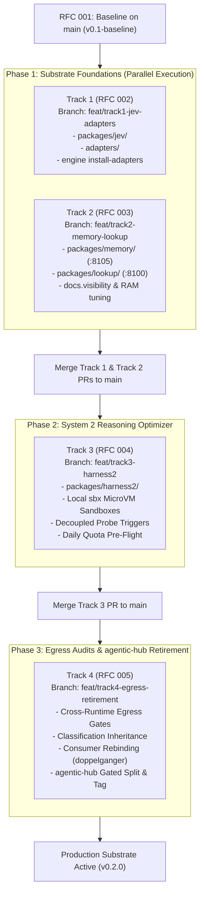

# Multi-Track Implementation Plan: Cognitive Engine Substrate & Reasoning

- **Document Type**: Multi-Track Engineering Implementation Plan & Execution DAG
- **Date**: 2026-10-26
- **Authors**: Aleksandr Korolev ([@rockad](https://github.com/rockad)), Antigravity Pair Architect
- **Target Reviewers**: [@Doc-Cr](https://github.com/Doc-Cr), Aleksandr Korolev ([@rockad](https://github.com/rockad))
- **Baseline Architecture**: [RFC 001: Cognitive Engine Architecture](../rfc/001-harness2-jev-unified-cognitive-substrate.md) (`v0.1-baseline` on `main`)
- **Child Track Specifications**:
  - Track 1: [RFC 002: System 1 — TypeSafe Jev Coprocessor & Multi-Harness Adapters](../rfc/002-system1-jev.md)
  - Track 2: [RFC 003: Memory & Lookup Substrates](../rfc/003-memory-lookup.md)
  - Track 3: [RFC 004: System 2 — Google Harness² Recursive Reasoning Optimizer](../rfc/004-system2-harness2.md)
  - Track 4: [RFC 005: Cross-Runtime Egress Gates & agentic-hub Retirement Protocol](../rfc/005-egress-retirement.md)

---

## 1. Executive Summary & Clarification Outcomes

Following the formal `/clarify` architectural review and incorporated feedback from collaborator [@Doc-Cr](https://github.com/Doc-Cr), the Cognitive Engine substrate execution roadmap is partitioned into four decoupled, modular tracks. This multi-track implementation plan defines the dependency graph, technical scopes, feature branching strategy, and GitHub review workflows.

### Core Architectural Decisions & Clarified Outcomes

- **4 Modular Child RFC Tracks (RFCs 002 through 005)**:
  - Decouples large, complex subsystem designs into focused, reviewable specifications.
  - Centralizes shared invariants, licensing boundaries, and monorepo topology in [RFC 001](../rfc/001-harness2-jev-unified-cognitive-substrate.md).
- **Independent Feature Branching Model**:
  - Each track develops on an independent feature branch created directly from `main`:
    - `feat/track1-jev-adapters`
    - `feat/track2-memory-lookup`
    - `feat/track3-harness2`
    - `feat/track4-egress-retirement`
  - Merges directly back to `main` via discrete Pull Requests with automated test verification.
- **Root CLI Multiplexer & Polyglot Workspaces**:
  - Bun workspace (`package.json`) manages TypeScript packages (`packages/jev/`, `adapters/`, `cli/`).
  - Python `uv` workspace (`pyproject.toml`) manages Python 3.12 packages (`packages/memory/`, `packages/lookup/`, `packages/harness2/`).
  - Standalone compiled executable binary (`bin/engine` / Makefile) provides high-level orchestration (`engine up`, `engine status`, `engine memory`, `engine jev`).
- **Substrate-First Parallel Execution DAG**:
  - Phase 1: Tracks 1 and 2 execute concurrently in parallel to lay the foundational System 1 coprocessor and native memory/lookup daemons.
  - Phase 2: Track 3 implements System 2 (Harness² recursive optimizer) on top of the validated System 1 judge and sandbox substrate.
  - Phase 3: Track 4 executes cross-runtime egress testing, privacy audits, consumer rebinding, and gated retirement of legacy `agentic-hub` plugins.

---

## 2. Substrate-First Execution Dependency Graph (DAG)

---

## 3. Detailed Breakdown by Track

### 3.1 Track 1 (RFC 002): System 1 — TypeSafe Jev Coprocessor & Multi-Harness Adapters

- **Target Branch**: `feat/track1-jev-adapters`
- **Specification**: [RFC 002: System 1 Coprocessor](../rfc/002-system1-jev.md)
- **Runtime & License**: TypeScript / Bun | MIT
- **Target Directories**: `packages/jev/`, `adapters/`, `cli/`
- **Key Deliverables**:
  - **TypeSafe Jev Core (`packages/jev`)**:
    - Sub-second probabilistic model tier dispatch (`jev_dispatch`, `jev_route`).
    - Binary quality gatekeeping and diff acceptance (`jev_judge`).
    - Free-tier offloading coprocessor (`jev_execute_free`, `jev_agent_free`) saving Gemini/Claude quota.
    - Model tier ceiling governance: subagent guard asks on ANY escalation above the session model (the earlier Claude Code subagent model rule was temporary and is not encoded as permanent).
  - **Dual-Mode Transport**:
    - Default: stdio transport (official TypeScript SDK; FastMCP is a Python library) for zero-latency direct integration with CLI harnesses. Tool arguments are strictly validated per [§3.5](#35-cross-cutting-mcp-selection--server-contract-2026-10-28).
    - Supervised Daemon: Streamable HTTP transport on `127.0.0.1:8115/mcp` managed via `engine up`.
  - **Multi-Harness Adapters (`adapters/`)**:
    - Google Antigravity sidecar integration and MCP registration (`~/.gemini/config/mcp_config.json`).
    - Claude Code native plugin package (`.claude-plugin/plugin.json`), MCP registration, and lifecycle hooks (`hooks/hooks.json`).
    - OpenCode V2 plugin bundle and event interceptors.
    - Turnkey installer command: `engine install-adapters`.
- **Invariants & Gates**:
  - Blocks `openrouter/free` offloading when handling private workspaces or under `zdr: strict`.
  - Enforces `@Doc-Cr` alias routing.

#### 3.1.3 Workflow Guard Seam: Option A Dual-Hook Strategy (2026-10-28)

Empirical testing confirmed that Claude Code workflow-spawned subagents bypass the standard `Agent|Task` hook matcher. To enforce model tier ceilings without restricting workflow agility, Track 1 codifies the **Option A Dual-Hook Strategy**:
- **Dual-Hook Architecture**:
  - Primary Subagent Hook: `PreToolUse` on `Agent|Task` catches direct CLI subagent delegations.
  - Secondary Workflow Hook: `PreToolUse` on `Workflow` in `adapters/claude/hooks/hooks.json` intercepts workflow script execution.
- **Version-Aware Ranking & Model Tracking**:
  - Models ranked by `(family, version)` tuple. Aliases resolved deterministically (`opus` -> 5.5, `sonnet` -> 5.5, `fable` -> 5.1).
  - Session model tracked via `PostModelSwitch` state file with transcript-tail fallback.
  - Unknown models prompt (`ask`). Every `ask` and safety fallback is audited in `~/.config/jev/claude_decisions.jsonl`.
  - Never block Claude Code's "switch models when a message is flagged" safety fallbacks.
- **Workflow AST Parser (`packages/jev/src/workflow-guard.ts`)**:
  - Acorn JavaScript AST parser with a fail-closed visitor.
  - Statically resolves `script`, `scriptPath`, `name`, nested `workflow()`, and `agentType`.
  - Model omitted = inherits session model (allowed).
  - Aliases, spread arguments, computed keys, template literals with expressions, dynamic/unparseable model expressions, and parse errors all fail closed with `ask` naming the exact call site.
- **Verification Fixtures & Canary Protocol**:
  - Capture live payloads (`PreToolUse[Workflow]`, `PostModelSwitch`, `SubagentStart`) with a log-only canary hook.
  - Commit real payloads as test fixtures before implementing production logic.
- **Native Hook Failure Policy**:
  - Guard hooks use native `"onFailure": "block"` (Claude Code >= 2.1.295). Verified in headless runs: crashing hook with `onFailure: "block"` blocks tool execution. Log-only hooks stay fail-open.
  - Unit test kills the hook process to assert a block.
- **Implementation Ownership Division & Operational Rules**:
  - Claude Code owns: `hooks.json`, `guard.ts` (fail-closed, version-aware model ranking, active in `on` and `on-demand` for both harnesses), `packages/jev/src/workflow-guard.ts`, and `packages/jev/src/core/config.ts` (`validateJevConfig`, `inspectJevConfigFile`).
  - Antigravity owns: plugin agent definitions (`agentDefinitionModel`) and Antigravity hook path quoting (`adapters/antigravity/src/index.ts`).
  - Config Rule (User Decision): Do nothing when Jev is explicitly `off`; when config is malformed fail loudly (ask on every guarded call, stderr line, `config_malformed` audit event). Missing file or `{}` = unset = default `off`.
  - Known Limits: Built-in agentTypes ask (no static allow-list yet), resume gap (after `--resume --model X` transcript tail can show previous model until switch event), static analysis cannot prove dynamic runtime indirection.

---

### 3.2 Track 2 (RFC 003): Memory & Lookup Substrates

- **Target Branch**: `feat/track2-memory-lookup`
- **Specification**: [RFC 003: Memory & Lookup Substrates](../rfc/003-memory-lookup.md)
- **Runtime & License**: Python 3.12 / uv | AGPL-3.0 (`packages/memory`) + MIT (`packages/lookup`)
- **Target Directories**: `packages/memory/`, `packages/lookup/`
- **Key Deliverables**:
  - **`packages/memory` (Native Upstream `basic-memory`, AGPL-3.0)**:
    - Runs upstream-maintained `basic-memory` package natively in Python via `uv` without Docker.
    - Binds strictly to `127.0.0.1:8105/mcp` during staging to avoid port conflicts with legacy daemons.
    - Exposes upstream FastMCP tools (`read_note`, `write_note`, `search_notes`, `list_directory`, `delete_note`, `build_context`).
    - Tuned hybrid retrieval parameters:
      - `BASIC_MEMORY_RERANKER_CANDIDATES=5–10`
      - `BASIC_MEMORY_RERANKER_MAX_DOCUMENT_CHARS=500–1000`
      - Bounded resident memory strictly under **2–3 GB RAM** while maintaining 9/10 context accuracy.
    - Out-of-tree persistent storage at `~/.local/share/cognitive-engine/memory/`.
  - **`packages/lookup` (Companion Archive & Transcript Search, MIT)**:
    - Runs natively on `127.0.0.1:8100/mcp`.
    - Preserves the 4 standard Lookup tools (`search_archive`, `get_document`, `refresh_index`, `archive_stats`).
    - Full-text SQLite FTS5 search indexing session transcripts and external knowledge archives.
    - Enforces `docs.visibility` classification (`open`, `gated`, `unstated`, `mixed`) for strict classification inheritance.
  - **Process-Boundary AGPL Containment**:
    - `packages/memory` communicates strictly across standard process/MCP loopback boundaries, cleanly confining AGPL-3.0 to its subpackage.

#### 3.2.1 Track 2 implementation findings & refinements (2026-10-28)

Full list with evidence in [RFC 003 §4](../rfc/003-memory-lookup.md). The ones that change the plan:

- **`packages/memory` is a launcher, not a fork.** It validates settings and `exec`s the pinned upstream `basic-memory mcp`. The reranker is off by default upstream, so the tuned configuration only exists because the launcher forces it; out-of-range bounds are refused, not clamped.
- **`packages/lookup` is a port of the Docker-era Lookup**, with the transport replaced by FastMCP and the Docker-only SMB mounting removed. Python 3.12 required replacing a 3.13+ stdlib call.
- **Decided follow-up — shares declared in the manifest** (branch `feat/lookup-smb-sources`, cut from `feat/track2-memory-lookup`; **S1–S5 done**, see the status lines below; not yet run against the production `core` share). Native Lookup cannot mount network shares, so a manifest `[source.volume]` is indexed through a userspace SMB client with no host mount, root or FUSE. Decisions:
  - **Access layer:** a full filesystem seam (`walk`, `stat`, `open`) with `LocalFS` and `SmbFS` backends; manifest, pipeline, hashing and every extractor call it. The engine's `Path` becomes a small `VPath` that carries its filesystem, replacing `type(path)(d["path"])` with a lexical `src.contains_logical()`. The file digest comes from the same read the extractor performs.
  - **Path model:** `root` stays the *logical* mount path that is stored and shown (hits are marked `REMOTE`); an optional `subpath` selects a directory inside the share. Existing manifests and any migrated index keep working.
  - **Dependency:** `smbprotocol` (MIT, pure Python) is a core dependency of `cognitive-lookup`, imported lazily. **NTLM only**: Kerberos needs system krb5 libraries, which is the host setup this feature removes.
  - **Reused as-is:** the `[source.volume]` schema and `${ENV}` credential references (never inline values); an unreachable share still lets the daemon start, with rows kept and marked stale; reparse points are not followed and every document path is re-checked against its root.
  - **S2–S5 status (2026-10-28, done on `feat/lookup-smb-sources`, after S1):** `smb.py` adds `SmbFS` over `smbprotocol` (core dependency, imported lazily; NTLM only). Size, mtime and the reparse flag come from one listing per directory, so an unchanged share costs zero reads and zero extra network calls; reparse points are skipped and counted (`skipped_links`); unsafe path segments (`..`, backslash, `:`, NUL) are refused before any network call; a failed listing raises `SourceUnreachable` and deletes nothing, while the other sources still ingest. Credentials are `${VAR}` references checked at manifest load (a literal value or an unset variable names the problem; the value never appears in an error). **24 SMB tests against a real SMB server** plus a fake client, 271 repo-wide, README and RFC 003 updated. Findings: a dev-only dependency (impacket) shadowed the production `smbclient` import under `uv run pytest` and a broad `except Exception` disguised that as "share unreachable" (impacket now runs only in an isolated environment, handlers narrowed); `smbprotocol` caches sessions per host, port and user.
  - **Real-Samba check on host `core`**: Completed on host `core` (2026-10-29). Dedicated read-only account `ce-lookup-ro` provisioned; password stored in `~/.config/samba/ce-lookup-ro.pass` (0600); filesystem traversal ACLs and Samba read-only access applied. All 7 live SMB tests and `SmbFS` walk/stat/read_text client tests passed against `//core/knowledge-archive`. Status: **DONE**.
  - **S1 status (2026-10-28, done on `feat/lookup-smb-sources`):** `lookup/vfs.py` adds the `FileSystem` protocol, `LocalFS` (today's behaviour moved verbatim) and a duck-typed `VPath`; `Source.fs` routes `exists`, `contains` and `files()`, and the pipeline's containment check and content digest, through it. **All 197 existing Lookup tests pass unedited.** An in-memory backend ingests the same tree identically after the real tree is deleted, and a second pass over an unchanged tree performs zero reads (mutation-checked: severing the digest routing fails the parity test). Extractors needed no change. S2 (`SmbFS`) is next.
  - **Streams** (S-prefixed to avoid clashing with the matrix): S1 introduce the seam with `LocalFS` only, a pure refactor that keeps all existing Lookup tests green unedited and blocks the rest; S2 `SmbFS`; S3 manifest schema (`subpath`, `type` accepts `cifs`/`smb`) and loud errors on unset credential references; S4 tests (an in-memory `FakeFS`, the ledger/escape/visibility tests parametrized over both backends, one in-process SMB server integration test); S5 docs.
  - **Acceptance:** a second pass over an unchanged share performs zero file opens; the existing core `[source.volume]` block indexes from an SMB server with no host mount; `..`, absolute paths and reparse points are refused and counted; no credential appears in any log or error string; and the server passes the §3.5 conformance runner.
- **Port policy (resolves a contradiction in RFCs 001/003/005):** the legacy `lookup-lookup-1` container holds `127.0.0.1:8100` and serves the network-share sources that native Lookup cannot read yet, and the zero-retirement policy forbids stopping it first. So native Lookup **stages on `:8101`** (`lookup mcp --http --port 8101`) and rebinds to `:8100` at Track 4 cutover, after the legacy container is stopped and per-source document-count parity is verified.

---

### 3.3 Track 3 (RFC 004): System 2 — Google Harness² Recursive Reasoning Optimizer

- **Target Branch**: `feat/track3-harness2`
- **Specification**: [RFC 004: System 2 Reasoning Optimizer](../rfc/004-system2-harness2.md)
- **Runtime & License**: Python 3.12 / uv | Apache-2.0
- **Target Directories**: `packages/harness2/`
- **Key Deliverables**:
  - **Upstream Consumption Invariant**:
    - Consumes upstream `google-research/harness2` directly as much as possible; adopts new upstream versions as they are released; uses its source only where direct use fails. Never rewritten or custom reimplemented.
    - Upstream is primary: Google Research / Google LLC, Apache-2.0; Xu et al. 2026, [arXiv:2610.14224](https://arxiv.org/abs/2610.14224). Foundational prompt evolution literature (*Promptbreeder*, *LLMs as Tool Makers*) are cited as related work only.
    - Consumes upstream as a pinned git dependency (commit SHA) in `pyproject.toml`, with a minimal fork only if forced.
  - **Task-Level Recursion (*Propose–Probe–Compose*)**:
    - Proposes candidate prompt/tool/context mutations across allowed dimensions without ground truth.
    - Behavioral contrast composer synthesizes candidate outputs into human-reviewable proposals.
  - **Dual-Engine Execution Isolation**:
    - Primary: Parallel candidate execution runs inside local Docker Sandboxes via standalone `sbx` CLI. (Implemented via `SbxRunner`, unverified on host as `sbx` is not installed).
    - Fallback: Ephemeral rootless Docker container sandbox (`--network none`, `--read-only`, zero off-host egress) when `sbx` is not installed.
    - Host prerequisite: Rootless Docker is **installed and verified on host** (`unix:///run/user/1000/docker.sock`, `docker info` reports `name=rootless`). 21 real-daemon integration tests pass unskipped.
  - **Fail-Closed Sandbox Fallback**:
    - If neither `sbx` nor Docker is available, candidate probing fails closed immediately.
    - Optional `mkdtemp` worktree mode generates diffs for inspection only and never executes untrusted code.
  - **Decoupled Probe Triggers**:
    - Probing is completely decoupled from routing confidence metrics. Stagnation heuristics are dropped; triggers are exactly RFC 004 §2.3:
      - Advisory push via hook: Post-task verification failure (`jev_judge` returns `FAIL` or score < 0.50), or execution retry limit exhausted ($N \ge 3$) in the agent loop. Documented in `packages/harness2/hooks/harness2-advise.sh` (snippet in README, not installed).
      - Explicit pull tool: On-demand request via read-only `harness2_trigger` (`advise` = trigger fired; `ready` = true|false|null; `blockers` listed; zero execution, pure read), `/probe <task>` in chat, or `engine probe`.
  - **Daily Quota Pre-Flight Check**:
    - Pre-flights `free_model_daily_requests` from `GET /api/v1/key` before triggering candidate sweeps.
    - Throttles or skips sweeps when OpenRouter daily quota is constrained.
  - **Protected Invariant Set**:
    - Guardrails, Egress/ZDR policies, Session ceilings, Lifecycle hooks, and the human gate on composer are immune to mutation.
  - **Continual Experience Learning**:
    - Proposes reflection entries into out-of-tree domain libraries at `~/.local/share/cognitive-engine/experiences/<domain>/`.
    - Requires human sign-off before committing to permanent storage via CLI.

#### 3.3.1 Track 3 Status & Refinements: Slice 1 & Slice 2 Completed, Slice 3 Roadmap (2026-10-29)

- **Slice 1 Completed (`feat/track3-harness2`)**:
  - Implemented FastMCP server on `127.0.0.1:8120` with `host_origin_protection="auto"` from the first commit.
  - Verified 12/12 on the black-box MCP conformance runner (`tools/mcp_conformance.py`).
  - Added read-only offline `harness2_status` tool and `dry_run` support on `harness2_propose`.
  - Upstream pinned at `1cfe254e8d25b15f37048c3730134686abe60335` as an optional extra (`[tool.uv.sources]`, extra `upstream`).
- **Slice 2 Completed (`feat/track3-harness2`)**:
  - Ephemeral rootless Docker sandbox runner (`DockerRunner`) implemented with full command-line hardening (`--network none`, `--read-only`, `--cap-drop ALL`, `no-new-privileges`, `user 65534`, readonly bind mount).
  - 21 real rootless-Docker integration tests pass on this host daemon.
  - Decoupled triggers: `harness2_trigger` pull tool (read-only advise/ready check) and `hooks/harness2-advise.sh` (advisory push hook script). Stagnation trigger dropped per user decision.
  - NOTICE and README formally cite Google Research / Apache-2.0 upstream as primary; Promptbreeder and Tool Makers cited as related work only.
  - Flat package layout in `packages/harness2/src/cognitive_harness2/`.
- **Slice 3 Two Gated Steps (Upstream Wiring Roadmap)**:
  - **Slice 3a (Safety Seams)**: Wire `MUTABLE` <-> upstream `SurfaceSpec` default-deny, egress gate on the Proposer endpoint, `Substrate.preflight` -> `require_rootless_docker`, quota/ledger pre-flight. Zero model calls, zero execution. Subject to independent review and user gate.
  - **Slice 3b (Execution)**: `DockerRunner` as `Substrate.execute`, one capped dry-run, hard budget cap, `requires_human_approval` kept intact. Runs only on user's separate go.

#### 3.3.2 Slice 3b (Execution) Architectural Design & Workstreams (2026-10-29)

Governed by user decisions made via `/clarify` on 2026-10-29. Slice 3b wires upstream Harness² optimization to real execution under a hardened rootless container topology with allow-list proxying and loud-failure configuration validation:

1. **Proposer Channels & Uniform Policy**:
   - **Supported Channels**: Local (`opencode` -> loopback `ollama`, `gemma4:12b`), agent provider (`claude` via Claude CLI, `agy` via Antigravity CLI), and `openrouter` (commercial models with ZDR).
   - **Declarative Channel Profiles (`proposer-channels.json`)**: Declares `kind`, `provider`, `endpoint`, `model`, `retention` (`local` | `zdr-attested` | `unknown`), `max_classification` (`open` < `gated` < `restricted`), `caps` {`sessions`, `wall_s`, `cost`}, and `approval` requirement.
   - **Loud-Failure Config Validation**: Any malformed, unparseable, or missing required field causes immediate fail-closed abort (identical to Jev config rules).
   - **ZDR Honest Disclosure**: ZDR represents the user's declaration and cannot be verified cryptographically against remote provider servers. Subscription tiers (Claude Code, Antigravity) default to `retention: unknown` and are restricted to `open` content.
   - **Ceiling Enforcement**: Sweeps inherit the strictest classification across all ingested sources. A channel is eligible only if `channel.max_classification >= sweep.classification` and its retention satisfies the active ZDR mode (`zdr: strict` prohibits `unknown`).
2. **Container Isolation with Allow-List Forward Proxy**:
   - Proposer agent CLI sessions run inside rootless Docker containers reusing `DockerRunner` hardening: read-only root, tmpfs `HOME`, dropped capabilities, pids/memory/cpu limits, CLI mounted read-only, candidate workspace mounted rw on scratch tmpfs.
   - Container connects to `--network internal` with a single dedicated allow-list forward proxy permitting outbound egress exclusively to the channel's declared endpoint.
   - Requires a lightweight glibc base image (such as Debian Bookworm slim) because musl (`alpine:3`) cannot execute glibc CLI binaries.
3. **Upstream Binding & Package Extensions**:
   - `packages/harness2` subclasses upstream's `Proposer` class, overriding invocation methods to redirect execution into the isolated container.
   - Adds an `agy_cli` channel implementation alongside upstream's `claude_cli` and `opencode`.
4. **Slot Table & Frontmatter Freezing**:
   - Mutable components: `c1` prompt, `c3` context_assembly, `c4` tool_description, `c5` decomposition_strategy (BODY ONLY), `c6` skills (BODY ONLY).
   - Denied: `c2` guardrails (slot and path stem), `c7` scripts, `c8` plugins/hooks.
   - In `c5` and `c6`, frontmatter keys (`model`, `tools`, `allowed-tools`, `permissions`) are strictly frozen to prevent privilege escalation.
5. **Execution Workstreams**:
   - **`WS-0` Spike**: Verify unverified assumptions: (a) Proposer subclassing feasibility without monkey-patching upstream internals, (b) headless non-interactive `agy` CLI container execution. (If `agy` headless execution is not viable, Antigravity channel is deferred).
   - **`WS-D` Slot Table**: Implement path-to-component surface mapping, frontmatter freezing AST visitor, and invariant rejection tests.
   - **`WS-A` Channel Profile & Egress**: Implement `proposer-channels.json` schema, loud-failure validator, and per-channel egress filtering.
   - **`WS-B` Container Image & Proxy**: Build glibc rootless Docker base image, configure allow-list forward proxy, and implement container session runner.
   - **`WS-C` Proposer Subclass & Binding**: Subclass upstream `Proposer`, bind container runner, and add `agy_cli` adapter.
   - **`WS-E` Stage 1 Local Smoke Runner**: Execute Stage 1 smoke test ($k=1$, 3 sessions, 4 rollouts, demo task, `opencode` -> `ollama gemma4:12b`, 2 GB / 2 CPU / 45m wall cap, $0 cost) under explicit user approval gate.
   - *Adversarial Gate*: Each workstream step undergoes read-only adversarial review by Antigravity on its own quota prior to human approval gates.

---

### 3.4 Track 4 (RFC 005): Cross-Runtime Egress Gates & agentic-hub Retirement Protocol

- **Target Branch**: `feat/track4-egress-retirement`
- **Specification**: [RFC 005: Egress & Retirement Protocol](../rfc/005-egress-retirement.md)
- **Runtime & License**: Polyglot (TypeScript / Python / Shell) | MIT
- **Target Directories**: Cross-repository (`cognitive-engine/`, `agentic-hub/`, `doppelganger/`)
- **Key Deliverables**:
  - **Cross-Runtime Egress Firewall**:
    - Unified outbound egress and ZDR policy validation enforced symmetrically across TypeScript (`packages/jev`) and Python (`packages/harness2`, `packages/lookup`).
    - Classification inheritance: Content derived from memory or transcripts inherits the strictest source classification; unclassified content defaults to restricted.
  - **Pre-Retirement Verification Gates**:
    - All unit, integration, schema, and latency test suites pass across Tracks 1, 2, and 3.
    - Memory footprint stays verified under 2–3 GB RAM under sustained query load.
    - Dual port binding verified on `127.0.0.1` (`:8105`, and Lookup on `:8101` staging, `:8100` after cutover).
    - Share-source parity: native Lookup indexes the same network-share sources as the legacy container before it is stopped.
    - MCP server contract verified on every daemon (`:8105`, `:8101`, `:8115`, Harness²) by the black-box conformance runner ([§3.5](#35-cross-cutting-mcp-selection--server-contract-2026-10-28)).
    - Local `sbx` probe isolation and fail-closed behavior verified.
    - Client configuration updated in `~/.gemini/config/mcp_config.json`.
  - **Phased agentic-hub Retirement Protocol**:
    - Freeze and deprecation notices added to `agentic-hub/plugins/jev/` and `agentic-hub/plugins/memory/`.
    - Consumer rebinding in `doppelganger` (`.mcp.json`, shell wrappers `jev-mode`, `memory.sh`).
    - Surgical removal of retired plugins from `agentic-hub`.
    - Reposition `agentic-hub` as the peripheral-only registry (`chrome-devtools`, `gitea`, `google-workspace`, `local-transcribe`).
    - Tag release `v2.4.0-split` in `agentic-hub`.

---

### 3.5 Cross-cutting: MCP selection & server contract (2026-10-28)

Decided with Aleksandr via `/clarify`, after a FastMCP vs official-SDK spike on Lookup ([RFC 003 §4](../rfc/003-memory-lookup.md), items 10–11) and a check of the TypeScript SDK 1.31.

| # | Decision |
|---|---|
| 1 | **Python servers use FastMCP**: Memory (upstream, pinned `fastmcp==4.1.3`), Lookup, and Harness² (RFC 004 §2.7). The official `MCPServer` was rejected because it silently ignores unknown arguments. |
| 2 | **Jev (TypeScript) moves to `McpServer.registerTool` with `z.object(...).strict()`** (typed handlers, SDK-generated JSON Schema, SDK validation). Chosen over a smaller `ajv` wrapper to reach the typed end state. It is larger and reshapes the registry tests, so it ships as its own commits on the Track 1 branch. |
| 3 | **One black-box conformance runner** (`tools/mcp_conformance.py`) enforces the contract below on every server, in both languages. Per-package tests remain as the fast inner loop. |

**Why this exists.** Two defects shipped because nothing enforced a shared contract: Lookup's HTTP daemon accepted a forged `Host` and a foreign `Origin`, and Jev accepts any tool arguments. Jev's handlers cast `args as {...}` and the low-level `Server` does not validate against `inputSchema`, so a typo'd, mistyped or missing argument is accepted, including on the `jev_execute_free*` tools that decide egress.

**The contract (every MCP daemon in this repo):**

1. Binds `127.0.0.1` only. There is no host option.
2. Refuses a forged `Host` (421/403) and a foreign `Origin` (403). `127.0.0.1` and `localhost` work.
3. Strict arguments: an unknown key, bad enum value, wrong type or missing required argument returns a tool error. Never silently ignored, never defaulted.
4. Stateless HTTP: no `Mcp-Session-Id`.
5. Liveness is `tools/list` or a TCP connect. `ping` was removed from the protocol (2026-07-28) and is not part of the contract.
6. The advertised `inputSchema` and the enforced validation come from one definition.

**Per-track consequences:**

- **Track 1 (Jev).** Migrate all 12 tools to `registerTool` with strict zod objects, via a small `defineTool()` helper that always applies `.strict()` (the raw-shape form silently drops unknown keys). Add the missing `Origin` check to the hand-written HTTP handler. Reshape the registry tests (`allTools` / `toolHandlers`) to read from the server; keep the `approvedTier`-absent assertion. RFC 002 acceptance gains "strict arguments" and "Origin refused" boxes on that branch.
- **Track 2.** Lookup already passes `host_origin_protection="auto"` and has tests pinning forged Host/Origin and misspelled-argument rejection; Memory's tests pin Host/Origin. Both are the runner's first two targets.
- **Track 3 (Harness²).** FastMCP, `host_origin_protection="auto"` from the first commit, and the runner in its tests.
- **Track 4.** The "client MCP configurations validated" gate runs the conformance runner against `:8105`, Lookup (`:8101` staging, `:8100` after cutover), `:8115` and Harness² before any `agentic-hub` retirement.

**The runner.** Python, official client plus `httpx`, runnable as `uv run tools/mcp_conformance.py <url | stdio command> --probe <spec>`. Each server supplies a small probe spec: one valid call, plus the argument and enum it should reject. It fails closed: a check it cannot perform is a failure, not a skip. Each package's test suite runs it against a daemon it starts on a free port.

**Sequencing.**

| Stream | Scope | Description | Role | Tier |
|---|---|---|---|---|
| WS5 | `tools/mcp_conformance.py`, `tools/probes/*.toml`, tests | Runner and probe specs; run against Memory and Lookup first | `qa_engineer` | `flash` |
| WS6 | `packages/jev/src/tools/*`, `packages/jev/src/server.ts`, tests | Strict `registerTool` migration plus `Origin` check; reshape registry tests | `code_engineer` | `flash` |
| WS7 | `plans/`, RFC 002 and 005 acceptance | Add the new acceptance boxes on their owning branches | `ghostwriter` | `openrouter_free` |

WS5 and WS6 are independent. **WS6 is done and committed on `feat/track1-jev-adapters` as part of PR #3** (decided by Aleksandr): `defineTool()` + `McpServer.registerTool` with strict zod for all 12 tools, the `Origin` check, a contract test that drives every tool from the registry, and RFC 002 updated; 307 tests pass (was 245). It needs a push to update the PR. WS5 starts from `feat/track2-memory-lookup` and needs no Jev changes; the runner's Jev probe is now a required check.

---

## 4. Workstream Summary & Execution Matrix

| Stream | Track | Branch | Scope / File Targets | Description | Lead Harness & Role | Recommended Tier |
|---|---|---|---|---|---|---|
| **WS1** | **Track 1** | `feat/track1-jev-adapters` | `packages/jev/`, `adapters/`, `cli/` | Migrate Jev core, stdio/HTTP transports, and Antigravity / Claude / OpenCode adapters | Claude Code (`code-engineer`) | `flash` |
| **WS2** | **Track 2** | `feat/track2-memory-lookup` | `packages/memory/`, `packages/lookup/` | Package native `basic-memory` on `:8105` and companion `lookup` on `:8100` with `docs.visibility` | Antigravity (`code-engineer`) | `flash_lite` |
| **WS3** | **Track 3 (Slice 1)** | `feat/track3-harness2` | `packages/harness2/` | FastMCP daemon on `:8120`, read-only `harness2_status`, conformance 12/12, quota check, 129 tests | Claude Code (`code-engineer`) | `flash` |
| **WS4** | **Track 4** | `feat/track4-egress-retirement` | `cognitive-engine/`, `doppelganger/`, `agentic-hub/` | Cross-runtime egress gates, consumer rebinding, and gated surgical retirement of legacy plugins | Antigravity (`system-operator`) | `flash_lite` |
| **WS5** | **Cross-cutting** | `feat/mcp-conformance` | `tools/` | Black-box MCP conformance runner and per-server probe specs (12/12 verified across all daemons) | Claude Code (`qa-engineer`) | `flash` |
| **WS6** | **Track 1 follow-up** | `feat/track1-jev-adapters` | `packages/jev/` | Strict `registerTool` migration for all 12 tools plus the `Origin` check (PR #3) | Claude Code (`code-engineer`) | `flash` |
| **WS7** | **Track 1 seam** | `feat/jev-workflow-guard` | `adapters/claude/hooks/`, `packages/jev/src/workflow-guard.ts` | Workflow Guard static AST inspector on `Workflow` tool closing subagent bypass hole | Claude Code (`code-engineer`) | `flash` |
| **WS8** | **Track 3 (Slice 2)** | `feat/track3-harness2` | `packages/harness2/src/cognitive_harness2/`, `NOTICE` | Ephemeral rootless Docker fallback (`--network none`, `--read-only`), failure triggers, upstream citation | Claude Code (`code-engineer`) | `flash` |
| **WS9** | **Track 1 review** | `feat/track1-jev-adapters` | `packages/jev/`, `adapters/` | PR #3 remediation, review coordination, and test suite verification | Antigravity (`code-engineer`) | `flash_lite` |
| **WS10** | **Tooling** | `feat/worktree-protocol` | `tools/wt`, `.githooks/pre-commit`, `AGENTS.md` | Repository-local worktree automation enforcing clean hub and isolated agent worktrees | Antigravity (`code-engineer`) | `flash_lite` |
| **WS-0** | **Track 3 (Slice 3b spike)** | `feat/track3-harness2` | `packages/harness2/` | Spike verifying Proposer subclassing feasibility and headless `agy` CLI container execution | Claude Code (`code-engineer`) | `flash` |
| **WS-D** | **Track 3 (Slice 3b slot)** | `feat/track3-harness2` | `packages/harness2/src/cognitive_harness2/` | Path-to-component slot table mapping and frontmatter freeze AST validator for c5/c6 | Claude Code (`code-engineer`) | `flash` |
| **WS-A** | **Track 3 (Slice 3b policy)** | `feat/track3-harness2` | `packages/harness2/src/cognitive_harness2/` | Declarative `proposer-channels.json` schema, loud-failure validator, and per-channel egress filtering | Claude Code (`code-engineer`) | `flash` |
| **WS-B** | **Track 3 (Slice 3b runner)** | `feat/track3-harness2` | `packages/harness2/` | Glibc rootless Docker container base, allow-list forward proxy, and session execution runner | Claude Code (`code-engineer`) | `flash` |
| **WS-C** | **Track 3 (Slice 3b binding)** | `feat/track3-harness2` | `packages/harness2/` | Upstream `Proposer` subclass binding container runner with `agy_cli` channel adapter | Claude Code (`code-engineer`) | `flash` |
| **WS-E** | **Track 3 (Slice 3b smoke)** | `feat/track3-harness2` | `packages/harness2/` | Stage 1 local smoke runner (k=1, 3 sessions, 4 rollouts, demo task, `opencode` -> `ollama`) | Claude Code (`code-engineer`) | `flash` |

---

## 5. Review & PR Protocol for Collaboration with @Doc-Cr

To ensure seamless peer review with collaborator [@Doc-Cr](https://github.com/Doc-Cr) on GitHub:

1. **Branch Hygiene & Stacked PR Delivery Strategy**:
   - Deliver via **Stacked PRs, bottom-up, using MERGE COMMITS (never squash)** to preserve granular commit history:
     - `feat/track2-memory-lookup` -> `main`
     - `feat/mcp-conformance` and `feat/lookup-smb-sources` -> `feat/track2-memory-lookup`
     - `feat/track3-harness2` -> `feat/mcp-conformance`
     - The guard branch (`feat/jev-workflow-guard`, stacked on `feat/track1-jev-adapters`) merges INTO the PR #3 branch first, then PR #3 -> `main`.
     - Retarget children to `main` after each upstream merge.
   - Keep commits atomic and semantic (`feat:`, `fix:`, `refactor:`, `docs:`, `test:`).
2. **Worktree Protocol (Repository-Local Automation)**:
   - Tooling for this repository only (nothing machine-wide or user-scope):
     - `AGENTS.md` repository rule: "never work in the hub; one agent, one worktree".
     - Standalone helper script `tools/wt` supporting `new`, `list`, `remove`, and `init` operations (refuses a dirty hub or a branch checked out elsewhere).
     - Local `.githooks/pre-commit` rejecting commits attempted directly in the primary worktree unless explicitly overridden with `CE_ALLOW_HUB=1`.
     - Git `core.hooksPath` configured per clone by `tools/wt init`.
     - *Status*: Implemented on branch `feat/worktree-protocol` (commit `d7f4e93`), verified with `tools/tests/test_wt.sh` (11/11 tests pass).
3. **Pull Request Protocol**:
   - Open PRs against designated target branches on GitHub (`rockad/cognitive-engine`).
   - Title format: `feat(trackX): <short summary> [RFC 00X]` (e.g. `feat(track1): migrate typesafe jev and multi-harness adapters [RFC 002]`).
   - Mention `@Doc-Cr` in the PR description with:
     - Reference to the corresponding child RFC and implementation plan section.
     - Summary of changes and test execution output.
     - Specific architectural verification questions.
4. **Automated Verification Gates**:
   - Prior to requesting review or merging, ensure local tests pass:
     - Bun workspace: `bun test` (0 errors).
     - Python workspace: `uv run pytest` (0 errors).
     - Conformance suite: `uv run tools/mcp_conformance.py <target>` (12/12 passed).
     - Egress test suite: `bun run test:egress` and `uv run pytest tests/test_egress.py`.
5. **Merge Sequencing**:
   - Follow bottom-up stacked PR sequence with merge commits.
   - Retarget child branches cleanly as each parent merges.
   - Track 4 executes as the final cutover PR.

---

## 6. Dual-Harness Cross-Delegation (Antigravity + Claude Code Pro)

To maximize development velocity and conserve Gemini Pro quota, implementation leverages a **Dual-Harness Architecture** combining **Claude Code (Sonnet 5.5 & Opus 5.5 via prepaid Pro subscription)** and **Google Antigravity (Flash/Medium Orchestrator)**.

### 6.1 Parallel Specialization Split

Following the approved architectural clarification, work is partitioned by specialized operational lanes:

| Subsystem / Concern | Primary Harness | Model Tier | Working Directory / Worktree | Rationale & Active Scope |
|---|---|---|---|---|
| **Deep Algorithmic Coding & AST Parsers** | **Claude Code** | Claude Sonnet 5.5 | Dedicated Worktree (`feat/track3-harness2` or Track 1) | Implements Workflow Guard static AST inspector (WS7) and Track 3 Slice 2 Docker fallback + triggers (WS8). Burns zero Gemini quota. |
| **Architectural Governance & PR Remediation** | **Antigravity** | Gemini 3.8 Flash | Dedicated Worktree (`/home/rockad/projects/cognitive-engine-track1`) | Coordinates PR #3 review remediations (WS9), multi-track dependency tracking, RFC alignment. |
| **Verification Gates & Quality Acceptance** | **Antigravity** | Gemini 3.8 Flash + `jev_judge` | Assigned Worktree | Runs test suites (`bun test`, `uv run pytest`), diff validation, and binary quality gating. |
| **Git, PRs & Review Coordination with @Doc-Cr** | **Antigravity** | Gemini 3.8 Flash | Assigned Worktree | Branch checkout, semantic commits, PR management, and GitHub review updates. |
| **Session State & Cross-Harness Continuity** | **Unified Memory** | Recall (:8110) & Lookup (:8100) | Live Bridge File | Synchronizes state via `/home/rockad/.agents/antigravity-claude-bridge-cognitive-engine.md` across both harnesses. |

### 6.2 Dedicated Worktree Protocol

To guarantee zero race conditions between Antigravity and Claude Code:
- **Dedicated Directory Assignment**: Each harness works in an isolated worktree path on disk:
  - Antigravity Track 1 Worktree: `/home/rockad/projects/cognitive-engine-track1`
  - Claude Code Working Directory: Dedicated worktree created via `git worktree add ../cognitive-engine-<track> <branch>`
- **No Shared Working Trees**: Never run parallel edits or branch switches in the same worktree directory.
- **Git Push Coordination**: Push feature branches cleanly and notify the other harness via `antigravity-claude-bridge.md` before initiating dependent work.

### 6.3 Operating Modes

#### Mode A: Concurrent Track Ownership (Parallel Worktrees)
- **Claude Code**: Implements WS7 (Workflow Guard) and WS8 (Track 3 Slice 2) in its dedicated worktree.
- **Antigravity**: Implements WS9 (Track 1 PR #3 review remediation) in `/home/rockad/projects/cognitive-engine-track1`.
- **Independence**: Both run simultaneously on disjoint feature branches without merge conflicts or context collisions.

#### Mode B: Dual-Harness Ping-Pong (Implement in Claude Code, Verify in Antigravity)
1. **Briefing Phase (Antigravity)**:
   - Antigravity scaffolds a self-contained, clipboard-ready **Harness Prompt Brief** in `antigravity-claude-bridge.md` specifying target files, invariants, and tests.
2. **Coding Phase (Claude Code)**:
   - Claude Code launches in its dedicated worktree, implements the brief, runs local checks, and commits.
3. **Verification & Quality Gate Phase (Antigravity)**:
   - Antigravity inspects diffs, runs test suites, executes `jev_judge`, and coordinates PR review with [@Doc-Cr](https://github.com/Doc-Cr).

### 6.3 Context & Session Sharing Protocol
- **Shared Repository Disk State**: Both harnesses operate directly on `~/projects/cognitive-engine`.
- **Clipboard-Ready Prompt Templates**: Antigravity formats self-contained markdown prompts with embedded schemas so Claude Code has complete context upon session start.
- **Cross-Harness Memory**: Both harnesses query `session-handoff:cognitive-engine` and search indexed session logs via `lookup` on `127.0.0.1:8100`.

### 6.4 Dynamic Workflows & Jev Integration (Follow-Up Plan)

When using dynamic multi-agent workflows in Claude Code, Jev participates in the workflow loop to judge subagent suitability, recommend model tiers, and gate quality.
- **Overshadowing Analysis & Seam Design**: Dedicated follow-up architecture plan established in [docs/plans/2026-10-28-claude-workflows-jev-integration-plan.md](2026-10-28-claude-workflows-jev-integration-plan.md).
- **Guiding Invariant**: Jev operates as an **asynchronous advisory coprocessor** (providing probabilistic sizing, free-tier offloading, and milestone `jev_judge` gates) rather than a rigid synchronous execution interceptor, preserving Claude Code's emergent workflow adaptation and avoiding latency amplification or context pollution.
