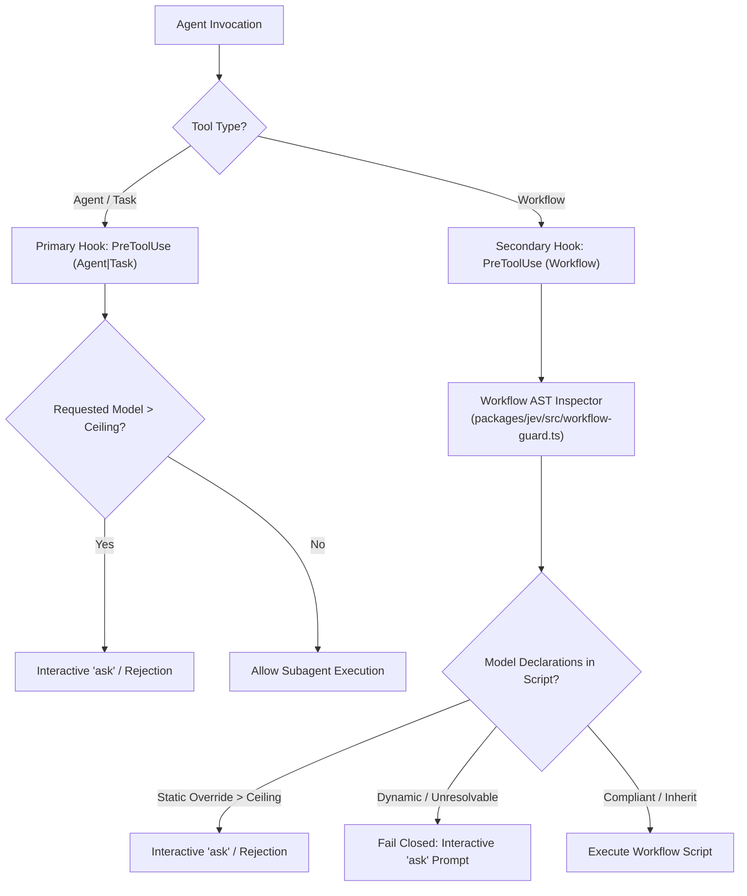

# Follow-up Architectural Plan: Jev Integration in Claude Code Dynamic Workflows

- **Document Type**: Architecture RFC & Exploratory Integration Plan
- **Date**: 2026-10-28
- **Authors**: Aleksandr Korolev ([@rockad](https://github.com/rockad)), Antigravity Pair Architect
- **Target Reviewers**: Aleksandr Korolev, [@Doc-Cr](https://github.com/Doc-Cr)
- **Status**: Proposed / Exploratory Follow-Up
- **Parent Specifications**:
  - [RFC 001: Cognitive Engine Architecture](../rfc/001-harness2-jev-unified-cognitive-substrate.md)
  - [RFC 002: Track 1 — System 1 Jev & Adapters](../rfc/002-system1-jev.md)
  - [Multi-Track Implementation Plan](2026-10-26-multi-track-implementation-plan.md)

---

## 1. Context & Motivation

In Claude Code, dynamic workflows allow Claude to autonomously decompose high-level objectives into adaptive, multi-agent workstreams. When TypeSafe Jev is active (`jev on` or `jev on-demand`), Jev should participate in this process to provide:
- Calibrated probability distributions over candidate subagents.
- Execution tier and model selection (`openrouter_free`, `flash_lite`, `flash`, `pro`).
- Free-tier offloading for boilerplate and summaries ($0 cost, 0 quota).
- Binary acceptance gating via `jev_judge`.

However, integrating an external System 1 decision engine into an emergent, dynamic workflow engine carries a primary architectural risk: **overshadowing or degrading Claude Code's native workflow agility**.

---

## 2. Core Trade-off Analysis: Advisory vs. Prescriptive Integration

```
                 Prescriptive Model (High Risk)                   Advisory Coprocessor Model (Recommended)
                 ───────────────────────────────                  ────────────────────────────────────────
Claude Objective ──► [Jev Static Decomposer] ──► Hard DAG       Claude Objective ──► [Claude Dynamic Planner]
                           │                                                              │
                           ▼                                                              ▼ (Async advisory probe)
                 Agent locked into fixed steps;                   [Jev Coprocessor: tier & agent calibration]
                 fails on emergent edge-cases.                                            │
                                                                                          ▼
                                                                  Claude adapts plan dynamically;
                                                                  Jev evaluates quality gates (jev_judge).
```

### Risk Evaluation: Potential Degradation Modes

| Failure Mode | Mechanism | Impact on Dynamic Workflows | Severity |
|---|---|---|---|
| **Workflow Overshadowing** | Jev forces a rigid, static subagent DAG before Claude explores the problem space. | Destroys Claude's ability to pivot when intermediate tool outputs reveal new requirements. | **High** |
| **Latency Amplification** | Synchronous pre-flight dispatch called on every micro-turn within a workflow loop. | Adds 200–800 ms per step; degrades conversational responsiveness. | **Medium** |
| **Context Pollution** | Heavy JSON dispatch manifests injected directly into the active prompt window. | Consumes Claude's token window without contributing domain-specific reasoning. | **Medium** |
| **False-Positive Blocking** | Strict PreToolUse guards aborting exploratory subagent delegations. | Frustrates the user and breaks legitimate workflow experimentation. | **High** |

---

## 3. Recommended Design: The Asynchronous Coprocessor Seam & Dual-Hook Guard

To enhance Claude Code's workflows without restricting their emergent dynamics, Jev operates as an **advisory coprocessor and quality gate**, combined with a deterministic safety guard:

### 3.1 Empirical Finding: Workflow Subagents Bypass `Agent|Task` Hooks

An empirical probe conducted during Track 3 slice 1 uncovered a critical enforcement gap in Claude Code:
- **The 4-Agent Workflow Probe**: A multi-agent workflow was executed in a Sonnet 5.5 session requesting four agents on `inherit`, `haiku`, `sonnet`, and `opus`.
- **Bypass Observed**: All four subagents executed. The agent transcript confirmed the `opus` request ran directly on `claude-opus-5-5` without user prompting and without triggering a block.
- **Log Evidence**: The hook decision log (`~/.config/jev/claude_decisions.jsonl`) recorded **zero** `PreToolUse` entries during the workflow run (108 → 109 lines, with the only addition being a prompt submission), whereas direct `Agent` calls earlier that session triggered hook logging immediately.
- **Architectural Consequence**: Subagents spawned dynamically from within a `Workflow` script bypass the standard `PreToolUse` `Agent|Task` matcher. RFC 002's assertion that the hook is the single enforcement point holds only for direct subagent calls.

### 3.2 Option A Dual-Hook Specification: Workflow Static AST Inspector

To close the enforcement hole without crippling dynamic workflows, Cognitive Engine implements the **Option A Dual-Hook Strategy**:



- **Dual-Hook Registration (`adapters/claude/hooks/hooks.json`)**:
  - Direct Subagent Seam: `PreToolUse` on `Agent|Task` (existing guard in `packages/jev/src/guard.ts`).
  - Workflow Seam: `PreToolUse` on `Workflow` pointing to `packages/jev/src/workflow-guard.ts`.
- **Static AST Inspection (`packages/jev/src/workflow-guard.ts`)**:
  - Intercepts the workflow script string before execution.
  - Traverses the AST looking for subagent spawn calls (e.g. `agent()`, `task()`, `Agent()`) and inspects model properties (`opus`, `fable`, `pro`).
  - Evaluates requested tiers against active session ceiling (`STRONG_RANK` vs active rank).
- **Fail-Closed Policy on Dynamic Expressions**:
  - If a model is defined via a dynamic expression (variable reference, runtime parameter, string interpolation, or conditional branch that cannot be statically evaluated), the guard **fails closed**.
  - Rather than silently allowing potentially runaway model invocations, it emits an interactive `ask` decision prompting the user for approval.

### 3.3 Three Integration Touchpoints

1. **Phase 0: Workflow Inception (Advisory Sizing)**:
   - When a multi-step workflow begins, Claude invokes `jev_dispatch` or `jev_route` to obtain calibrated subagent candidates and recommended model tiers.
   - **Non-blocking**: Jev's output is treated as high-confidence guidance, not a mandatory constraint. Claude retains full authority to override based on fresh context.
2. **Phase 1: In-Flight Free-Tier Offloading**:
   - Worker subagents dynamically dispatch mechanical boilerplate, documentation scaffolding, and data transformations to `jev_execute_free` ($0.00 cost, zero Claude Pro quota). Egress and ZDR strict policies apply strictly.
3. **Phase 2: Milestone Quality Gating (`jev_judge`)**:
   - Upon completion of critical workflow phases, Claude invokes `jev_judge` with the acceptance criteria and code diff.
   - Provides binary quality gating before committing or proceeding to dependent phases.

---

## 4. Exploration Roadmap & Empirical Benchmarking

Before codifying this behavior into production adapters, execute a three-stage validation spike:

- **Stage 1 (Comparative Baseline)**:
  - Run 5 representative multi-agent workflows in Claude Code without Jev (native baseline).
  - Measure: completion rate, token consumption, total duration, and planning flexibility.
- **Stage 2 (Advisory Jev Coupling)**:
  - Run the same 5 workflows with Jev in advisory mode (`jev on-demand`).
  - Measure: token savings from free-tier offloading, routing accuracy, and prompt overhead.
- **Stage 3 (Overshadowing Audit)**:
  - Introduce ambiguous, mutating requirements mid-workflow.
  - Verify that Claude Code successfully adapts without being blocked or constrained by Jev routing state.

---

## 5. Next Steps

- Keep Track 2 and Track 3 focused on foundational memory and reasoning substrates.
- Revisit this specification after Track 3 (Harness² recursive optimizer) to harmonize workflow execution across both System 1 (Jev) and System 2 (Harness²).
