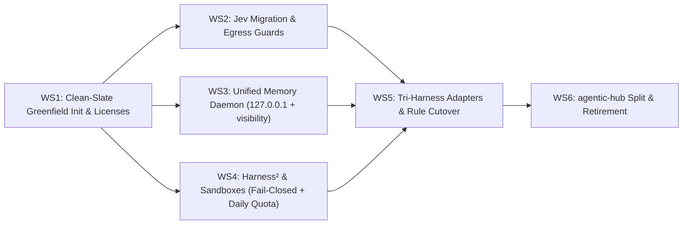

# RFC 001: Cognitive Engine — Autonomous Cognitive Substrate (Harness² + Jev + Memory)

- **Document Type**: Architecture RFC & Unified Implementation Plan
- **RFC Number**: 001
- **Status**: Formally Clarified / Implementation Blueprint (Incorporating [@Doc-Cr](https://github.com/Doc-Cr) Review #1)
- **Authors**: Aleksandr Korolev ([@rockad](https://github.com/rockad)), Antigravity Pair Architect
- **Target Reviewers**: [@doc-cr](https://github.com/doc-cr), Aleksandr Korolev
- **Target Runtimes**: Google Antigravity, Claude Code, OpenCode
- **Upstream PR**: [rockad/cognitive-engine#1](https://github.com/rockad/cognitive-engine/pull/1)

> [!IMPORTANT]
> **Unified Entity Invariant**: This RFC serves simultaneously as the formal architectural proposal and the actionable engineering implementation plan. There is zero divergence between this document and the active execution roadmap. Following review feedback from [@Doc-Cr](https://github.com/Doc-Cr), this plan will be executed directly without intermediate translation layers.

---

## 1. Executive Summary & Tripartite Architecture

This plan establishes **Cognitive Engine** as a dedicated standalone core platform repository (`rockad/cognitive-engine`) consolidating three complementary AI agent infrastructure layers into an **Autonomous Cognitive Substrate**:

1. **System 1 (TypeSafe Jev)**: Sub-second (~380ms) probabilistic routing, model tier dispatch, free-tier offloading, quality gatekeeping (`jev_judge`), and session ceiling governance.
2. **System 2 (Google Harness²)**: Contrastive trajectory probing (*Propose–Probe–Compose*) without ground truth, automated harness component mutation across 8 dimensions, and continual learning via `EXPERIENCE.md`.
3. **Memory Substrate (Unified SQLite Engine)**: Single native daemon on `127.0.0.1:8100/mcp` unifying notes, entities, transcripts, and domain playbooks, retiring the external `basic-memory` Docker container.

```mermaid
flowchart TB
    subgraph CognitiveEngine ["1. Cognitive Engine (New Standalone Monorepo: rockad/cognitive-engine)"]
        direction TB
        
        subgraph TS_Runtime ["TypeScript / Bun Runtime"]
            JevCore["TypeSafe Jev Core (System 1 Coprocessor)"]
            JevRouter["Probabilistic Tier Dispatch (~380ms)"]
            JevJudge["Quality & Diff Gate (jev_judge)"]
            FreeOffload["Zero-Cost Boilerplate Offloader (openrouter/free)"]
            EgressTS["Egress & ZDR Policy Guard (TypeScript)"]
        end
        
        subgraph Python_Runtime ["Python 3.12 / uv Runtime"]
            H2Engine["Google Harness² Core (System 2 Optimizer)"]
            H2Proposer["Candidate Mutators (Protected Invariants Excluded)"]
            H2Composer["Behavioral Contrast Composer (Human-in-the-Loop Proposal)"]
            H2Reflector["Continual Reflector (Writes to ~/.local/share/)"]
            EgressPy["Egress & ZDR Policy Guard (Python)"]
            
            MemoryService["Unified Cognitive Memory Daemon (127.0.0.1:8100/mcp)"]
            SQLiteDB[("~/.local/share/cognitive-engine/memory.sqlite")]
            MemoryService --- SQLiteDB
        end
        
        TS_Runtime <==>|Standard FastMCP-over-stdio / Local HTTP (127.0.0.1)| Python_Runtime
    end

    subgraph SandboxLayer ["2. Execution Isolation Layer"]
        DockerSandbox1["Docker Sandbox (Candidate Trajectory A)"]
        DockerSandbox2["Docker Sandbox (Candidate Trajectory B)"]
        FailClosed["Fail-Closed Gate (Docker Offline -> Abort / mkdtemp Diff-Only)"]
        
        H2Engine -.->|Primary (Strict Container Isolation)| DockerSandbox1
        H2Engine -.->|Primary (Strict Container Isolation)| DockerSandbox2
        H2Engine -.->|Docker Down| FailClosed
    end

    subgraph OutOfTree ["3. Host Out-of-Tree State (~/.local/share/cognitive-engine/)"]
        RuntimeExp[("experiences/<domain>/ (EXPERIENCE.md + INDEX.md)")]
        MemoryDB[("memory.sqlite (FTS5 + Notes + documents.visibility)")]
    end
    MemoryService --- OutOfTree
    H2Reflector --- RuntimeExp

    subgraph Peripherals ["4. Peripheral Registry (rockad/agentic-hub)"]
        PluginsRegistry["Standalone Tool Plugins (chrome-devtools, gitea, google-workspace, local-transcribe)"]
        SkillsRegistry["Standalone Utility Skills (clarify, md-to-pdf, markdown-convert, rclone)"]
        Marketplace[".claude-plugin/ & marketplace.json Manifests"]
    end

    subgraph ConsumerRuntimes ["5. Tri-Harness Adapters"]
        AGY["Google Antigravity (MCP + ask_question + Subagents)"]
        Claude["Claude Code (Hooks + AskUserQuestion + .claude-plugin)"]
        OpenCode["OpenCode (V2 Plugin + --substrate opencode + TUI)"]
    end

    subgraph ConsumerWorkspaces ["6. Consumer Workspaces"]
        Doppelganger["doppelganger ($VAULT: Personal Second Brain & Career Master Records)"]
        WorkRepos["Work Repositories (Software Projects, Tooling)"]
    end

    CognitiveEngine ===> ConsumerRuntimes
    Peripherals ===> ConsumerRuntimes
    ConsumerRuntimes ===> ConsumerWorkspaces
```

### Tripartite Separation of Concerns
* **`cognitive-engine` (The Core Platform)**: Holds Jev, Harness², the unified memory daemon, and native cross-harness adapters. Zero project-specific notes or application data.
* **`agentic-hub` (The Peripheral Registry)**: Repositioned as the community marketplace and distribution hub for peripheral, tool-specific plugins (`chrome-devtools`, `gitea`, `google-workspace`, `local-transcribe`) and standalone skills (`md-to-pdf`, `markdown-convert`).
* **`doppelganger` (The Consumer Vault)**: Preserved as Aleksandr's pure personal knowledge vault and second brain (`$VAULT`), holding zero container plumbing, optimizer loops, or engine code.

---

## 2. Architectural Decisions & Refinements (Incorporating @Doc-Cr Review)

| # | Architectural Dimension | Clarified Decision | Operational Rationale & @Doc-Cr Guidance |
|---|---|---|---|
| **1** | **Monorepo Packaging & Runtime** | **Polyglot Monorepo** | Bun workspaces for TypeScript (Jev/MCP) + `uv` workspaces for Python 3.12 (Harness²/Memory). Zero rewrite debt; native performance for both runtimes. |
| **2** | **Internal Component IPC** | **Standard MCP-to-MCP** | Harness² exposes standard FastMCP tools (`harness2_propose`, `harness2_probe`, `harness2_compose`) consumed by Jev. Standardized, inspectable, decoupled. |
| **3** | **Memory Substrate Engine** | **Consolidated Single-Daemon SQLite Engine** | Retire `basic-memory` Docker container; unify Recall (notes/entities) and Lookup (FTS5 search) into a single native SQLite daemon bound to `127.0.0.1`. Saves ~1GB RAM in WSL2. |
| **4** | **Probe Execution Isolation** | **Docker Sandboxes** | Isolated agent micro-sandboxes ([Docker Sandboxes](https://www.docker.com/products/docker-sandboxes/)) for secure, zero-risk parallel candidate execution. |
| **5** | **Sandbox Offline Fallback** | **Fail-Closed by Default (Explicit Opt-In for Diff-Only)** | *Refined*: A silent `/tmp/` worktree fallback gives zero network/user isolation. If Docker is offline, probe fails closed. Worktree is an explicit opt-in in `mkdtemp` that **never executes code** (inspection/diff only). |
| **6** | **Modular Package Design (Zero Docker Bloat)** | **Standalone-Capable Packages (`packages/memory`)** | Both `packages/jev` and `packages/memory` are designed to be usable completely standalone via their own FastMCP servers or orchestrated together in the engine. Replaces the 1–2 GB Docker memory bloat of `basic-memory` with a native Python SQLite service consuming <50MB RAM on `127.0.0.1:8105`. |
| **7** | **OpenRouter Rate Limits & Quotas** | **Adaptive RPM Clamp + Daily Cap Pre-Flight** | In addition to 15 RPM throttling (2 workers, 3s stagger), the prober pre-flights `free_model_daily_requests` from `GET /api/v1/key`. If daily quota is low, probing skips/aborts. |
| **8** | **Licensing & Origin Hygiene** | **Explicit Multi-License Attribution** | Root `LICENSE` added: Jev and Memory code are MIT; Harness² is Apache-2.0. Upstream licenses and `third_party/licenses/` preserved; modified files marked. |
| **9** | **Probing under ZDR Strict** | **ZDR-Compliant Endpoint Routing** | Under `zdr: strict`, candidate probes route strictly to verified Zero Data Retention models (local Ollama or signed commercial ZDR endpoints like Anthropic Direct); never touches `openrouter/free`. |
| **10** | **Experience Seeding & Storage** | **Sanitized Repo Templates + Out-of-Tree Storage** | Sanitized seed templates in `packages/memory/templates/experiences/` bootstrap `~/.local/share/cognitive-engine/experiences/` on first run. Runtime additions live out-of-tree; cross-machine sync is decoupled to user dotfiles. |

---

## 3. Security, Data Egress & Invariant Protections

To protect private data across pooled workspaces and prevent untrusted self-mutation, Cognitive Engine establishes three non-negotiable architectural invariants:

### 3.1 Data Egress & ZDR (Zero Data Retention) Inheritance
When data is pooled across workspaces in shared memory and experiences, directory-based path checking (`assertEgressAllowed`) is insufficient:
1. **Classification Inheritance**: Any content derived from memory notes, transcripts, or experiences **inherits the strictest classification of its sources**. A record with no classification is treated as **restricted** by default.
2. **Lookup Primitive Retention**: Preserve `documents.visibility` (`public`, `internal`, `confidential`, `restricted`) in the new SQLite schema, populated from frontmatter. Both `documents.visibility` and directory paths act as dual security lines.
3. **ZDR Strict Enforcement**: Under an active ZDR policy, candidate probes carrying restricted content go **only to ZDR-compliant endpoints or not at all**. Under `zdr: strict`, where Jev already blocks `openrouter/free` (`callOpenRouterFree`), probing must fail closed or route through verified ZDR providers.
4. **Cross-Language Enforcement**: Egress and ZDR validation must be enforced in both the TypeScript (Jev) and Python (Harness²) runtimes.

### 3.2 Physical Storage of Runtime Experiences (Leak Prevention)
1. **Out-of-Tree Storage**: Runtime experiences must **never be stored in the git repository tree** (`packages/memory/experiences/`). Writing private interview notes, client details, or corporate infrastructure lessons to the repo tree risks leaking confidential data on `git push`.
2. **Dedicated Runtime Path**: All active `EXPERIENCE.md` and `INDEX.md` domain files live outside the tree at:
   ```
   ~/.local/share/cognitive-engine/experiences/<domain>/
   ```
3. **Human Approval Gate**: The reflector proposes candidate lessons; entries are never committed to permanent domain storage without explicit human confirmation.

### 3.3 Protected Invariant Set (Immunity from Optimizer Mutation)
Although Harness² supports mutating 8 harness components, Cognitive Engine defines a **strictly protected set that the optimizer may NEVER mutate**:
- **Guardrails**: Safety constraints and verification gates.
- **Egress & ZDR Policies**: Data retention and network destination rules.
- **Session Model Ceiling**: Subagent and task model tier limits.
- **Lifecycle Hooks**: PreToolUse and PostToolUse security interceptors.
- **Human Gate on Composer**: The composer output is always presented as a proposed patch for human review, never auto-applied to active agent environments.

---

## 4. Deep Component Specifications

### 4.1 System 1: TypeSafe Jev Coprocessor (TypeScript / Bun)
- **Sub-Second Tier Dispatch (`jev_dispatch`)**: Evaluates task complexity in ~380ms and routes to optimal subagents and model tiers (`openrouter_free`, `flash_lite`, `flash`, `pro`).
- **Quota Preservation & Free Offloading (`jev_execute_free`)**: Automatically offloads boilerplate generation, summaries, text formatting, and commit message drafting to `openrouter/free` at $0.00 cost (0 Gemini/Claude quota). Blocked under `zdr: strict`.
- **Session Model Ceiling Enforcement**: Clamps child subagents to never exceed the active parent model tier without explicit manual user approval.
- **Diff Quality Gates (`jev_judge`)**: Binary acceptance testing for file diffs, test outcomes, and pre-commit checks.

### 4.2 System 2: Google Harness² Recursive Optimizer (Python 3.12 / uv)
- **Task-Level Recursion (*Propose–Probe–Compose*)**:
  - Automatically triggered when `jev_dispatch` reports low confidence (`<0.50`), or on-demand via `/probe`.
  - Probes $k$ candidate modifications across allowed components in parallel isolated Docker Sandboxes.
  - Fails closed if Docker is down. Optional `mkdtemp` worktree mode for inspection/diff only (no code execution).
- **Harnessing-Level Recursion (*Continual Learning*)**:
  - Post-task reflection proposes empirical lessons into out-of-tree domain libraries (`~/.local/share/cognitive-engine/experiences/`), requiring human sign-off.

### 4.3 Memory Substrate: Unified Cognitive Memory Daemon (`127.0.0.1:8105/mcp`)
Replaces the dual-container setup with a single native Python SQLite daemon binding strictly to `127.0.0.1:8105` during staging to prevent port collisions with legacy Lookup (`:8100`):
- **`notes` & `entities` tables**: Stores session handoffs (`session-memory:<workspace>`), active goals, and knowledge entities.
- **`fts_transcripts` & `fts_docs` tables**: Full-text SQLite FTS5 search with BM25 ranking and `documents.visibility` classification.
- **`experiences` table**: Indexes out-of-tree domain playbooks from `~/.local/share/cognitive-engine/experiences/`.
- **Template Bootstrapping**: Ships sanitized seed templates in `packages/memory/templates/experiences/` to bootstrap empty hosts on first run.
- **Storage**: Single local database file at `~/.local/share/cognitive-engine/memory.sqlite`.

---

## 5. Proposed Repository Topology (`rockad/cognitive-engine`)

```text
cognitive-engine/
├── LICENSE                           # Root MIT License (Jev & Memory)
├── third_party/
│   └── licenses/
│       └── LICENSE.harness2          # Apache-2.0 License for Google Research code
├── packages/
│   ├── jev/                          # System 1: Router, Judge, Free-tier coprocessor (TS)
│   │   ├── src/                      # FastMCP server, egress checks, and core logic
│   │   ├── hooks/                    # Claude Code Pre/PostToolUse lifecycle hooks
│   │   └── opencode/                 # OpenCode V2 plugin
│   ├── harness2/                     # System 2: Recursive Optimizer & Prober (Python 3.12)
│   │   ├── core/                     # Python 3.12 engine (wrapped from google-research/harness2)
│   │   ├── substrate/                # OpenCode & Antigravity substrate adapters
│   │   ├── prober/                   # Docker Sandboxes parallel manager (fail-closed + mkdtemp diff-only)
│   │   └── composer/                 # Contrastive behavioral synthesizer (human proposal)
│   └── memory/                       # Unified Memory Daemon (Python 3.12 / SQLite)
│       ├── src/                      # SQLite service (FTS5 + Graph Notes + documents.visibility)
│       └── storage/                  # Host storage manager pointing to ~/.local/share/cognitive-engine/
├── adapters/                         # First-Class Cross-Harness Integrations
│   ├── antigravity/                  # Antigravity sidecar & MCP registrations
│   ├── claude/                       # Claude Code plugin bundle
│   └── opencode/                     # OpenCode plugin bundle
├── package.json                      # Bun workspace manifest
└── pyproject.toml                    # uv workspace manifest
```

---

## 6. Implementation Roadmap & Parallel Workstream Breakdown



| Stream | Scope / File Targets | Description | Suggested Role | Recommended Tier |
|---|---|---|---|---|
| **WS1: Repo Provisioning** | `cognitive-engine/` (New Repo Root) | Scaffold pristine greenfield repo (`v1.0.0`) with Bun workspaces, `uv` workspaces, and MIT + Apache-2.0 licenses | `system-operator` | `flash_lite` |
| **WS2: Jev Migration** | `packages/jev/` | Migrate TypeSafe Jev core, FastMCP server, cross-harness hook bindings, and ZDR/egress policy engine | `code-engineer` | `flash_lite` |
| **WS3: Unified Memory Daemon** | `packages/memory/` | Author native SQLite schema (`notes`, `entities`, `fts_transcripts`, `documents.visibility`), bind `127.0.0.1`, out-of-tree storage | `code-engineer` | `flash_lite` |
| **WS4: Harness² & Sandboxes** | `packages/harness2/` | Package Harness² with FastMCP wrappers, Docker Sandboxes SDK (fail-closed + mkdtemp diff fallback), daily quota check, and protected invariant set | `code-engineer` | `flash_lite` |
| **WS5: Adapters & Rule Cutover** | `adapters/`, `doppelganger/` | Package Antigravity, Claude Code, and OpenCode adapters; bind memory tools; clean legacy engine scripts from `doppelganger` | `system-operator` | `flash_lite` |
| **WS6: agentic-hub Split** | `agentic-hub/` | Rebind consumers, deprecate and surgically retire `plugins/jev` and `plugins/memory` from `agentic-hub` after all completion gates pass | `system-operator` | `flash_lite` |

---

## 7. Split & Retirement Protocol for `agentic-hub`

To maintain 100% developer continuity and prevent broken environments, the migration adheres to a strict **zero-retirement prerequisite policy**: no files or plugins will be retired from `agentic-hub` until `cognitive-engine` is completely operational, tested, and verified across all three harnesses.

### Gated Split Checklist
1. **Verification Gates**:
   - `packages/jev` passes all existing test suites.
   - **Egress & ZDR Gates**: Existing egress path rules and ZDR strict mode test suites pass in both TypeScript and Python.
   - **Port Isolation**: The new unified memory daemon runs on a staging port (e.g. `:8105`) and binds strictly to `127.0.0.1` while legacy Lookup still holds `:8100`.
   - `packages/harness2` completes a live dual-path probe inside a Docker Sandbox with fail-closed behavior verified when Docker is stopped.
   - Global config `~/.gemini/config/mcp_config.json` is updated to point to `cognitive-engine`.
2. **Deprecation Phase**:
   - Add warning notice to `agentic-hub/plugins/jev/README.md`: *"Notice: TypeSafe Jev has migrated upstream to rockad/cognitive-engine. This copy is frozen for legacy compatibility."*
   - Add identical notice to `agentic-hub/plugins/memory/README.md`.
3. **Consumer Rebinding**:
   - Update `doppelganger/.mcp.json` and shell aliases (`jev`, `jev-mode`, `memory.sh`) to point to the new engine binaries.
4. **Surgical Retirement**:
   - Remove `plugins/jev/` and `plugins/memory/` from `agentic-hub`.
   - Update `agentic-hub/marketplace.json` to register only peripheral plugins (`chrome-devtools`, `gitea`, `google-workspace`, `local-transcribe`) and standalone skills.
   - Update `agentic-hub/README.md` positioning it as the community peripheral registry.
   - Tag commit as `v2.4.0-split` in `agentic-hub`.

---

## 8. Targeted Review Requests & Brainstorming Points for [@Doc-Cr](https://github.com/Doc-Cr)

We specifically invite [@Doc-Cr](https://github.com/Doc-Cr)'s architectural feedback on:

1. **Docker Sandboxes Fail-Closed & mkdtemp Fallback**:
   Confirming our adoption of your recommendation: fail closed by default if Docker is down; `mkdtemp` worktrees are an explicit opt-in that only generate inspection diffs and **never execute code**.
2. **Pluggable Memory Provider Dependency vs. Monorepo Bundling**:
   *Research Point*: Rather than forcibly bundling memory inside `cognitive-engine/packages/memory`, should Memory be treated as a **pluggable external dependency (Memory Provider interface over MCP)**?
   - *Standalone Usability*: Memory plugins (`agentic-hub/plugins/memory`) retain their own independent release cycle and can be used standalone by other agents without needing Jev or Harness².
   - *Decoupled Engine*: `cognitive-engine` simply declares a requirement for any MCP-compliant Memory Provider (supporting existing `plugins/memory` today, or a lightweight unified SQLite service in the future, with fallback to `.agents/memory.json`).
3. **Daily Quota Pre-Flight**:
   Confirming our adoption of `GET /api/v1/key` checking `free_model_daily_requests` before probing.
4. **Data Egress & ZDR Invariants**:
   Reviewing the classification inheritance invariant, `documents.visibility` retention in SQLite, and cross-runtime Python enforcement.
5. **Out-of-Tree Experience Storage**:
   Confirming the physical separation of runtime experiences to `~/.local/share/cognitive-engine/experiences/` to prevent repository leaks.
