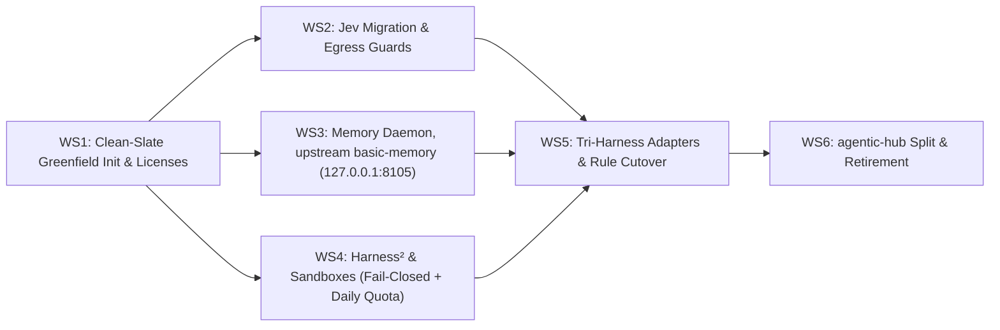

# RFC 001: Cognitive Engine — Autonomous Cognitive Substrate (Harness² + Jev + Memory)

- **Document Type**: Architecture RFC & Unified Implementation Plan
- **RFC Number**: 001
- **Status**: Formally Clarified / Implementation Blueprint (Incorporating [@Doc-Cr](https://github.com/Doc-Cr) Review #1)
- **Authors**: Aleksandr Korolev ([@rockad](https://github.com/rockad)), Antigravity Pair Architect
- **Target Reviewers**: [@doc-cr](https://github.com/doc-cr), Aleksandr Korolev
- **Target Runtimes**: Google Antigravity, Claude Code, OpenCode
- **Upstream PR**: [rockad/cognitive-engine#1](https://github.com/rockad/cognitive-engine/pull/1)

> [!IMPORTANT]
> **Unified Entity Invariant**: This RFC serves simultaneously as the formal architectural proposal and the actionable engineering implementation plan. There is zero divergence between this document and the active execution roadmap. Following review feedback from [@Doc-Cr](https://github.com/Doc-Cr), this plan will be executed directly without intermediate translation layers.

---

## 1. Executive Summary & Tripartite Architecture

This plan establishes **Cognitive Engine** as a dedicated standalone core platform repository (`rockad/cognitive-engine`) consolidating three complementary AI agent infrastructure layers into an **Autonomous Cognitive Substrate**:

1. **System 1 (TypeSafe Jev)**: Sub-second (~380ms) probabilistic routing, model tier dispatch, free-tier offloading, quality gatekeeping (`jev_judge`), and session ceiling governance.
2. **System 2 (Google Harness²)**: Contrastive trajectory probing (*Propose–Probe–Compose*) without ground truth, automated harness component mutation across 8 dimensions, and continual learning via `EXPERIENCE.md`.
3. **Memory Substrate (Upstream `basic-memory`)**: Native Python daemon on `127.0.0.1:8105/mcp` during staging (Path A, decision 21), holding notes, entities, and domain playbooks, retiring the `basic-memory` Docker container.

```mermaid
flowchart TB
    subgraph CognitiveEngine ["1. Cognitive Engine (New Standalone Monorepo: rockad/cognitive-engine)"]
        direction TB
        
        subgraph TS_Runtime ["TypeScript / Bun Runtime"]
            JevCore["TypeSafe Jev Core (System 1 Coprocessor)"]
            JevRouter["Probabilistic Tier Dispatch (~380ms)"]
            JevJudge["Quality & Diff Gate (jev_judge)"]
            FreeOffload["Zero-Cost Boilerplate Offloader (openrouter/free)"]
            EgressTS["Egress & ZDR Policy Guard (TypeScript)"]
        end
        
        subgraph Python_Runtime ["Python 3.12 / uv Runtime"]
            H2Engine["Google Harness² Core (System 2 Optimizer)"]
            H2Proposer["Candidate Mutators (Protected Invariants Excluded)"]
            H2Composer["Behavioral Contrast Composer (Human-in-the-Loop Proposal)"]
            H2Reflector["Continual Reflector (Writes to ~/.local/share/)"]
            EgressPy["Egress & ZDR Policy Guard (Python)"]
            
            MemoryService["Memory Daemon, upstream basic-memory (127.0.0.1:8105/mcp)"]
            SQLiteDB[("~/.local/share/cognitive-engine/memory/")]
            MemoryService --- SQLiteDB
        end
        
        TS_Runtime <==>|Standard FastMCP-over-stdio / Local HTTP (127.0.0.1)| Python_Runtime
    end

    subgraph SandboxLayer ["2. Execution Isolation Layer"]
        DockerSandbox1["Docker Sandbox (Candidate Trajectory A)"]
        DockerSandbox2["Docker Sandbox (Candidate Trajectory B)"]
        FailClosed["Fail-Closed Gate (sbx Unavailable -> Abort / mkdtemp Diff-Only)"]
        
        H2Engine -.->|Primary (microVM Isolation)| DockerSandbox1
        H2Engine -.->|Primary (microVM Isolation)| DockerSandbox2
        H2Engine -.->|sbx Unavailable| FailClosed
    end

    subgraph OutOfTree ["3. Host Out-of-Tree State (~/.local/share/cognitive-engine/)"]
        RuntimeExp[("experiences/<domain>/ (EXPERIENCE.md + INDEX.md)")]
        MemoryDB[("memory/ (basic-memory state: notes, FTS5, embeddings)")]
    end
    MemoryService --- OutOfTree
    H2Reflector --- RuntimeExp

    subgraph Peripherals ["4. Peripheral Registry (rockad/agentic-hub)"]
        PluginsRegistry["Standalone Tool Plugins (chrome-devtools, gitea, google-workspace, local-transcribe)"]
        SkillsRegistry["Standalone Utility Skills (clarify, md-to-pdf, markdown-convert, rclone)"]
        Marketplace[".claude-plugin/ & marketplace.json Manifests"]
    end

    subgraph ConsumerRuntimes ["5. Tri-Harness Adapters"]
        AGY["Google Antigravity (MCP + ask_question + Subagents)"]
        Claude["Claude Code (Hooks + AskUserQuestion + .claude-plugin)"]
        OpenCode["OpenCode (V2 Plugin + --substrate opencode + TUI)"]
    end

    subgraph ConsumerWorkspaces ["6. Consumer Workspaces"]
        Doppelganger["doppelganger ($VAULT: Personal Second Brain & Career Master Records)"]
        WorkRepos["Work Repositories (Software Projects, Tooling)"]
    end

    CognitiveEngine ===> ConsumerRuntimes
    Peripherals ===> ConsumerRuntimes
    ConsumerRuntimes ===> ConsumerWorkspaces
```

### Tripartite Separation of Concerns
* **`cognitive-engine` (The Core Platform)**: Holds Jev, Harness², the unified memory daemon, and native cross-harness adapters. Zero project-specific notes or application data.
* **`agentic-hub` (The Peripheral Registry)**: Repositioned as the community marketplace and distribution hub for peripheral, tool-specific plugins (`chrome-devtools`, `gitea`, `google-workspace`, `local-transcribe`) and standalone skills (`md-to-pdf`, `markdown-convert`).
* **`doppelganger` (The Consumer Vault)**: Preserved as Aleksandr's pure personal knowledge vault and second brain (`$VAULT`), holding zero container plumbing, optimizer loops, or engine code.

---

## 2. Architectural Decisions & Refinements (Incorporating @Doc-Cr Review)

| # | Architectural Dimension | Clarified Decision | Operational Rationale & @Doc-Cr Guidance |
|---|---|---|---|
| **1** | **Monorepo Packaging & Runtime** | **Polyglot Workspace Topology (Bun + uv)** | Bun workspaces for TypeScript (`packages/jev`, `cli/`, `adapters/`) + `uv` workspaces for Python 3.12 (`packages/harness2`, `packages/memory`). Maximizes code reuse, zero rewrite debt for Jev or basic-memory, and native performance. |
| **2** | **Internal Component IPC** | **Standard MCP-to-MCP** | Harness² exposes standard FastMCP tools (`harness2_propose`, `harness2_probe`, `harness2_compose`) consumed by Jev. Standardized, inspectable, decoupled. |
| **3** | **Memory Substrate Engine** | **Native Python FastMCP Daemon (Upstream `basic-memory`)** | Retire Docker containers; run the upstream-maintained `basic-memory` package natively in Python via `uv` bound strictly to `127.0.0.1:8105`. Zero rewrite debt (KISS/DRY), leverages existing maintained library with full FastMCP toolset. |
| **4** | **Probe Execution Isolation** | **Docker Sandboxes** | Isolated agent micro-sandboxes ([Docker Sandboxes](https://www.docker.com/products/docker-sandboxes/)) for secure, zero-risk parallel candidate execution. |
| **5** | **Sandbox Offline Fallback** | **Fail-Closed by Default (Explicit Opt-In for Diff-Only)** | *Refined*: A silent `/tmp/` worktree fallback gives zero network/user isolation. If the Docker Sandboxes runtime (`sbx`) is unavailable, probe fails closed. Worktree is an explicit opt-in in `mkdtemp` that **never executes code** (inspection/diff only). |
| **6** | **Modular Standalone Packages (Zero Docker Bloat)** | **Standalone-Capable Packages (`packages/memory`, `packages/jev`)** | Both `packages/jev` and `packages/memory` are decoupled, standalone libraries that can run independently as dedicated FastMCP servers or be orchestrated together in the engine. Replaces the Docker container with native execution consuming ~730MB–1.2GB RAM on `127.0.0.1:8105`. |
| **7** | **OpenRouter Rate Limits & Quotas** | **Adaptive RPM Clamp + Daily Cap Pre-Flight** | In addition to 15 RPM throttling (2 workers, 3s stagger), the prober pre-flights `free_model_daily_requests` from `GET /api/v1/key`. If daily quota is low, probing skips/aborts. |
| **8** | **Licensing & Origin Hygiene** | **Explicit Multi-License Attribution** | Root `LICENSE` added: Jev code is MIT; Harness² is Apache-2.0; `packages/memory` wraps upstream `basic-memory`, which is AGPL-3.0, so its license is preserved and the license of `packages/memory` has to account for it. Upstream licenses and `third_party/licenses/` preserved; modified files marked. |
| **9** | **Probing under ZDR Strict** | **ZDR-Compliant Endpoint Routing** | Under `zdr: strict`, candidate probes route strictly to verified Zero Data Retention models (local Ollama or signed commercial ZDR endpoints like Anthropic Direct); never touches `openrouter/free`. |
| **10** | **Experience Seeding & Storage** | **Sanitized Repo Templates + Out-of-Tree Storage** | Sanitized seed templates in `packages/memory/templates/experiences/` bootstrap `~/.local/share/cognitive-engine/experiences/` on first run. Runtime additions live out-of-tree; cross-machine sync is decoupled to user dotfiles. |
| **11** | **CLI Tooling & Multiplexing** | **Unified `engine` CLI Multiplexer (Compiled Bun Binary)** | A single `engine <command>` CLI entrypoint built via `bun build --compile` yields a standalone zero-dependency executable (`engine memory`, `engine jev`, `engine up`, `engine status`). |
| **12** | **SQLite Schema & Migrations** | **Superseded by decision 21** | Under Path A, upstream `basic-memory` owns its schema and migrations; the TypeScript/Zod migration runner no longer applies to `packages/memory`. |
| **13** | **Cross-Platform Supervision** | **`engine install-services` Installer** | Generates platform-native user-level daemons: systemd user units (`~/.config/systemd/user/`) with `loginctl enable-linger` on Linux/WSL2, launchd agent plists on macOS, and Windows/Docker configurations. |
| **14** | **Subpackage Distribution & Registry Staging** | **Staged Monorepo Packages (Internal -> Gitea -> Public)** | Build pipelines and versioning configured in `packages/jev` (npm) and `packages/memory` (uv/PyPI). Public registry publishing held during development; private Gitea package registry (`git.bigrockad.com`) used for staging. |
| **15** | **Client Harness MCP Registration** | **Discrete Standalone MCP Servers with Engine Supervisor** | Client harnesses register discrete FastMCP servers (`memory` at `:8105/mcp`, `jev` at `:8115/mcp`) supervised by `engine up`. Ensures isolated failure domains, zero proxy overhead, and granular `mcp-toggle` context preservation. |
| **16** | **Memory Backward Compatibility** | **Upstream Tool Names + Lookup Tools** | Under Path A, the ten `basic-memory` tools used by the `recall` skill keep their names natively (`read_note`, `write_note`, `search_notes`, `edit_note`, `view_note`, `move_note`, `delete_note`, `build_context`, `recent_activity`, `list_memory_projects`). The four Lookup tools used by the `lookup` and `memory` skills (`search_archive`, `get_document`, `refresh_index`, `archive_stats`) need a backend before they can be served or aliased. |
| **17** | **TypeScript SQLite & Query Engine** | **Superseded by decision 21** | Under Path A, memory storage and queries are handled by upstream `basic-memory` in Python; the `bun:sqlite` engine no longer applies to `packages/memory`. |
| **18** | **Cross-Harness Adapter Packaging** | **Unified Multi-Harness Adapter Package (`adapters/`)** | Single versioned Bun workspace package containing Claude Code, OpenCode, and Antigravity shims. Installed turnkey via `engine install-adapters` to eliminate cross-harness version drift. |
| **19** | **Python Subprocess & Service Supervision** | **Hybrid Dual-Mode (`Bun.spawn()` + Systemd Unit)** | `engine up` uses native `Bun.spawn()` for single-command interactive dev and graceful SIGTERM teardown; `engine install-services` generates a single user systemd/launchd unit running `engine up --daemon` for background persistence. |
| **20** | **Harness² Probe Trigger Decoupling** | **Failure-Driven & Command-Driven Triggers** | Decouples probing from routing confidence (`min(subagent, tier)`), which falsely triggered on tier ambiguity. Probes trigger strictly on post-task quality failure (`jev_judge` FAIL or score < 0.50), error retry exhaustion, or explicit on-demand `/probe` command, bounded by daily quota pre-flight (`GET /api/v1/key`). |
| **21** | **Retrieval Pipeline & RAM Budget (<2–3 GB)** | **Full Hybrid Retrieval via Upstream `basic-memory` (BGE-Small + Jina Reranker)** | Adopts Path A: runs upstream `basic-memory` natively via `uv`. Retains full hybrid search (`bge-small-en-v1.5` embeddings + `jina-reranker-v1-tiny-en` cross-encoder). Tuned limits (`BASIC_MEMORY_RERANKER_CANDIDATES=5–10`, `BASIC_MEMORY_RERANKER_MAX_DOCUMENT_CHARS=500–1000`) keep steady-state resident memory comfortably under **2–3 GB**, preserving proven 9/10 past-context accuracy without Docker. |
| **22** | **Lookup Archive & Transcripts Substrate** | **Dedicated Companion Package (`packages/lookup`)** | Retains Lookup as a dedicated native Python package (`packages/lookup`) in the `uv` workspace, running on `127.0.0.1:8100` alongside `basic-memory` on `:8105`. Both supervised by `engine up`. Preserves FTS5 transcript indexing, mail/document search, and `docs.visibility` (`open`, `gated`, `unstated`, `mixed`). |
| **23** | **Monorepo Licensing & AGPL Containment** | **Process-Boundary Multi-Licensing** | Monorepo is MIT at root (`packages/jev`, `cli/`, `adapters/`, `packages/lookup`); `packages/harness2` is Apache-2.0; `packages/memory` is AGPL-3.0 (from `basic-memory`). Because `packages/memory` operates across standard MCP process/network boundaries, AGPL-3.0 is cleanly confined to `packages/memory`. |
| **24** | **Jev Transport Architecture** | **Dual-Mode Transport (Stdio Default + Streamable HTTP)** | Jev executes over stdio by default for direct zero-latency integration with Claude Code, OpenCode, and Antigravity. When orchestrated as a background daemon via `engine up`, it exposes Streamable HTTP on `127.0.0.1:8115/mcp`. |
| **25** | **Sandbox Execution Scope** | **Strict Local-Only MicroVMs (`sbx`)** | Docker Sandboxes execution is strictly restricted to local microVMs via the standalone `sbx` CLI. Cloud sandboxing is explicitly prohibited, preventing off-machine code or credential movement. |

---

## 3. Security, Data Egress & Invariant Protections

To protect private data across pooled workspaces and prevent untrusted self-mutation, Cognitive Engine establishes three non-negotiable architectural invariants:

### 3.1 Data Egress & ZDR (Zero Data Retention) Inheritance
When data is pooled across workspaces in shared memory and experiences, directory-based path checking (`assertEgressAllowed`) is insufficient:
1. **Classification Inheritance**: Any content derived from memory notes, transcripts, or experiences **inherits the strictest classification of its sources**. A record with no classification is treated as **restricted** by default.
2. **Lookup Primitive Retention**: Preserve Lookup's `docs.visibility` (`open`, `gated`, `unstated`, `mixed`; `unstated` is treated as gated), populated from frontmatter, wherever the archive is indexed after the split. Both `docs.visibility` and directory paths act as dual security lines.
3. **ZDR Strict Enforcement**: Under an active ZDR policy, candidate probes carrying restricted content go **only to ZDR-compliant endpoints or not at all**. Under `zdr: strict`, where Jev already blocks `openrouter/free` (`callOpenRouterFree`), probing must fail closed or route through verified ZDR providers.
4. **Cross-Language Enforcement**: Egress and ZDR validation must be enforced in both the TypeScript (Jev) and Python (Harness²) runtimes.

### 3.2 Physical Storage of Runtime Experiences (Leak Prevention)
1. **Out-of-Tree Storage**: Runtime experiences must **never be stored in the git repository tree** (`packages/memory/experiences/`). Writing private interview notes, client details, or corporate infrastructure lessons to the repo tree risks leaking confidential data on `git push`.
2. **Dedicated Runtime Path**: All active `EXPERIENCE.md` and `INDEX.md` domain files live outside the tree at:
   ```
   ~/.local/share/cognitive-engine/experiences/<domain>/
   ```
3. **Human Approval Gate**: The reflector proposes candidate lessons; entries are never committed to permanent domain storage without explicit human confirmation.

### 3.3 Protected Invariant Set (Immunity from Optimizer Mutation)
Although Harness² supports mutating 8 harness components, Cognitive Engine defines a **strictly protected set that the optimizer may NEVER mutate**:
- **Guardrails**: Safety constraints and verification gates.
- **Egress & ZDR Policies**: Data retention and network destination rules.
- **Session Model Ceiling**: Subagent and task model tier limits.
- **Lifecycle Hooks**: PreToolUse and PostToolUse security interceptors.
- **Human Gate on Composer**: The composer output is always presented as a proposed patch for human review, never auto-applied to active agent environments.

---

## 4. Deep Component Specifications

### 4.1 System 1: TypeSafe Jev Coprocessor (TypeScript / Bun)
- **Sub-Second Tier Dispatch (`jev_dispatch`)**: Evaluates task complexity in ~380ms and routes to optimal subagents and model tiers (`openrouter_free`, `flash_lite`, `flash`, `pro`).
- **Quota Preservation & Free Offloading (`jev_execute_free`)**: Automatically offloads boilerplate generation, summaries, text formatting, and commit message drafting to `openrouter/free` at $0.00 cost (0 Gemini/Claude quota). Blocked under `zdr: strict`.
- **Session Model Ceiling Enforcement**: Clamps child subagents to never exceed the active parent model tier without explicit manual user approval.
- **Diff Quality Gates (`jev_judge`)**: Binary acceptance testing for file diffs, test outcomes, and pre-commit checks.

### 4.2 System 2: Google Harness² Recursive Optimizer (Python 3.12 / uv)
- **Task-Level Recursion (*Propose–Probe–Compose*)**:
  - **Decoupled Probe Triggers**: Probing is decoupled from routing uncertainty. Triggers fire on:
    1. Post-task verification failure (`jev_judge` returns `FAIL` or score < 0.50).
    2. Execution retry limit exceeded (agent loop recovery after $N$ attempts).
    3. Explicit on-demand request (`/probe <task>` in chat or `engine probe`).
    4. Guarded by daily quota pre-flight (`free_model_daily_requests` from `GET /api/v1/key`).
  - Probes $k$ candidate modifications across allowed components in parallel isolated Docker Sandboxes.
  - Fails closed if the `sbx` runtime is unavailable. Optional `mkdtemp` worktree mode for inspection/diff only (no code execution).
- **Harnessing-Level Recursion (*Continual Learning*)**:
  - Post-task reflection proposes empirical lessons into out-of-tree domain libraries (`~/.local/share/cognitive-engine/experiences/`), requiring human sign-off.

### 4.3 Memory Substrate: Native Python FastMCP Daemon (Upstream `basic-memory`) & Companion `packages/lookup`
Runs the upstream-maintained `basic-memory` project natively in Python via `uv` under `packages/memory`, binding strictly to `127.0.0.1:8105` during staging to prevent port collisions with legacy Lookup (`:8100`):
- **Upstream Code Reuse (Path A — Zero Rewrite Debt)**: Packages `basic-memory` as a native Python workspace member. Avoids rewriting complex embedding and knowledge graph engines from scratch (KISS/DRY), completely eliminates Docker container overhead, and guarantees strict localhost binding (`127.0.0.1`).
- **Hybrid Retrieval Pipeline & RAM Tuning (<2–3 GB Budget)**:
  - **Lexical Search**: SQLite FTS5 table with BM25 ranking for exact terms, symbols, and identifiers.
  - **Semantic Vector Search**: Dense vector embeddings via `bge-small-en-v1.5` (fastembed, 384 dimensions).
  - **Cross-Encoder Reranking**: Re-ranks candidates using `jinaai/jina-reranker-v1-tiny-en`.
  - **Sized for Accuracy & Bounded Memory**: Configured with `BASIC_MEMORY_RERANKER_CANDIDATES=5–10` and `BASIC_MEMORY_RERANKER_MAX_DOCUMENT_CHARS=500–1000` (the current agentic-hub compose file already sets 10 and 1000). This bounds the ONNX Runtime CPU memory arena to settle resident memory comfortably under **2–3 GB**, preserving the proven **9/10 past-context retrieval accuracy** demonstrated in empirical benchmarking (`eval/past-context-test.md`).
- **Toolset**: Exposes `basic-memory`'s own tools under their upstream names (`read_note`, `write_note`, `search_notes`, `edit_note`, etc.).
- **Companion Archive & Transcript Package (`packages/lookup`)**: Retained as a dedicated companion package (`packages/lookup`) in the `uv` workspace, running natively on `127.0.0.1:8100`. It preserves the 4 Lookup tools (`search_archive`, `get_document`, `refresh_index`, `archive_stats`), indexes transcripts and external knowledge archives, and enforces `docs.visibility` (`open`, `gated`, `unstated`, `mixed`) for strict classification inheritance under `zdr: strict`.
- **Storage**: State volume stored out-of-tree at `~/.local/share/cognitive-engine/memory/` and `~/.local/share/cognitive-engine/lookup/`.

### 4.4 Engine Multiplexer & Cross-Platform Supervision
- **Unified CLI (`cli/src/index.ts` -> `bin/engine`)**: High-level multiplexer built with Bun (`bun build --compile cli/src/index.ts --outfile bin/engine`) producing a standalone, zero-dependency executable binary supporting `engine memory`, `engine lookup`, `engine jev`, `engine up`, and `engine status`.
- **Cross-Platform Service Installer (`engine install-services`)**: Automatically generates and registers user-level service supervisors:
  - Linux/WSL2: systemd user units (`~/.config/systemd/user/cognitive-engine.service`) with `loginctl enable-linger` to ensure daemons persist across terminal sessions.
  - macOS: launchd agent plist (`~/Library/LaunchAgents/com.cognitive-engine.daemon.plist`).
  - Windows: Docker or native background service configurations.

---

## 5. Proposed Repository Topology (`rockad/cognitive-engine`)

```text
cognitive-engine/
├── LICENSE                           # Root MIT License (Jev, CLI, Adapters, Lookup)
├── third_party/
│   └── licenses/
│       ├── LICENSE.harness2          # Apache-2.0 License for Google Research code
│       └── LICENSE.basic-memory      # AGPL-3.0 License for upstream basic-memory
├── bin/
│   └── engine                        # Standalone compiled Bun executable (ELF/Mach-O)
├── cli/                              # CLI multiplexer implementation (TypeScript / Bun)
│   ├── package.json
│   └── src/                          # CLI commands (commander/clipanion in TS)
├── packages/
│   ├── jev/                          # System 1: Router, Judge, Free-tier coprocessor (TS / Bun)
│   │   ├── package.json
│   │   ├── src/                      # FastMCP server, egress checks, and core logic (stdio / HTTP)
│   │   ├── hooks/                    # Claude Code Pre/PostToolUse lifecycle hooks
│   │   └── opencode/                 # OpenCode V2 plugin
│   ├── memory/                       # Knowledge Graph & Semantic Memory Daemon (Python 3.12 / uv)
│   │   ├── pyproject.toml            # Wraps upstream basic-memory (AGPL-3.0) with tuned reranker
│   │   ├── src/                      # basic-memory wrapper (:8105/mcp)
│   │   └── templates/                # Sanitized experience templates
│   ├── lookup/                       # Transcript Archive & Document Search Daemon (Python 3.12 / uv)
│   │   ├── pyproject.toml            # FTS5 search + docs.visibility (:8100/mcp)
│   │   └── src/lookup/               # Extracted from agentic-hub/plugins/memory/servers/lookup (MIT)
│   └── harness2/                     # System 2: Recursive Optimizer & Prober (Python 3.12 / uv)
│       ├── pyproject.toml            # Google Research code workspace member (Apache-2.0)
│       ├── core/                     # Upstream engine (wrapped from google-research/harness2)
│       ├── substrate/                # OpenCode & Antigravity substrate adapters
│       ├── prober/                   # Docker Sandboxes parallel manager (fail-closed microVMs)
│       └── composer/                 # Contrastive behavioral synthesizer (human proposal)
├── adapters/                         # First-Class Cross-Harness Integrations (TS / Bun)
│   ├── package.json
│   ├── antigravity/                  # Antigravity sidecar & MCP registrations
│   ├── claude/                       # Claude Code plugin bundle
│   └── opencode/                     # OpenCode plugin bundle
├── package.json                      # Bun workspace manifest (jev, cli, adapters)
├── bun.lock
└── pyproject.toml                    # uv workspace manifest (harness2, memory, lookup)
```

---

## 6. Implementation Roadmap & Parallel Workstream Breakdown



| Stream | Scope / File Targets | Description | Suggested Role | Recommended Tier |
|---|---|---|---|---|
| **WS1: Repo Provisioning** | `cognitive-engine/` (New Repo Root) | Scaffold pristine greenfield repo (`v1.0.0`) with Bun workspaces, `uv` workspaces, and MIT + Apache-2.0 licenses | `system-operator` | `flash_lite` |
| **WS2: Jev Migration** | `packages/jev/` | Migrate TypeSafe Jev core, FastMCP server, cross-harness hook bindings, and ZDR/egress policy engine | `code-engineer` | `flash_lite` |
| **WS3: Unified Memory Daemon** | `packages/memory/` | Package upstream `basic-memory` via `uv` (decision 21), bind `127.0.0.1:8105`, out-of-tree storage, reranker limits; carry Lookup's `docs.visibility` into whatever indexes the archive | `code-engineer` | `flash_lite` |
| **WS4: Harness² & Sandboxes** | `packages/harness2/` | Package Harness² with FastMCP wrappers, Docker Sandboxes SDK (fail-closed + mkdtemp diff fallback), daily quota check, and protected invariant set | `code-engineer` | `flash_lite` |
| **WS5: Adapters & Rule Cutover** | `adapters/`, `doppelganger/` | Package Antigravity, Claude Code, and OpenCode adapters; bind memory tools; clean legacy engine scripts from `doppelganger` | `system-operator` | `flash_lite` |
| **WS6: agentic-hub Split** | `agentic-hub/` | Rebind consumers, deprecate and surgically retire `plugins/jev` and `plugins/memory` from `agentic-hub` after all completion gates pass | `system-operator` | `flash_lite` |

---

## 7. Split & Retirement Protocol for `agentic-hub`

To maintain 100% developer continuity and prevent broken environments, the migration adheres to a strict **zero-retirement prerequisite policy**: no files or plugins will be retired from `agentic-hub` until `cognitive-engine` is completely operational, tested, and verified across all three harnesses.

### Gated Split Checklist
1. **Verification Gates**:
   - `packages/jev` passes all existing test suites.
   - **Egress & ZDR Gates**: Existing egress path rules and ZDR strict mode test suites pass in both TypeScript and Python.
   - **Port Isolation**: The new unified memory daemon runs on a staging port (e.g. `:8105`) and binds strictly to `127.0.0.1` while legacy Lookup still holds `:8100`.
   - `packages/harness2` completes a live dual-path probe inside a Docker Sandbox with fail-closed behavior verified when the `sbx` runtime is unavailable.
   - Global config `~/.gemini/config/mcp_config.json` is updated to point to `cognitive-engine`.
2. **Deprecation Phase**:
   - Add warning notice to `agentic-hub/plugins/jev/README.md`: *"Notice: TypeSafe Jev has migrated upstream to rockad/cognitive-engine. This copy is frozen for legacy compatibility."*
   - Add identical notice to `agentic-hub/plugins/memory/README.md`.
3. **Consumer Rebinding**:
   - Update `doppelganger/.mcp.json` and shell aliases (`jev`, `jev-mode`, `memory.sh`) to point to the new engine binaries.
4. **Surgical Retirement**:
   - Remove `plugins/jev/` and `plugins/memory/` from `agentic-hub`.
   - Update `agentic-hub/marketplace.json` to register only peripheral plugins (`chrome-devtools`, `gitea`, `google-workspace`, `local-transcribe`) and standalone skills.
   - Update `agentic-hub/README.md` positioning it as the community peripheral registry.
   - Tag commit as `v2.4.0-split` in `agentic-hub`.

---

## 8. Targeted Review Requests & Brainstorming Points for [@Doc-Cr](https://github.com/Doc-Cr)

We specifically invite [@Doc-Cr](https://github.com/Doc-Cr)'s architectural feedback on:

1. **Docker Sandboxes Fail-Closed & mkdtemp Fallback**:
   Confirming our adoption of your recommendation: fail closed by default if the `sbx` runtime is unavailable; `mkdtemp` worktrees are an explicit opt-in that only generate inspection diffs and **never execute code**.
2. **Pluggable & Standalone Subpackages (Zero Docker Bloat & Isolated MCP Registration)**:
   We refined the architecture so both `packages/jev` and `packages/memory` are decoupled, standalone-capable libraries within the monorepo:
   - *Packaging*: Standalone package definitions (`package.json` for npm and `pyproject.toml` for uv/PyPI) with versioning and build pipelines, staged to private Gitea registry (`git.bigrockad.com`) during active development before any public registry publishing.
   - *Client MCP Registration*: Agent harnesses register discrete standalone FastMCP servers (`memory` at `:8105/mcp`, `jev` at `:8115/mcp`) supervised by `engine up`, ensuring isolated failure domains, direct communication without proxy overhead, and granular `mcp-toggle` token control.
   - *Compatibility*: `packages/memory` keeps the upstream `basic-memory` tool names used by the `recall` skill; the four Lookup tools need a backend first (decision 16).
3. **Daily Quota Pre-Flight**:
   Confirming our adoption of `GET /api/v1/key` checking `free_model_daily_requests` before probing.
4. **Data Egress & ZDR Invariants**:
   Reviewing the classification inheritance invariant, `docs.visibility` retention, and cross-runtime Python enforcement.
5. **Out-of-Tree Experience Storage**:
   Confirming the physical separation of runtime experiences to `~/.local/share/cognitive-engine/experiences/` to prevent repository leaks.
6. **Polyglot Monorepo Workspace Boundaries (Bun + uv)**:
   Reviewing the consolidation of Jev, CLI (`bun build --compile`), and Adapters into TypeScript/Bun workspaces, while running both `packages/harness2` and `packages/memory` in Python 3.12 (`uv` workspaces) to maximize code reuse, eliminate Docker, and preserve upstream library maintenance.
7. **Harness² Probe Trigger Decoupling**:
   Confirming adoption of Doc's recommendation: probing is decoupled from routing uncertainty and triggers strictly on `jev_judge` post-task failure (score < 0.50), execution retry exhaustion, or explicit on-demand `/probe` command, bounded by daily quota pre-flight (`GET /api/v1/key`).
8. **Native Execution of Upstream `basic-memory` under <2–3 GB Budget**:
   Confirming adoption of Path A: running upstream-maintained `basic-memory` natively in Python via `uv` (zero Docker). It uses full hybrid retrieval with `bge-small-en-v1.5` embeddings and the `jina-reranker-v1-tiny-en` cross-encoder. Configured limits (`BASIC_MEMORY_RERANKER_CANDIDATES=5–10`, `BASIC_MEMORY_RERANKER_MAX_DOCUMENT_CHARS=500–1000`) keep steady-state resident memory comfortably within the 2–3 GB budget, achieving proven 9/10 past-context retrieval accuracy.
9. **Companion `packages/lookup` for Transcripts & `docs.visibility`**:
   Confirming retention of Lookup as a dedicated companion package (`packages/lookup`) in the `uv` workspace, running natively on `127.0.0.1:8100`. It provides the 4 Lookup tools (`search_archive`, `get_document`, `refresh_index`, `archive_stats`), indexes transcripts, and enforces `docs.visibility` (`open`, `gated`, `unstated`, `mixed`).
10. **Process-Boundary AGPL Containment**:
    Confirming that because `packages/memory` operates as a standalone daemon communicating strictly over MCP process/network boundaries (stdio or HTTP loopback), AGPL-3.0 is legally and architecturally confined to `packages/memory`, while the rest of the monorepo remains MIT and Apache-2.0.
11. **Dual-Mode Jev Transport**:
    Confirming that Jev defaults to stdio for zero-latency, direct integration with client harnesses (`agy mcp`, Claude Code, OpenCode), with optional Streamable HTTP on `:8115/mcp` when supervised via `engine up`.
12. **Strict Local-Only Sandboxing**:
    Formalizing that microVM execution runs strictly locally via the standalone `sbx` CLI; zero cloud sandboxing or off-host code movement.
13. **Empirical Measurement Provenance**:
    Documenting that memory and retrieval figures originate from empirical profiling in `/home/rockad/projects/recall/docs/memory-footprint.md` and `eval/past-context-test.md`.
