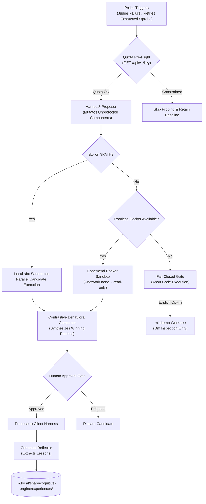

# RFC 004: Track 3 — System 2: Google Harness² Recursive Reasoning Optimizer

- **RFC Number**: 004
- **Track**: Track 3
- **Status**: Proposed
- **Runtime**: Python 3.12 / uv
- **License**: Apache-2.0
- **Target Subsystem**: `packages/harness2/`
- **Target Branch**: `feat/track3-harness2`
- **Parent Blueprint**: [RFC 001: Cognitive Engine Architecture](001-harness2-jev-unified-cognitive-substrate.md)
- **Implementation Plan**: [Multi-Track Implementation Plan](../plans/2026-10-26-multi-track-implementation-plan.md)

---

## 1. Summary & Motivation

Establishes Track 3 of Cognitive Engine: packaging Google Harness² as a native Python 3.12 workspace package (`packages/harness2`) managed by `uv`. 

Harness² serves as the System 2 reflective reasoning and prompt optimization engine. It operates at two recursive levels:
- **Task-Level Recursion (*Propose–Probe–Compose*)**: Evaluates candidate prompt, tool, and context modifications across parallel execution trajectories without requiring ground-truth labels.
- **Harnessing-Level Recursion (*Continual Learning*)**: Extracts generalized problem-solving strategies and distilled lessons into out-of-tree experience libraries.

---

## 2. Technical Scope & Core Components

### 2.1 Recursive Reasoning Core (`packages/harness2/core/`)
- Wraps upstream Google Research Harness² algorithms.
- Supports mutation across permissible harness dimensions (prompts, tool descriptions, context assembly, decomposition strategies).
- Integrates with OpenRouter API for candidate generation using calibrated sampling profiles.

### 2.2 Execution Isolation via Dual-Engine Local Sandboxing (`packages/harness2/prober/`)
Probing trajectories require strict local execution isolation to protect host state:
- **Primary: Native Local MicroVM Sandboxes (`sbx`)**:
  - Probing trajectories execute in local sandboxes using native `sbx` when available on `$PATH`.
  - Cloud sandboxing is explicitly prohibited; code, files, and credentials never leave the host machine.
- **Secondary: Ephemeral Rootless Docker Container Fallback**:
  - If `sbx` is unavailable on `$PATH`, the prober falls back to an ephemeral, rootless Docker container sandbox configured with:
    - `--network none` (strict network isolation, zero egress)
    - `--read-only` (read-only root filesystem, scratch in tmpfs only)
    - Zero off-host credential or environment leakage
  - Preserves automated candidate execution on developer machines where `sbx` is not yet installed, rather than blocking the optimizer loop.
- **Fail-Closed Fallback Gate**:
  - If neither `sbx` nor Docker is available, the prober fails closed by default and refuses to run candidate code.
  - Worktree fallback is an explicit user opt-in (`--allow-worktree-diff`) using `mkdtemp` that **only generates diffs for static inspection and never executes code**.

### 2.3 Decoupled Probe Triggers
Probing is completely decoupled from System 1 routing confidence metrics. Probing triggers strictly on:
- **Verification Failure**: Post-task `jev_judge` returns `FAIL` or score < 0.50.
- **Error Retry Exhaustion**: Client harness agent loop exceeds recovery attempts ($N \ge 3$) on the same task.
- **Explicit On-Demand Request**: User or agent invokes `/probe <task>` in chat or runs `engine probe`.

### 2.4 Quota Pre-Flight Check
- Pre-flights daily quota via OpenRouter API (`GET /api/v1/key`) before starting probe sweeps.
- Inspects `free_model_daily_requests` and rate limits.
- If daily quota is exhausted or throttled, probing automatically aborts with a graceful notice, falling back to standard execution without burning remaining quota.

### 2.5 Behavioral Contrast Composer (`packages/harness2/composer/`)
- Evaluates candidate trajectories contrastively without requiring labeled ground-truth answers.
- Identifies behavioral divergences, syntax correctness, tool call precision, and semantic completeness.
- Synthesizes winning components into a structured patch proposal for human review.

### 2.6 Out-of-Tree Experience Learning (`packages/harness2/reflector/`)
- Discovered patterns and failure mitigations are distilled into domain experience documents (`EXPERIENCE.md`, `INDEX.md`).
- **Physical Out-of-Tree Storage**:
  - Stored strictly outside the repository at `~/.local/share/cognitive-engine/experiences/<domain>/`.
  - Prevents accidental exposure of private codebase patterns or credentials in git commits.
- **Mandatory Human Sign-Off**:
  - Experience updates are presented as candidate suggestions; they are never committed to permanent storage without explicit human confirmation.

### 2.7 FastMCP Interface
`packages/harness2` exposes standard FastMCP tools consumable by System 1 and client harnesses:
- `harness2_propose`: Generates mutation candidates for a given task or prompt.
- `harness2_probe`: Executes candidates in parallel `sbx` sandboxes and collects outputs.
- `harness2_compose`: Contrasts outputs and generates a synthesized patch.
- `harness2_reflect`: Extracts generalizable lessons for domain experience storage.

The server uses FastMCP and meets the project-wide MCP contract (RFC 001 D29–D30): loopback bind only, `host_origin_protection="auto"` (forged Host and foreign Origin refused), strict argument validation (an unknown, mistyped or missing argument is a tool error), stateless HTTP, and liveness via `tools/list`. The `host_origin_protection` argument is off by default in FastMCP and must be set from the first commit.

### 2.8 Citation Lineage Contract (Google DeepMind Prompt Optimization)
The `NOTICE` and `README.md` files must formally cite foundational Google DeepMind prompt optimization literature:
- *Promptbreeder: Self-Referential Self-Improvement Via Prompt Evolution* (Fernando et al., 2023, [arXiv:2309.16797](https://arxiv.org/abs/2309.16797)).
- *Large Language Models as Tool Makers* (Cai et al., 2023, [arXiv:2305.17126](https://arxiv.org/abs/2305.17126)).

The documentation must explicitly document our clean-room, dual-harness heuristic implementation:
- Acknowledge the theoretical lineage and algorithmic inspiration from Google DeepMind prompt evolution research.
- Explicitly state that the code in `packages/harness2` is an independent, clean-room implementation tailored for multi-harness agent architectures (Antigravity, Claude Code, OpenCode).
- Preserve the Apache-2.0 license boundary for `packages/harness2`.

---

## 3. Invariants & Security Protections

### 3.1 Protected Invariant Set (Immune from Mutation)
The optimizer is strictly barred from modifying:
- Guardrail definitions and verification gates.
- Outbound egress and ZDR policies.
- Session model ceiling rules (e.g. Pro tier manual approval requirements).
- Lifecycle interceptor hooks (PreToolUse and PostToolUse).
- The human approval requirement on composer outputs.

### 3.2 Egress & ZDR Policy Adherence
- Probing candidate generation respects `zdr: strict`.
- Under strict ZDR, candidate prompts route solely through verified zero-retention endpoints (local Ollama or signed commercial ZDR endpoints) and never to `openrouter/free`.

---

## 4. Acceptance Criteria

- [x] `packages/harness2` installs and runs cleanly under Python 3.12 with `uv sync`.
- [x] FastMCP server initializes and exposes all 4 `harness2_*` tools (plus a read-only `harness2_status`, see §5).
- [x] The server passes the MCP conformance runner (RFC 001 D30), including forged Host / foreign Origin refusal and strict arguments: 12/12 on the real daemon.
- [ ] Probing triggers execute successfully upon simulated `jev_judge` failure and `/probe` command. *(The decision logic is done and tested as a pure function; wiring it to `jev_judge` events and a `/probe` command is not built.)*
- [ ] Option A Dual-Engine sandbox isolation executes candidate trajectories: native local `sbx` microVMs as primary, or ephemeral rootless Docker container (`--network none`, `--read-only`, zero egress) when `sbx` is unavailable.
- [x] Missing sandbox runtime (neither `sbx` nor Docker available) triggers clean fail-closed abort without executing code.
- [x] `GET /api/v1/key` pre-flight prevents execution when quota limits are reached. *(Tested against mocked responses; the live field names are unverified.)*
- [x] Experience reflections write exclusively to `~/.local/share/cognitive-engine/experiences/`. *(Staged lessons are pending until a human approves them through the CLI.)*
- [x] Protected invariants are verified immutable by automated mutation rejection tests. *(Components are refused and wired; the protected-path rule is tested but not yet used, since this slice mutates components, not files.)*
- [ ] Apache-2.0 license file and Google DeepMind prompt optimization literature citations (Promptbreeder [arXiv:2309.16797], LLMs as Tool Makers [arXiv:2305.17126]) applied in `NOTICE` and `README.md` with clean-room provenance notice.

---

## 5. Implementation Notes (Track 3 slice 1, 2026-10-28)

Decisions the RFC left open, made explicitly:

1. **Port `8120`.** RFC 004 assigns none; `8120` is clear of 8100/8105/8110/8115 and overridable with `COGNITIVE_HARNESS2_PORT`. Registered with the conformance runner via `tools/probes/harness2.toml`.
2. **A fifth tool, `harness2_status`.** Read-only and offline: sandbox availability, whether a key is configured (never its value), storage root, the protected set. Track 4's Gate 3 needs a way to ask "is sbx there, is the quota ok" without running a probe, and the conformance runner needs a harmless valid call.
3. **`dry_run` on `harness2_propose`.** Reports the egress and quota verdict without calling a model, so a caller can see a refusal before committing to a run.
4. **Only four components are mutable.** RFC 001 says Harness² mutates 8 components; this RFC names four. Anything else, and every unknown name, is refused until someone edits `MUTABLE` deliberately.
5. **Human sign-off is a CLI step, not a tool.** An agent can stage a lesson with `harness2_reflect` but cannot commit it.
6. **No upstream package is wrapped.** The RFC names none, so this is an independent baseline of the four stages with a heuristic composer.
7. **Bug found while testing:** the protected-path check stripped leading `../` and `/` before testing for escapes, so `../../escape` and `/etc/passwd` passed. Fixed, with tests.
