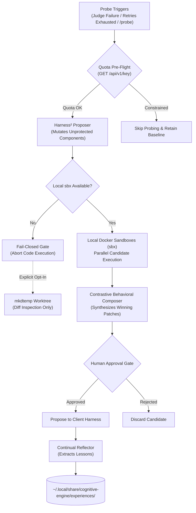

# RFC 004: Track 3 — System 2: Google Harness² Recursive Reasoning Optimizer

- **RFC Number**: 004
- **Track**: Track 3
- **Status**: Proposed
- **Runtime**: Python 3.12 / uv
- **License**: Apache-2.0
- **Target Subsystem**: `packages/harness2/`
- **Target Branch**: `feat/track3-harness2`
- **Parent Blueprint**: [RFC 001: Cognitive Engine Architecture](001-harness2-jev-unified-cognitive-substrate.md)
- **Implementation Plan**: [Multi-Track Implementation Plan](../plans/2026-10-26-multi-track-implementation-plan.md)

---

## 1. Summary & Motivation

Establishes Track 3 of Cognitive Engine: packaging Google Harness² as a native Python 3.12 workspace package (`packages/harness2`) managed by `uv`. 

Harness² serves as the System 2 reflective reasoning and prompt optimization engine. It operates at two recursive levels:
- **Task-Level Recursion (*Propose–Probe–Compose*)**: Evaluates candidate prompt, tool, and context modifications across parallel execution trajectories without requiring ground-truth labels.
- **Harnessing-Level Recursion (*Continual Learning*)**: Extracts generalized problem-solving strategies and distilled lessons into out-of-tree experience libraries.

---

## 2. Technical Scope & Core Components

### 2.1 Recursive Reasoning Core (`packages/harness2/core/`)
- Wraps upstream Google Research Harness² algorithms.
- Supports mutation across permissible harness dimensions (prompts, tool descriptions, context assembly, decomposition strategies).
- Integrates with OpenRouter API for candidate generation using calibrated sampling profiles.

### 2.2 Execution Isolation via Local MicroVMs (`packages/harness2/prober/`)
- **Strict Local MicroVM Sandboxing**:
  - Probing trajectories execute exclusively inside local Docker Sandboxes managed via the standalone `sbx` CLI.
  - Cloud sandboxing is explicitly prohibited; code, files, and credentials never leave the host machine.
- **Fail-Closed Sandbox Fallback**:
  - If the `sbx` runtime is unavailable, the prober fails closed by default and refuses to run candidate code.
  - Worktree fallback is an explicit user opt-in (`--allow-worktree-diff`) using `mkdtemp` that **only generates diffs for static inspection and never executes code**.

### 2.3 Decoupled Probe Triggers
Probing is completely decoupled from System 1 routing confidence metrics. Probing triggers strictly on:
- **Verification Failure**: Post-task `jev_judge` returns `FAIL` or score < 0.50.
- **Error Retry Exhaustion**: Client harness agent loop exceeds recovery attempts ($N \ge 3$) on the same task.
- **Explicit On-Demand Request**: User or agent invokes `/probe <task>` in chat or runs `engine probe`.

### 2.4 Quota Pre-Flight Check
- Pre-flights daily quota via OpenRouter API (`GET /api/v1/key`) before starting probe sweeps.
- Inspects `free_model_daily_requests` and rate limits.
- If daily quota is exhausted or throttled, probing automatically aborts with a graceful notice, falling back to standard execution without burning remaining quota.

### 2.5 Behavioral Contrast Composer (`packages/harness2/composer/`)
- Evaluates candidate trajectories contrastively without requiring labeled ground-truth answers.
- Identifies behavioral divergences, syntax correctness, tool call precision, and semantic completeness.
- Synthesizes winning components into a structured patch proposal for human review.

### 2.6 Out-of-Tree Experience Learning (`packages/harness2/reflector/`)
- Discovered patterns and failure mitigations are distilled into domain experience documents (`EXPERIENCE.md`, `INDEX.md`).
- **Physical Out-of-Tree Storage**:
  - Stored strictly outside the repository at `~/.local/share/cognitive-engine/experiences/<domain>/`.
  - Prevents accidental exposure of private codebase patterns or credentials in git commits.
- **Mandatory Human Sign-Off**:
  - Experience updates are presented as candidate suggestions; they are never committed to permanent storage without explicit human confirmation.

### 2.7 FastMCP Interface
`packages/harness2` exposes standard FastMCP tools consumable by System 1 and client harnesses:
- `harness2_propose`: Generates mutation candidates for a given task or prompt.
- `harness2_probe`: Executes candidates in parallel `sbx` sandboxes and collects outputs.
- `harness2_compose`: Contrasts outputs and generates a synthesized patch.
- `harness2_reflect`: Extracts generalizable lessons for domain experience storage.

---

## 3. Invariants & Security Protections

### 3.1 Protected Invariant Set (Immune from Mutation)
The optimizer is strictly barred from modifying:
- Guardrail definitions and verification gates.
- Outbound egress and ZDR policies.
- Session model ceiling rules (e.g. Pro tier manual approval requirements).
- Lifecycle interceptor hooks (PreToolUse and PostToolUse).
- The human approval requirement on composer outputs.

### 3.2 Egress & ZDR Policy Adherence
- Probing candidate generation respects `zdr: strict`.
- Under strict ZDR, candidate prompts route solely through verified zero-retention endpoints (local Ollama or signed commercial ZDR endpoints) and never to `openrouter/free`.

---

## 4. Acceptance Criteria

- [ ] `packages/harness2` installs and runs cleanly under Python 3.12 with `uv sync`.
- [ ] FastMCP server initializes and exposes all 4 `harness2_*` tools.
- [ ] Probing triggers execute successfully upon simulated `jev_judge` failure and `/probe` command.
- [ ] Local `sbx` microVM sandbox executes candidate trajectories in complete isolation.
- [ ] Missing `sbx` runtime triggers clean fail-closed abort without executing code.
- [ ] `GET /api/v1/key` pre-flight prevents execution when quota limits are reached.
- [ ] Experience reflections write exclusively to `~/.local/share/cognitive-engine/experiences/`.
- [ ] Protected invariants are verified immutable by automated mutation rejection tests.
- [ ] Apache-2.0 license file and Google Research notice attributes applied.
