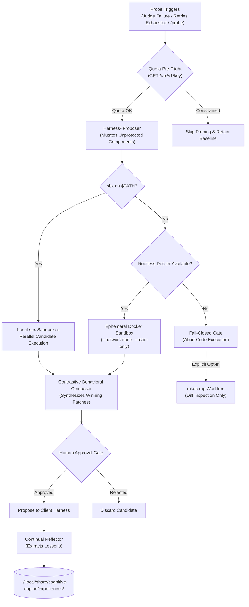
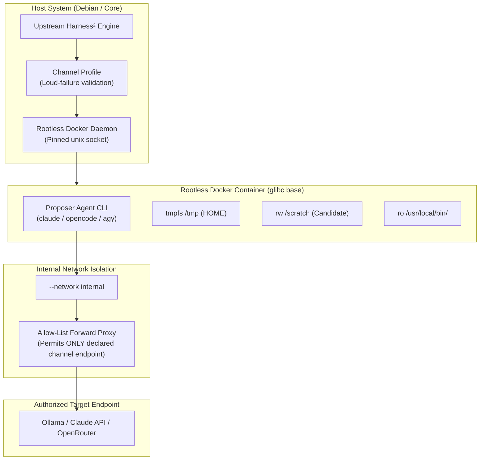

# RFC 004: Track 3 — System 2: Google Harness² Recursive Reasoning Optimizer

- **RFC Number**: 004
- **Track**: Track 3
- **Status**: Proposed
- **Runtime**: Python 3.12 / uv
- **License**: Apache-2.0
- **Target Subsystem**: `packages/harness2/`
- **Target Branch**: `feat/track3-harness2`
- **Parent Blueprint**: [RFC 001: Cognitive Engine Architecture](001-harness2-jev-unified-cognitive-substrate.md)
- **Implementation Plan**: [Multi-Track Implementation Plan](../plans/2026-10-26-multi-track-implementation-plan.md)

---

## 1. Summary & Motivation

Establishes Track 3 of Cognitive Engine: packaging Google Harness² as a native Python 3.12 workspace package (`packages/harness2`) managed by `uv`. 

Harness² serves as the System 2 reflective reasoning and prompt optimization engine. It operates at two recursive levels:
- **Task-Level Recursion (*Propose–Probe–Compose*)**: Evaluates candidate prompt, tool, and context modifications across parallel execution trajectories without requiring ground-truth labels.
- **Harnessing-Level Recursion (*Continual Learning*)**: Extracts generalized problem-solving strategies and distilled lessons into out-of-tree experience libraries.

---

## 2. Technical Scope & Core Components

### 2.1 Recursive Reasoning Core & Flat Layout (`packages/harness2/src/cognitive_harness2/`)
- Flat package architecture replaces nested directories: `packages/harness2/src/cognitive_harness2/{sandbox,engine,triggers,advice,invariants,egress,quota,experience,server}.py`.
- Consumes upstream `google-research/harness2` directly as much as possible; adopts new upstream versions as they are released; uses its source only where direct use fails. Never rewritten or reimplemented.
- Pinned at commit `1cfe254e8d25b15f37048c3730134686abe60335` as an optional extra (`[tool.uv.sources]`, extra `upstream`) in `pyproject.toml`, with a minimal fork only if forced.
- Supports mutation across permissible harness dimensions (prompts, tool descriptions, context assembly, decomposition strategies).
- Integrates with OpenRouter API for candidate generation using calibrated sampling profiles.

### 2.2 Execution Isolation via Dual-Engine Local Sandboxing (`sandbox.py`)
Probing trajectories require strict local execution isolation to protect host state:
- **Primary: Native Local MicroVM Sandboxes (`sbx`)**:
  - Probing trajectories execute in local sandboxes using native `sbx` when available on `$PATH`.
  - Cloud sandboxing is explicitly prohibited; code, files, and credentials never leave the host machine.
  - *Status*: `SbxRunner` is implemented but unverified against a real binary because standalone `sbx` is not installed on this host.
- **Secondary: Ephemeral Rootless Docker Container Fallback (`DockerRunner`)**:
  - If `sbx` is unavailable on `$PATH`, the prober falls back to an ephemeral, rootless Docker container sandbox configured with:
    - `--network none` (strict network isolation, zero egress)
    - `--read-only` (read-only root filesystem, scratch in tmpfs only)
    - Pinned unix socket execution, dropped capabilities (`--cap-drop ALL`), `no-new-privileges`, unprivileged user (`65534:65534`), and candidate staged read-only at `/candidate`
    - Zero off-host credential or environment leakage
  - *Status*: Rootless Docker is **installed and verified on host** (`unix:///run/user/1000/docker.sock`, `docker info` reports `name=rootless`). 21 real-daemon integration tests pass unskipped (`packages/harness2/tests/test_docker_integration.py`).
- **Fail-Closed Fallback Gate**:
  - If neither `sbx` nor Docker is available, the prober fails closed by default and refuses to run candidate code.
  - Worktree fallback is an explicit user opt-in (`--allow-worktree-diff`) using `mkdtemp` that **only generates diffs for static inspection and never executes code**.

### 2.3 Decoupled Probe Triggers (`triggers.py`, `advice.py`)
Probing is completely decoupled from System 1 routing confidence metrics. Stagnation heuristics are dropped; triggers are exactly as specified:
- **Advisory Push via Hook (`hooks/harness2-advise.sh`)**:
  - Documented (not installed) Claude Code hook script: counts consecutive tool failures per session; advises at the retry limit ($N \ge 3$) and multiples of 3.
  - Post-task verification failure: `jev_judge` returns `FAIL` or score < 0.50.
  - Error retry exhaustion: Client harness agent loop exceeds recovery attempts ($N \ge 3$) on the same task. User interrupts are not counted.
  - Atomic single-byte count append (`$XDG_STATE_HOME/cognitive-engine/harness2-hook/<sid>.count`), fail-open (always exits 0), zero secrets or prompt text stored, automatic 7-day stale count pruning.
- **Explicit Pull Tool (`harness2_trigger`)**:
  - Pure read-only pull tool: evaluates failure summary without starting sandboxes, calling models, or writing files.
  - Takes `on_demand`, `judge_passed`, `judge_score`, `consecutive_failures`, `failure_signatures`, `zdr`, `classification`, and `check_quota`.
  - Result schema: `advise` (trigger fired), `ready` (`true` | `false` | `null` when quota is unchecked), `blockers` (reasons if unready), `cost_class`, and `requires_human_approval: true`.
  - User or agent invokes `/probe <task>` in chat, runs `engine probe`, or calls `harness2_trigger`.

### 2.4 Quota Pre-Flight Check (`quota.py`)
- Pre-flights daily quota via OpenRouter API (`GET /api/v1/key`) before starting probe sweeps.
- Inspects `free_model_daily_requests` and rate limits.
- If daily quota is exhausted or throttled, probing automatically aborts with a graceful notice, falling back to standard execution without burning remaining quota.

### 2.5 Behavioral Contrast Composer (`engine.py`)
- Evaluates candidate trajectories contrastively without requiring labeled ground-truth answers.
- Identifies behavioral divergences, syntax correctness, tool call precision, and semantic completeness.
- Synthesizes winning components into a structured patch proposal for human review.

### 2.6 Out-of-Tree Experience Learning (`experience.py`)
- Discovered patterns and failure mitigations are distilled into domain experience documents (`EXPERIENCE.md`, `INDEX.md`).
- **Physical Out-of-Tree Storage**:
  - Stored strictly outside the repository at `~/.local/share/cognitive-engine/experiences/<domain>/`.
  - Prevents accidental exposure of private codebase patterns or credentials in git commits.
- **Mandatory Human Sign-Off**:
  - Experience updates are presented as candidate suggestions; they are never committed to permanent storage without explicit human confirmation via the CLI (`cognitive-harness2 experience approve`).

### 2.7 FastMCP Interface (`server.py`)
`packages/harness2` exposes standard FastMCP tools consumable by System 1 and client harnesses:
- `harness2_propose`: Generates mutation candidates for a given task or prompt (`dry_run` supported).
- `harness2_probe`: Executes candidates in parallel sandboxes (`sbx` or rootless Docker) and collects outputs.
- `harness2_compose`: Contrasts outputs and generates a synthesized patch (`requires_human_approval: true`).
- `harness2_reflect`: Extracts generalizable lessons for domain experience storage (staged as pending).
- `harness2_trigger`: Read-only pull check returning `advise`, `ready` (`true` | `false` | `null`), `blockers`, and `cost_class`.
- `harness2_status`: Read-only, offline readiness report (sandbox, API key configuration, experience root, mutable components).

The server uses FastMCP and meets the project-wide MCP contract (RFC 001 D29–D30): loopback bind only, `host_origin_protection="auto"` (forged Host and foreign Origin refused), strict argument validation (an unknown, mistyped or missing argument is a tool error), stateless HTTP, and liveness via `tools/list`. The `host_origin_protection` argument is off by default in FastMCP and must be set from the first commit.

### 2.8 Citation Lineage Contract (Upstream Google Research Harness²)
The `NOTICE` and `README.md` files formally cite upstream Google Research Harness² as primary:
- **Primary Source & Citation**: Google Research / Google LLC, Apache-2.0; Xu et al. 2026, [arXiv:2610.14224](https://arxiv.org/abs/2610.14224).
- **Related Work Only**: Foundational prompt evolution literature (*Promptbreeder*, Fernando et al., 2023, [arXiv:2309.16797](https://arxiv.org/abs/2309.16797); *Large Language Models as Tool Makers*, Cai et al., 2023, [arXiv:2305.17126](https://arxiv.org/abs/2305.17126)) are cited strictly as related work.
- **Consumption Invariant**: `packages/harness2` uses upstream `google-research/harness2` directly as much as possible, adopting new upstream versions as they are released. It consumes upstream as a pinned git dependency (commit `1cfe254e8d25b15f37048c3730134686abe60335`) in `pyproject.toml` (extra `upstream`), using a minimal fork only if forced, and using its source only where direct use fails. Never claimed as a rewrite or custom reimplementation.
- Preserve the Apache-2.0 license boundary for `packages/harness2`.

---

## 3. Invariants & Security Protections

### 3.1 Protected Invariant Set (Immune from Mutation)
The optimizer is strictly barred from modifying:
- Guardrail definitions and verification gates.
- Outbound egress and ZDR policies.
- Session model ceiling rules (e.g. Pro tier manual approval requirements).
- Lifecycle interceptor hooks (PreToolUse and PostToolUse).
- The human approval requirement on composer outputs.

### 3.2 Egress & ZDR Policy Adherence
- Probing candidate generation respects `zdr: strict`.
- Under strict ZDR, candidate prompts route solely through verified zero-retention endpoints (local Ollama or signed commercial ZDR endpoints) and never to `openrouter/free`.

---

## 4. Acceptance Criteria

- [x] `packages/harness2` installs and runs cleanly under Python 3.12 with `uv sync`.
- [x] FastMCP server initializes and exposes all tools (`harness2_{propose,probe,compose,reflect,trigger,status}`).
- [x] The server passes the MCP conformance runner (RFC 001 D30), including forged Host / foreign Origin refusal and strict arguments: 12/12 on the real daemon.
- [x] Probing triggers execute successfully: advisory push via hook script (`packages/harness2/hooks/harness2-advise.sh`) plus read-only pull tool (`harness2_trigger` with `advise`/`ready` semantics). Pure logic and hook smoke-tested.
- [x] Option A Dual-Engine sandbox isolation executes candidate trajectories: ephemeral rootless Docker container (`--network none`, `--read-only`, zero egress) verified against live daemon (`unix:///run/user/1000/docker.sock`; 21 real-daemon integration tests pass unskipped). Native local `sbx` microVMs supported via `SbxRunner` (unverified on host; `sbx` not installed).
- [x] Missing sandbox runtime (neither `sbx` nor Docker available) triggers clean fail-closed abort without executing code.
- [x] `GET /api/v1/key` pre-flight prevents execution when quota limits are reached. *(Tested against mocked responses; the live field names are unverified.)*
- [x] Experience reflections write exclusively to `~/.local/share/cognitive-engine/experiences/`. *(Staged lessons are pending until a human approves them through the CLI.)*
- [x] Protected invariants are verified immutable by automated mutation rejection tests. *(Components are refused and wired; protected-path rule tested against directory and subpath escapes.)*
- [x] Apache-2.0 license file and upstream Google Research Harness² citations (Xu et al. 2026, arXiv:2610.14224; Promptbreeder and Tool Makers as related work) applied in `NOTICE` and `README.md` (commit `ffe4de4`).

---

## 5. Implementation Notes & Roadmap (Track 3)

1. **Port `8120`.** FastMCP daemon bound to `127.0.0.1:8120`, overridable with `COGNITIVE_HARNESS2_PORT`. Registered with the conformance runner via `tools/probes/harness2.toml`.
2. **Read-only tools.** `harness2_status` (offline readiness report) and `harness2_trigger` (read-only advisory pull check with `advise`/`ready` semantics).
3. **`dry_run` on `harness2_propose`.** Reports policy verdict without calling a model.
4. **Only four components are mutable.** `prompt`, `tool_description`, `context_assembly`, `decomposition_strategy`. All others refused.
5. **Human sign-off is a CLI step.** An agent stages lessons with `harness2_reflect`; only a human approves them with `cognitive-harness2 experience approve`.
6. **Upstream consumption.** Pinned git dependency at `1cfe254e` (extra `upstream`).
7. **Slice 3 Two Gated Steps**:
   - **Slice 3a (Safety Seams)**: Wire `MUTABLE` <-> upstream `SurfaceSpec` default-deny, egress gate on Proposer endpoint, `Substrate.preflight` -> `require_rootless_docker`, quota/ledger pre-flight. Zero model calls, zero execution. Subject to independent review and user gate.
   - **Slice 3b (Execution)**: `DockerRunner` as `Substrate.execute`, one capped dry-run, hard budget cap, `requires_human_approval` kept intact. Runs only on user's separate go.
---

## 6. Upstream Wiring & Execution Roadmap (Slice 3)

### 6.1 Slice 3a: Safety Seams (Verified, No Model Calls, No Execution)
- **Upstream Surface Mapping (`upstream_surface.py`)**: Maps upstream `SurfaceSpec` paths to the protected invariant set with default-deny. Binds directly to filesystem paths rather than ambiguous `c1..c8` slot aliases: `c3` (memory) maps to `context_assembly`, `c5` (subagents) maps to `decomposition_strategy`, `c6` (skills) is denied as undecided.
- **Proposer Egress Gate (`upstream_egress.py`)**: Decides on an upstream `Proposer` configuration before any session exists. Upstream's Proposer forces Vertex AI via environment variables and inherits the host environment; Cognitive Engine requires an explicit endpoint declaration and enforces 15 strict refusal rules (refuses Vertex/hosted cloud, cloud CLI without explicit opt-in, undeclared endpoints, credential-like environment variables, userinfo/query/fragments in URLs, hosted providers behind loopback).
- **Substrate Seam (`substrate.py`)**: Implements `CognitiveSubstrate` adhering to upstream's `Substrate` protocol. Preflight invokes `require_rootless_docker`; `execute` and `read_trajectory` refuse execution ("slice 3b").
- **Sweep Plan Gate (`sweep_plan.py`)**: Refuses sweep generation without hard caps (sessions, wall time, cost), when a blocker exists, or without an allowed proposer.
- **Zero-Side-Effect Proof (`test_no_side_effects.py`)**: Trap-based testing verifies that zero subprocess, network socket, HTTP client, or filesystem mutation occurs outside verified preflight checks.

### 6.2 Slice 3b: Execution & Proposer Isolation Design
Slice 3b connects upstream Harness² recursive optimization to real execution under a strict multi-tier safety architecture governed by user decisions (2026-10-29):

#### 1. Proposer Channels
Optimization proposals originate from one of three supported channels:
- **Local**: `opencode` -> `ollama` on loopback (currently `gemma4:12b` only).
- **Agent Provider**: The harness's own CLI (`Claude` via `claude` CLI, `Antigravity` via `agy` CLI).
- **OpenRouter**: Commercial models accessed via OpenRouter API under strict ZDR.
All channels are subject to uniform zero-data-retention and classification policies.

#### 2. Uniform Policy via Per-Channel Profile
Every channel is governed by a declarative profile (`proposer-channels.json`):
- `kind`: CLI runner type (`opencode`, `claude_cli`, `agy_cli`, `openrouter`).
- `provider`: Underlying provider identity.
- `endpoint`: Loopback or authorized remote URL.
- `model`: Target model identifier.
- `retention`: Data retention level (`local` | `zdr-attested` | `unknown`).
- `max_classification`: Ceiling for ingestible source classification (`open` < `gated` < `restricted`).
- `caps`: Hard budget limits (`max_sessions`, `max_wall_s`, `max_cost_usd`).
- `approval`: Human approval requirement flag (default true per sweep).

> [!IMPORTANT]
> **ZDR Declaration vs. Verification**: Zero Data Retention is recorded based on the user's explicit declaration and provider terms. Remote provider adherence cannot be cryptographically audited. Subscription channels (Claude Code, Antigravity) provide no verifiable ZDR guarantees for subscription tiers; they default strictly to `retention: unknown` and are restricted to `open` content only. Channel profiles follow loud-failure validation: any malformed profile causes immediate fail-closed refusal.

#### 3. Execution Isolation (Rootless Docker with Allow-List Forward Proxy)
Proposer CLI sessions run in isolated, rootless Docker containers reusing the hardened `DockerRunner` architecture:

- **Container Hardening**: Read-only root filesystem, tmpfs `HOME`, dropped capabilities (`--cap-drop ALL`), strict pids/memory/cpu limits, CLI mounted read-only, candidate workspace mounted read-write on scratch tmpfs.
- **Network Containment**: Container runs on `--network internal`. Outbound traffic routes strictly through a single dedicated allow-list forward proxy permitting communication exclusively with the channel's declared endpoint.
- **Base Image**: Uses a lightweight glibc base image (such as Debian Bookworm slim) to support standard agent CLIs (`alpine:3` musl is incompatible with glibc CLI binaries).
- **Alternatives Considered & Rejected**:
  - *Bubblewrap (`bwrap`)*: Rejected as a secondary technology requiring independent maintenance without standard seccomp/cgroup defaults and lacking macOS portability.
  - *Host process with tool filtering*: Rejected because subscription agent CLIs store active credentials in `HOME`, presenting ambient token exfiltration risk.

#### 4. Package Binding
`packages/harness2` subclasses upstream's `Proposer` class, overriding invocation methods to redirect agent execution into the isolated container under the declared channel profile. Upstream recursion, ledger budgets, judge evaluations, and candidate selection remain untouched. Slice 1 baseline serves as fallback and test double. An `agy_cli` channel is implemented in `packages/harness2` to support headless Antigravity runs alongside upstream's `claude_cli` and `opencode`.

#### 5. Slot Table & Component Immutability
Upstream paths are mapped to invariant components:
- **Mutable Components**:
  - `c1` prompt: System prompts and instructions.
  - `c3` context_assembly: Context assembly rules and memory retrieval heuristics.
  - `c4` tool_description: Descriptions of exposed tools.
  - `c5` decomposition_strategy: Subagent task decomposition logic (**BODY ONLY**).
  - `c6` skills: Procedural skill documentation (**BODY ONLY**).
- **Immutable & Denied Components**:
  - `c2` guardrails: Safety boundaries and invariant checks (denied by slot and path stem).
  - `c7` scripts: Tool executable scripts.
  - `c8` plugins/hooks: Interceptors, hooks, and extensions.
  - **Frontmatter Fields**: In `c5` and `c6`, frontmatter keys (`model`, `tools`, `allowed-tools`, `permissions`) are **FROZEN**. Mutations attempting to alter frontmatter are rejected as model-tier or privilege escalations.

#### 6. Phased Rollout Stages
Slice 3b executes through three strictly sequential, user-gated stages:

1. **Stage 1: Local Smoke Test**:
   - Budget: $k=1$ (ledger parameters $P=3$k sessions, $R=4$k rollouts; max 3 sessions, 4 rollouts).
   - Task: Bundled minimal demo task.
   - Channel: `opencode` -> `ollama` (`gemma4:12b` on loopback).
   - Resources: 45 min total wall clock, 10 min per session cap, container capped at 2 GB RAM, 2 CPUs, 256 pids, $0 cost. (All figures are proposals).
   - Gate: Explicit user approval before start.
2. **Stage 2: OpenRouter Strict ZDR**:
   - Channel: OpenRouter API under verified ZDR.
   - Budget: User-defined dollar and session ceiling.
   - Gate: Requires separate user approval following Stage 1 review.
3. **Stage 3: Subscription Agent Channels**:
   - Channel: Claude Code / Antigravity CLI.
   - Scope: Open content only (`retention: unknown`).
   - Gate: Requires separate user approval following Stage 2 review.

---

## 7. Acceptance Criteria per Stage

### Slice 3a: Safety Seams & Invariants (Completed)
- [x] Upstream `SurfaceSpec` maps cleanly to `MUTABLE` with default-deny; slot stems and subpaths rejected if protected.
- [x] Proposer egress gate enforces 15 refusal rules; Vertex AI and cloud CLIs blocked by default.
- [x] `CognitiveSubstrate.preflight` enforces rootless Docker requirement; `execute` raises clean "slice 3b" blocker.
- [x] `sweep_plan` refuses plans without hard budget caps or with unverified readiness.
- [x] Side-effect trap test suite proves zero network, subprocess, or filesystem side-effects occur during seam execution.

### Slice 3b Stage 1: Local Smoke (Gated on User Go)
- [ ] Glibc-based rootless container image built and verified on local daemon.
- [ ] Allow-list forward proxy successfully restricts container egress to loopback Ollama.
- [ ] Upstream `Proposer` subclass launches containerized `opencode` session and captures output.
- [ ] Frontmatter freeze validator rejects attempts to alter `model` or `tools` in candidate skills/subagents.
- [ ] Complete k=1 smoke sweep completes within resource limits (2 GB, 2 CPU, 45m wall) without side-effects on host.

### Slice 3b Stage 2: OpenRouter Integration (Gated)
- [ ] OpenRouter channel profile validates against schema with strict ZDR enforcement.
- [ ] Dollar budget cap enforced fail-closed by ledger pre-flight.

### Slice 3b Stage 3: Subscription Channels (Gated)
- [ ] Subscription channel profiles validate with `retention: unknown` and clamp sweep classification to `open`.
- [ ] Containerized `claude_cli` and `agy_cli` sessions execute without leaking credentials outside container.

---

## 8. Unverified Assumptions
The following architectural assumptions are tracked and must be verified before production cutover:
1. **Proposer Subclassing**: Assumes upstream `harness2.proposer.Proposer` cleanly delegates execution methods without internal hard-coded host dependencies.
2. **Headless Antigravity CLI (`agy`)**: Assumes `agy` supports fully headless, non-interactive command-line execution within a container. (Tracked as prerequisite spike `WS-0`).
3. **Native `sbx` MicroVMs**: Local `sbx` runtime remains unverified on host (not installed). Ephemeral rootless Docker is the verified active sandbox.
4. **Live OpenRouter Quota Response Schema**: Field names for `GET /api/v1/key` are verified against mock schemas but pending validation against live endpoint responses.
