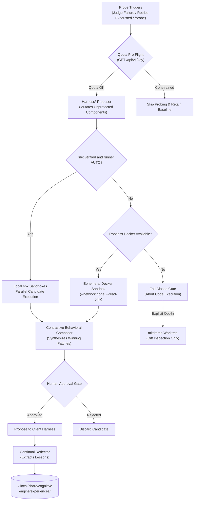
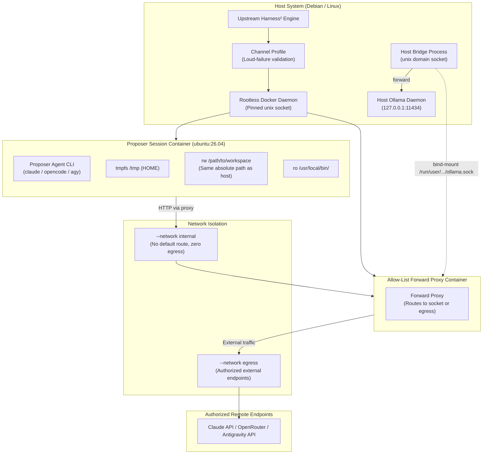

# RFC 004: Track 3 — System 2: Google Harness² Recursive Reasoning Optimizer

- **RFC Number**: 004
- **Track**: Track 3
- **Status**: Proposed
- **Runtime**: Python 3.12 / uv
- **License**: Apache-2.0
- **Target Subsystem**: `packages/harness2/`
- **Target Branch**: `feat/track3-harness2`
- **Parent Blueprint**: [RFC 001: Cognitive Engine Architecture](001-harness2-jev-unified-cognitive-substrate.md)
- **Implementation Plan**: [Multi-Track Implementation Plan](../plans/2026-10-26-multi-track-implementation-plan.md)

---

## 1. Summary & Motivation

Establishes Track 3 of Cognitive Engine: packaging Google Harness² as a native Python 3.12 workspace package (`packages/harness2`) managed by `uv`. 

Harness² serves as the System 2 reflective reasoning and prompt optimization engine. It operates at two recursive levels:
- **Task-Level Recursion (*Propose–Probe–Compose*)**: Evaluates candidate prompt, tool, and context modifications across parallel execution trajectories without requiring ground-truth labels.
- **Harnessing-Level Recursion (*Continual Learning*)**: Extracts generalized problem-solving strategies and distilled lessons into out-of-tree experience libraries.

---

## 2. Technical Scope & Core Components

### 2.1 Recursive Reasoning Core & Flat Layout (`packages/harness2/src/cognitive_harness2/`)
- Flat package architecture replaces nested directories: `packages/harness2/src/cognitive_harness2/{sandbox,engine,triggers,advice,invariants,egress,quota,experience,server}.py`.
- Consumes upstream `google-research/harness2` directly as much as possible; adopts new upstream versions as they are released; uses its source only where direct use fails. Never rewritten or reimplemented.
- Pinned at commit `1cfe254e8d25b15f37048c3730134686abe60335` as an optional extra (`[tool.uv.sources]`, extra `upstream`) in `pyproject.toml`, with a minimal fork only if forced.
- Supports mutation across permissible harness dimensions (prompts, tool descriptions, context assembly, decomposition strategies).
- Integrates with OpenRouter API for candidate generation using calibrated sampling profiles.

### 2.2 Execution Isolation via Dual-Engine Local Sandboxing (`sandbox.py`)
Probing trajectories require strict local execution isolation to protect host state:
- **Primary: Native Local MicroVM Sandboxes (`sbx`)**:
  - Probing trajectories execute in local sandboxes using native `sbx`. `sbx` is the AUTO default for model-free untrusted execution (see section 9.7 for the full selection matrix).
  - Cloud sandboxing is explicitly prohibited; code, files, and credentials never leave the host machine.
  - *Status*: `sbx` v0.50.1 is **verified live** (2026-10-31) and is in `VERIFIED_SBX_VERSIONS`.
- **Secondary: Ephemeral Rootless Docker Container Fallback (`DockerRunner`)**:
  - If `sbx` is unavailable or its version is not verified, the prober falls back, loudly, to an ephemeral, rootless Docker container sandbox configured with:
    - `--network none` (strict network isolation, zero egress)
    - `--read-only` (read-only root filesystem, scratch in tmpfs only)
    - Pinned unix socket execution, dropped capabilities (`--cap-drop ALL`), `no-new-privileges`, unprivileged user (`65534:65534`), and candidate staged read-only at `/candidate`
    - Zero off-host credential or environment leakage
  - *Status*: Rootless Docker is **installed and verified on host** (`unix:///run/user/1000/docker.sock`, `docker info` reports `name=rootless`). 21 real-daemon integration tests pass unskipped (`packages/harness2/tests/test_docker_integration.py`).
- **Fail-Closed Fallback Gate**:
  - If neither `sbx` nor Docker is available, the prober fails closed by default and refuses to run candidate code.
  - Worktree fallback is an explicit user opt-in (`--allow-worktree-diff`) using `mkdtemp` that **only generates diffs for static inspection and never executes code**.

### 2.3 Decoupled Probe Triggers (`triggers.py`, `advice.py`)
Probing is completely decoupled from System 1 routing confidence metrics. Stagnation heuristics are dropped; triggers are exactly as specified:
- **Advisory Push via Hook (`hooks/harness2-advise.sh`)**:
  - Documented (not installed) Claude Code hook script: counts consecutive tool failures per session; advises at the retry limit ($N \ge 3$) and multiples of 3.
  - Post-task verification failure: `jev_judge` returns `FAIL` or score < 0.50.
  - Error retry exhaustion: Client harness agent loop exceeds recovery attempts ($N \ge 3$) on the same task. User interrupts are not counted.
  - Atomic single-byte count append (`$XDG_STATE_HOME/cognitive-engine/harness2-hook/<sid>.count`), fail-open (always exits 0), zero secrets or prompt text stored, automatic 7-day stale count pruning.
- **Explicit Pull Tool (`harness2_trigger`)**:
  - Pure read-only pull tool: evaluates failure summary without starting sandboxes, calling models, or writing files.
  - Takes `on_demand`, `judge_passed`, `judge_score`, `consecutive_failures`, `failure_signatures`, `zdr`, `classification`, and `check_quota`.
  - Result schema: `advise` (trigger fired), `ready` (`true` | `false` | `null` when quota is unchecked), `blockers` (reasons if unready), `cost_class`, and `requires_human_approval: true`.
  - User or agent invokes `/probe <task>` in chat, runs `engine probe`, or calls `harness2_trigger`.

### 2.4 Quota Pre-Flight Check (`quota.py`)
- Pre-flights daily quota via OpenRouter API (`GET /api/v1/key`) before starting probe sweeps.
- Inspects `free_model_daily_requests` and rate limits.
- If daily quota is exhausted or throttled, probing automatically aborts with a graceful notice, falling back to standard execution without burning remaining quota.

### 2.5 Behavioral Contrast Composer (`engine.py`)
- Evaluates candidate trajectories contrastively without requiring labeled ground-truth answers.
- Identifies behavioral divergences, syntax correctness, tool call precision, and semantic completeness.
- Synthesizes winning components into a structured patch proposal for human review.

### 2.6 Out-of-Tree Experience Learning (`experience.py`)
- Discovered patterns and failure mitigations are distilled into domain experience documents (`EXPERIENCE.md`, `INDEX.md`).
- **Physical Out-of-Tree Storage**:
  - Stored strictly outside the repository at `~/.local/share/cognitive-engine/experiences/<domain>/`.
  - Prevents accidental exposure of private codebase patterns or credentials in git commits.
- **Mandatory Human Sign-Off**:
  - Experience updates are presented as candidate suggestions; they are never committed to permanent storage without explicit human confirmation via the CLI (`cognitive-harness2 experience approve`).

### 2.7 FastMCP Interface (`server.py`)
`packages/harness2` exposes standard FastMCP tools consumable by System 1 and client harnesses:
- `harness2_propose`: Generates mutation candidates for a given task or prompt (`dry_run` supported).
- `harness2_probe`: Executes candidates in parallel sandboxes (`sbx` or rootless Docker) and collects outputs.
- `harness2_compose`: Contrasts outputs and generates a synthesized patch (`requires_human_approval: true`).
- `harness2_reflect`: Extracts generalizable lessons for domain experience storage (staged as pending).
- `harness2_trigger`: Read-only pull check returning `advise`, `ready` (`true` | `false` | `null`), `blockers`, and `cost_class`.
- `harness2_status`: Read-only, offline readiness report (sandbox, API key configuration, experience root, mutable components).

The server uses FastMCP and meets the project-wide MCP contract (RFC 001 D29–D30): loopback bind only, `host_origin_protection="auto"` (forged Host and foreign Origin refused), strict argument validation (an unknown, mistyped or missing argument is a tool error), stateless HTTP, and liveness via `tools/list`. The `host_origin_protection` argument is off by default in FastMCP and must be set from the first commit.

### 2.8 Citation Lineage Contract (Upstream Google Research Harness²)
The `NOTICE` and `README.md` files formally cite upstream Google Research Harness² as primary:
- **Primary Source & Citation**: Google Research / Google LLC, Apache-2.0; Xu et al. 2026, [arXiv:2610.14224](https://arxiv.org/abs/2610.14224).
- **Related Work Only**: Foundational prompt evolution literature (*Promptbreeder*, Fernando et al., 2023, [arXiv:2309.16797](https://arxiv.org/abs/2309.16797); *Large Language Models as Tool Makers*, Cai et al., 2023, [arXiv:2305.17126](https://arxiv.org/abs/2305.17126)) are cited strictly as related work.
- **Consumption Invariant**: `packages/harness2` uses upstream `google-research/harness2` directly as much as possible, adopting new upstream versions as they are released. It consumes upstream as a pinned git dependency (commit `1cfe254e8d25b15f37048c3730134686abe60335`) in `pyproject.toml` (extra `upstream`), using a minimal fork only if forced, and using its source only where direct use fails. Never claimed as a rewrite or custom reimplementation.
- Preserve the Apache-2.0 license boundary for `packages/harness2`.

---

## 3. Invariants & Security Protections

### 3.1 Protected Invariant Set (Immune from Mutation)
The optimizer is strictly barred from modifying:
- Guardrail definitions and verification gates.
- Outbound egress and ZDR policies.
- Session model ceiling rules (e.g. Pro tier manual approval requirements).
- Lifecycle interceptor hooks (PreToolUse and PostToolUse).
- The human approval requirement on composer outputs.

### 3.2 Egress & ZDR Policy Adherence
- Probing candidate generation respects `zdr: strict`.
- Under strict ZDR, candidate prompts route solely through verified zero-retention endpoints (local Ollama or signed commercial ZDR endpoints) and never to `openrouter/free`.

---

## 4. Acceptance Criteria

- [x] `packages/harness2` installs and runs cleanly under Python 3.12 with `uv sync`.
- [x] FastMCP server initializes and exposes all tools (`harness2_{propose,probe,compose,reflect,trigger,status}`).
- [x] The server passes the MCP conformance runner (RFC 001 D30), including forged Host / foreign Origin refusal and strict arguments: 12/12 on the real daemon.
- [x] Probing triggers execute successfully: advisory push via hook script (`packages/harness2/hooks/harness2-advise.sh`) plus read-only pull tool (`harness2_trigger` with `advise`/`ready` semantics). Pure logic and hook smoke-tested.
- [x] Option A Dual-Engine sandbox isolation executes candidate trajectories: ephemeral rootless Docker container (`--network none`, `--read-only`, zero egress) verified against live daemon (`unix:///run/user/1000/docker.sock`; 21 real-daemon integration tests pass unskipped). Native local `sbx` microVMs (`SbxRunner`, v0.50.1) verified live and selected by default for model-free untrusted execution, with a loud Docker fallback (section 9.7).
- [x] Missing sandbox runtime (neither `sbx` nor Docker available) triggers clean fail-closed abort without executing code.
- [x] `GET /api/v1/key` pre-flight prevents execution when quota limits are reached. *(Tested against mocked responses; the live field names are unverified.)*
- [x] Experience reflections write exclusively to `~/.local/share/cognitive-engine/experiences/`. *(Staged lessons are pending until a human approves them through the CLI.)*
- [x] Protected invariants are verified immutable by automated mutation rejection tests. *(Components are refused and wired; protected-path rule tested against directory and subpath escapes.)*
- [x] Apache-2.0 license file and upstream Google Research Harness² citations (Xu et al. 2026, arXiv:2610.14224; Promptbreeder and Tool Makers as related work) applied in `NOTICE` and `README.md` (commit `ffe4de4`).

---

## 5. Implementation Notes & Roadmap (Track 3)

1. **Port `8120`.** FastMCP daemon bound to `127.0.0.1:8120`, overridable with `COGNITIVE_HARNESS2_PORT`. Registered with the conformance runner via `tools/probes/harness2.toml`.
2. **Read-only tools.** `harness2_status` (offline readiness report) and `harness2_trigger` (read-only advisory pull check with `advise`/`ready` semantics).
3. **`dry_run` on `harness2_propose`.** Reports policy verdict without calling a model.
4. **Only four components are mutable.** `prompt`, `tool_description`, `context_assembly`, `decomposition_strategy`. All others refused.
5. **Human sign-off is a CLI step.** An agent stages lessons with `harness2_reflect`; a human approves them with `cognitive-harness2 experience approve`. The gate raises the bar for agents and scripts but has a stated residual limit (section 9.6).
6. **Upstream consumption.** Pinned git dependency at `1cfe254e` (extra `upstream`).
7. **Slice 3 Two Gated Steps**:
   - **Slice 3a (Safety Seams)**: Wire `MUTABLE` <-> upstream `SurfaceSpec` default-deny, egress gate on Proposer endpoint, `Substrate.preflight` -> `require_rootless_docker`, quota/ledger pre-flight. Zero model calls, zero execution. Subject to independent review and user gate.
   - **Slice 3b (Execution)**: `DockerRunner` as `Substrate.execute`, one capped dry-run, hard budget cap, `requires_human_approval` kept intact. Runs only on user's separate go.
---

## 6. Upstream Wiring & Execution Roadmap (Slice 3)

### 6.1 Slice 3a: Safety Seams (Verified, No Model Calls, No Execution)
- **Upstream Surface Mapping (`upstream_surface.py`)**: Maps upstream `SurfaceSpec` paths to the protected invariant set with default-deny. Binds directly to filesystem paths rather than ambiguous `c1..c8` slot aliases: `c3` (memory) maps to `context_assembly`, `c5` (subagents) maps to `decomposition_strategy`, `c6` (skills) is denied as undecided.
- **Proposer Egress Gate (`upstream_egress.py`)**: Decides on an upstream `Proposer` configuration before any session exists. Upstream's Proposer forces Vertex AI via environment variables and inherits the host environment; Cognitive Engine requires an explicit endpoint declaration and enforces 15 strict refusal rules (refuses Vertex/hosted cloud, cloud CLI without explicit opt-in, undeclared endpoints, credential-like environment variables, userinfo/query/fragments in URLs, hosted providers behind loopback).
- **Substrate Seam (`substrate.py`)**: Implements `CognitiveSubstrate` adhering to upstream's `Substrate` protocol. Preflight invokes `require_rootless_docker`; `execute` and `read_trajectory` refuse execution ("slice 3b").
- **Sweep Plan Gate (`sweep_plan.py`)**: Refuses sweep generation without hard caps (sessions, wall time, cost), when a blocker exists, or without an allowed proposer.
- **Zero-Side-Effect Proof (`test_no_side_effects.py`)**: Trap-based testing verifies that zero subprocess, network socket, HTTP client, or filesystem mutation occurs outside verified preflight checks.

### 6.2 Slice 3b: Execution & Proposer Isolation Design
Slice 3b connects upstream Harness² recursive optimization to real execution under a strict multi-tier safety architecture governed by user decisions (2026-10-29):

#### 1. Proposer Channels
Optimization proposals originate from one of three supported channels:
- **Local**: `opencode` -> `ollama` on loopback (Stage 1 measured: `gemma4:e4b` via a 16k-context variant; `gemma4:12b` does not load on the 8 GB GPU, see section 9).
- **Agent Provider**: The harness's own CLI (`Claude` via `claude` CLI, `Antigravity` via `agy` CLI).
- **OpenRouter**: Commercial models accessed via OpenRouter API under strict ZDR.
All channels are subject to uniform zero-data-retention and classification policies.

#### 2. Uniform Policy via Per-Channel Profile
Every channel is governed by a declarative profile (`proposer-channels.json`):
- `kind`: CLI runner type (`opencode`, `claude_cli`, `agy_cli`, `openrouter`).
- `provider`: Underlying provider identity.
- `endpoint`: Loopback or authorized remote URL.
- `model`: Target model identifier.
- `retention`: Data retention level (`local` | `zdr-attested` | `unknown`).
- `max_classification`: Ceiling for ingestible source classification (`open` < `gated` < `restricted`).
- `caps`: Hard budget limits (`max_sessions`, `max_wall_s`, `max_cost_usd`).
- `approval`: Human approval requirement flag (default true per sweep).

> [!IMPORTANT]
> **ZDR Declaration vs. Verification**: Zero Data Retention is recorded based on the user's explicit declaration and provider terms. Remote provider adherence cannot be cryptographically audited. Subscription channels (Claude Code, Antigravity) provide no verifiable ZDR guarantees for subscription tiers; they default strictly to `retention: unknown` and are restricted to `open` content only. Channel profiles follow loud-failure validation: any malformed profile causes immediate fail-closed refusal.

#### 3. Execution Isolation (Host Unix-Socket Bridge & Forward Proxy Container)
Proposer CLI sessions run in isolated, rootless Docker containers reusing the hardened `DockerRunner` architecture:

- **Rootlesskit Network Boundary & Isolation**:
  - `rootlesskit` executes with `--net=gvisor-tap-vsock --disable-host-loopback`.
  - Empirically verified: host loopback is **unreachable** from inside rootless containers via `127.0.0.1`, `172.17.0.1`, `10.0.2.2`, `192.168.127.1`, or `host.docker.internal:host-gateway` (which resolves to `172.17.0.1`, the bridge inside rootlesskit's network namespace, not the host).
  - An `--internal` container network has no default route and zero egress.
  - Consequence: A standard forward proxy inside a container attempting to connect to host loopback `127.0.0.1:11434` over TCP fails.
- **Host Unix-Socket Bridge Topology**:
  - A lightweight host process bridges a single unix domain socket (e.g. `/run/user/1000/cognitive-engine/ollama.sock`, mode 0600) to host loopback `127.0.0.1:11434` (Ollama) and nothing else.
  - The socket is bind-mounted into the forward proxy container only.
  - The forward proxy container connects to two networks:
    - `--network internal`: Shared with the proposer session container (no default gateway, zero outbound access).
    - `--network egress`: Connected to the external gateway for remote provider calls.
  - For local channels (`opencode` -> `ollama`), internal HTTP requests are forwarded directly to the bind-mounted unix socket.
  - For remote channels (Claude API, OpenRouter, Antigravity API), internal HTTP requests route strictly to the declared host/port via the egress network.
  - Complete Host Isolation: All other host loopback services (`8100` Lookup, `8105` Recall, `8115`, `8120`, Samba, etc.) remain strictly unreachable from containers by default.
- **Base Image Selection**:
  - Selected: `ubuntu:26.04` (glibc 2.43 matching the host system; 40 MiB) as primary container image; `debian:13-slim` (28 MiB) as fallback.
  - Evaluated and Rejected: `distroless/cc-debian13` (10 MiB) was rejected because it lacks a shell, which Claude Code's `Bash` tool strictly requires. `alpine:3` was rejected because musl is incompatible with glibc CLI binaries.
- **Workspace Mounting (Same Absolute Path)**:
  - The candidate workspace is bind-mounted read-write at the **same absolute path** inside the container as on the host.
  - This is strictly required because agent tooling (`OPENCODE_PERMISSION` in particular) hard-codes and enforces exact host-absolute paths.
- **Container Hardening**: Read-only root filesystem, tmpfs `HOME`, dropped capabilities (`--cap-drop ALL`), strict pids/memory/cpu limits, CLI mounted read-only, candidate workspace mounted read-write at host absolute path.
- **Design changes from first contact (Stage 1, 2026-10-30/31)**:
  - **Proxy environment**: `opencode --standalone` talks to its own loopback server through a proxy-aware client, so the session needs `NO_PROXY=127.0.0.1,localhost,::1` (run #1). The runner sets exactly that value and nothing wider; callers may not set proxy variables.
  - **Network alias**: ollama 0.32.11 has a DNS-rebinding guard that returns 403 for any `Host` that is not a loopback or private IP, `localhost`, the machine hostname, or `*.localhost` / `*.local` / `*.internal`. The proxy container therefore carries the network alias `harness2-proxy.internal` (run #2). Every stub shares one measured model of ollama's Host, Origin and body refusals.
  - **Model and context**: `gemma4:12b` (11.9B plus a speculative draft model) cannot load on the 8 GB GPU shared with the desktop (run #3). The channel uses `gemma4:e4b`, chosen by benchmark (section 9.2), with thinking ON. ollama's default context for gemma4 is 4096 tokens, which truncates opencode's roughly 4-6k-token steps, so a 16k variant (Modelfile `num_ctx 16384`, name `gemma4-e4b-16k`) is required.
  - **opencode provider block**: opencode v2.0.25 needs the npm package `@ai-sdk/openai-compatible` named in the provider block of its config.
  - **opencode footprint**: `TMP_EXEC` False works; the image has no `rg`, so grep, glob, webfetch, websearch, question and subagent tools are denied; it needs about 19 MB of `/tmp` and 0.5 MB of `HOME`; `--standalone` avoids the background service. Running opencode on the host auto-starts `opencode serve --service`, which must be stopped.
- **Alternatives Considered & Rejected**:
  - *Bubblewrap (`bwrap`)*: Rejected as a secondary technology requiring independent maintenance without standard seccomp/cgroup defaults and lacking macOS portability.
  - *Host process with tool filtering*: Rejected because subscription agent CLIs store active credentials in `HOME`, presenting ambient token exfiltration risk.

#### 4. Package Binding & Channel Execution
- **Upstream Proposer Subclassing (Verified via WS-0 Spike)**:
  - Upstream Harness² callers do not invoke `isinstance(p, Proposer)`; interactions follow duck typing.
  - `packages/harness2` subclasses upstream `Proposer`, overriding `_claude_cli` and `_opencode` to execute `docker run --rm -i ...` with the workspace bind-mounted at the same absolute path.
  - Subclass overrides `env()` because upstream's `env()` hard-codes `CLAUDE_CODE_USE_VERTEX=1`.
  - Duck typing requirements verified: `_selector_for` calls `p.env(selector_spec)`, `generate()` yields candidate proposals.
  - Upstream Couplings to Navigate:
    - `spec.py:33`: `CHANNELS` is a closed tuple; `ChannelSpec.__post_init__` rejects `agy_cli` unless adapted in our package.
    - `schedule.py:188-192`: `_selector_for` constructs a plain `Proposer` when selector spec differs; our entry points must pass `selector_prop` explicitly to retain the containerized subclass.
    - `cli/run_sweep.py:151`: Constructs `Proposer(...)` directly; our CLI entry point invokes `schedule.run_sweep` directly with our containerized subclass.
    - Private method signatures: `_claude_cli`, `_opencode`, `env`, context/harness harvest paths, and CLI flags.
- **Opencode Binary Version Mismatch**:
  - Host installed binary is `opencode` v2.0.25 (lacks `--dir` and `--variant` flags, defaults to a background daemon; `--standalone` flag runs foreground session).
  - Upstream tests assume `bun run src/index.ts run --dir ... --variant ...` against a pinned source checkout that is not cloned in standard environments.
  - Resolution: Adapt to v2 flags in our overridden `_opencode` method (we build the command line anyway) and validate JSON event streaming with a real local smoke call during Stage 1, avoiding building bun + pinned source checkouts into the container base image.
- **Headless Antigravity CLI (`agy_cli`) Feasibility (Verified via WS-0 Spike)**:
  - 100% verified feasible headlessly in a container without GUI or browser interaction.
  - Invocation: `agy --print="<prompt>" --dangerously-skip-permissions --model="<model>" [--effort=low]`. (Prompt attached as `--print="..."` to avoid flag ingestion; workspace passed via positional argument or `--add-dir`). Real autonomous file edits verified in 9 seconds.
  - Authentication: Reads JSON oauth token from `$HOME/.gemini/antigravity-cli/antigravity-oauth-token`, injectable read-only without browser (`chmod 400`).
  - Filesystem & MCP: `/` read-only, `$HOME` tmpfs, empty `mcp_config.json` (`{"mcpServers":{}}`) ensures zero MCP startup hangs, `--sandbox` enables terminal restrictions.
  - Network: Exactly ONE endpoint contacted: `daily-cloudcode-pa.googleapis.com:443` (HTTP/2 SSE). Single allow-list rule is 100% sufficient.
  - Cost: $0 under Google AI subscription (~21k tokens).
- **Dotenv Loading Source Correction**:
  - Upstream `config.py:21` sets `ROOT` to the clone directory when `pyproject.toml` sits beside the package, so `load_dotenv` reads `<clone>/.env`, NOT `$CWD/.env` (`harness2/.env` does not exist).

#### 5. Slot Table & Component Immutability
Upstream paths are mapped to invariant components:
- **Mutable Components**:
  - `c1` prompt: System prompts and instructions.
  - `c3` context_assembly: Context assembly rules and memory retrieval heuristics.
  - `c4` tool_description: Descriptions of exposed tools.
  - `c5` decomposition_strategy: Subagent task decomposition logic (**BODY ONLY**).
  - `c6` skills: Procedural skill documentation (**BODY ONLY**).
- **Immutable & Denied Components**:
  - `c2` guardrails: Safety boundaries and invariant checks (denied by slot and path stem).
  - `c7` scripts: Tool executable scripts.
  - `c8` plugins/hooks: Interceptors, hooks, and extensions.
  - **Frontmatter Fields**: In `c5` and `c6`, frontmatter keys (`model`, `tools`, `allowed-tools`, `permissions`) are **FROZEN**. Mutations attempting to alter frontmatter are rejected as model-tier or privilege escalations.

#### 6. Phased Rollout Stages
Slice 3b executes through three strictly sequential, user-gated stages:

1. **Stage 1: Local Smoke Test**:
   - Budget: $k=1$ (ledger parameters $P=3$k sessions, $R=4$k rollouts; max 3 sessions, 4 rollouts).
   - Task: Bundled minimal demo task.
   - Channel: `opencode` -> `ollama` (`gemma4-e4b-16k` on loopback; changed from `gemma4:12b`, see section 9). **Stage 1 completed 2026-10-31 (run #4).**
   - Resources: 45 min total wall clock, 10 min per session cap, container capped at 2 GB RAM, 2 CPUs, 256 pids, $0 cost. (All figures are proposals).
   - Gate: Explicit user approval before start.
2. **Stage 2: OpenRouter Strict ZDR**:
   - Channel: OpenRouter API under verified ZDR.
   - Budget: User-defined dollar and session ceiling.
   - Gate: Requires separate user approval following Stage 1 review.
3. **Stage 3: Subscription Agent Channels**:
   - Channel: Claude Code / Antigravity CLI.
   - Scope: Open content only (`retention: unknown`).
   - Gate: Requires separate user approval following Stage 2 review.

---

## 7. Acceptance Criteria per Stage

### Slice 3a: Safety Seams & Invariants (Completed)
- [x] Upstream `SurfaceSpec` maps cleanly to `MUTABLE` with default-deny; slot stems and subpaths rejected if protected.
- [x] Proposer egress gate enforces 15 refusal rules; Vertex AI and cloud CLIs blocked by default.
- [x] `CognitiveSubstrate.preflight` enforces rootless Docker requirement; `execute` raises clean "slice 3b" blocker.
- [x] `sweep_plan` refuses plans without hard budget caps or with unverified readiness.
- [x] Side-effect trap test suite proves zero network, subprocess, or filesystem side-effects occur during seam execution.

### Slice 3b Stage 1: Local Smoke (Gated on User Go)
- [x] Glibc-based rootless container image (`ubuntu:26.04`) built and verified on local daemon (run #4, 2026-10-31).
- [x] Host unix-socket bridge and forward proxy container route container traffic to loopback Ollama only (7/7 sessions reached the model). The ollama management API is no longer reachable: the route allow-list closes it (section 9.5).
- [x] Containerized `opencode` session launched and output captured (7 sessions exit 0).
- [x] Frontmatter freeze validator covered by slice 3a / WS-D tests. **Not exercised by a live accepted edit**: no proposer edit was accepted in run #4.
- [x] Smoke sweep (P=3 proposer sessions, R=4 solver rollouts) completed in 127 s, $0, clean teardown. Resource caps were not stressed.

### Slice 3b Stage 2: OpenRouter Integration (Gated)
- [ ] OpenRouter channel profile validates against schema with strict ZDR enforcement.
- [ ] Dollar budget cap enforced fail-closed by ledger pre-flight.

### Slice 3b Stage 3: Subscription Channels (Gated)
- [ ] Subscription channel profiles validate with `retention: unknown` and clamp sweep classification to `open`.
- [ ] Containerized `claude_cli` and `agy_cli` sessions execute without leaking credentials outside container.

---

## 8. Assumptions & Spike Verifications
The following architectural assumptions are tracked and verified across slice spikes and Stage 1 runs.

1. **Proposer Subclassing**: **VERIFIED WITH CAVEATS**. Upstream callers rely on duck typing rather than `isinstance`. Subclassing works cleanly by overriding `_claude_cli`, `_opencode`, and `env()` with same-absolute-path workspace mounting. Caveats and couplings tracked: closed `CHANNELS` tuple in `spec.py`, `_selector_for` fallback construction in `schedule.py`, direct `Proposer` instantiation in `cli/run_sweep.py`, and opencode CLI v2 argument differences.
2. **Headless Antigravity CLI (`agy`)**: **VERIFIED (spike), not run in Stage 1**. Headless non-interactive execution confirmed in container spike (`--print="..."`, read-only token injection `antigravity-oauth-token` mode 0400, single allow-list endpoint `daily-cloudcode-pa.googleapis.com:443`, tmpfs `HOME`, 9s execution). Stage 3 will exercise it for real.
3. **Rootless Docker Host-Loopback Egress**: **DISPROVEN & REDESIGNED**. Direct container-to-host loopback via TCP is impossible under rootlesskit `gvisor-tap-vsock`. Replaced with host unix-socket bridge + forward proxy container architecture. **The replacement is VERIFIED by run #4 (2026-10-31)**: 7/7 sessions in the contained `opencode` reached the model through egress proxy, host bridge and ollama.
4. **Containerized opencode end to end**: **VERIFIED by run #4 (2026-10-31)**. opencode v2.0.25 in the contained session, `--standalone`, exit 0 in 7/7 sessions, JSON event stream captured, teardown clean (nothing left behind daemon-wide). Required fixes are in section 6.2 item 3 (NO_PROXY, network alias, provider block).
5. **Local model viability**: **VERIFIED by run #4 and the benchmark (section 9.2)** for `gemma4:e4b` 16k with thinking ON. `gemma4:12b` is **DISPROVEN** on this host (8 GB GPU shared with the desktop).
6. **Native `sbx` MicroVMs**: **VERIFIED live (2026-10-31, v0.50.1)**. The real command flow is `create` / `cp` / `exec` / `rm --force`, and its daemon needs the `kvm` gid (started via `sg kvm`). `sbx` is now the AUTO default for model-free untrusted execution, with a loud Docker fallback; model sessions stay on Docker (section 9.7).
7. **Live OpenRouter Quota Response Schema**: **STILL UNVERIFIED**. Field names for `GET /api/v1/key` are verified against mock schemas but pending validation against live endpoint responses (Stage 2).
8. **Accepted proposer edit applied and re-scored**: **STILL UNVERIFIED**. No proposer edit has been accepted in run #4 or in the three stage 1b runs (sections 9.3 and 9.4).
9. **`claude_cli` token delivery (value vs file)**: **STILL UNVERIFIED / unsolved** (Stage 3).

---

## 9. Stage 1 Results and Lessons (2026-10-30/31)

### 9.1 Runs

| Run | Outcome | Cause and fix |
|---|---|---|
| #1 | Failed | `opencode --standalone` talks to its own loopback server through a proxy-aware client and the runner set no `NO_PROXY`. Fix: runner sets `NO_PROXY=127.0.0.1,localhost,::1` only; callers may not set proxy variables. |
| #2 | Failed | ollama 0.32.11 returns 403 for `Host` values outside loopback/private IPs, `localhost`, machine hostname, `*.localhost` / `.local` / `.internal`. Fix: network alias `harness2-proxy.internal`; one shared measured model of ollama's Host/Origin/body refusals in every stub. |
| #3 | Failed | ollama could not load `gemma4:12b` (11.9B plus speculative draft model, 8 GB GPU shared with the desktop): `Gemma4Assistant requires ctx_other`, `vector::_M_range_check`. Fix: change model (below). |
| #4 | **Succeeded** | 7 sessions exit 0, 7/7 reached the model, P=3 proposer sessions plus R=4 solver rollouts, 127 s, $0, clean teardown. Solver pass rates: base1 3/3, dom1 3/3, agg1 3/3, inv1 2/3 (arithmetic noise). |

### 9.2 Model benchmark

Candidates `qwen3-4b-16k`, `gemma4:e4b` and `nemotron-3-nano:4b`, scored with a pre-registered scoring rule.

- `gemma4:e4b` won with thinking ON: tool suite 91%, agent task 9/10.
- `think:false` cripples gemma and nemotron.
- qwen3 thinks too long at temperature 0.
- ollama's default gemma4 context is 4096, which would truncate opencode steps; the 16k variant (`num_ctx 16384`) is required.

### 9.3 What is and is not proven

Proven by run #4:
- The full containment path works for real: contained opencode -> egress proxy -> host bridge -> ollama.
- Teardown leaves nothing behind.
- The channel runs at $0 within a 127 s sweep.

**Not proven:**
- **No accepted proposer edit has been exercised.** All three proposer stages kept the base harness because the base already passes the task. The edit-apply, frontmatter-freeze-on-live-edit and re-score path has therefore never run on a real candidate.
- The stage-1 task is too easy to discriminate harnesses; the inv1 2/3 result is noise, not signal. Stage 1b (section 9.4) did not change this.
- Nothing about stages 2 and 3 (OpenRouter, subscription channels).

### 9.4 Stage 1b results (hard task set, 2026-10-31)

Stage 1b added a harder task set so that a proposer edit could be accepted and re-scored: the `sum-signed-hard` task, a deliberately weak base harness, and a `--task-set {easy,hard}` selector.

| Run | Model | Outcome |
|---|---|---|
| 1b-1 | gemma4:e4b (16k) | No proposer edit accepted. The INV proposer edited a `c7` script and the slot table refused it. |
| 1b-2 | gemma4:e4b (16k) | No proposer edit accepted. The INV proposer edited a `c7` script again and the slot table refused it. |
| 1b-3 | qwen3-4b-16k | No proposer edit accepted. The qwen proposers made no edit. |

Honest reading:
- **The loop is unproven.** No run produced an accepted edit, so apply, frontmatter freeze on a live edit, and re-score have still never run on a real candidate.
- The base harness passes about half the time at k=1, so a pass/fail difference between harnesses is noise, not signal.
- The two refusals are evidence that the slot table works against a real proposer (it stopped a `c7` edit), not evidence that the optimizer improves anything.
- Next step: improve the proposer's signal by telling it which files are mutable. Check first that the upstream rules allow this.

### 9.5 Route filter and model pinning

The forward proxy admits only an allow-list of method and path pairs on the unix route to ollama:
- `GET /api/tags`
- `GET /v1/models`
- `POST /v1/chat/completions`
- `POST /v1/completions`
- `POST /api/show`

Everything else is refused, which closes the ollama management API that run #4 left reachable (the earlier "route filter in progress" note is closed). The denial log records the method and path of each refused request. The proxy also pins the model: a request that names any model other than the approved one is refused, so a contained session cannot switch to a larger or different model through the allowed endpoints. The `ACCESS-SUMMARY` counters now cover the proxy traffic of a run.

### 9.6 Approval gate: the true guarantee and the residual limit

The approval of a real-model sweep (`stage1 run --approve <channel>`, `confirm_on_terminal`) is a human-in-the-loop control. What it does (hardened 2026-10-31 after the Fable 5.1 review):
- The process must have a controlling terminal: the confirmation is read from `/dev/tty`, never from stdin, so pipes, redirected stdin and scripts without a tty are refused.
- The typed text is the approval phrase plus a fresh four-word nonce shown on the terminal, so a prewritten answer does not work.
- The command refuses to run, with no flag to override it, when the environment carries a known agent-harness marker (`CLAUDECODE`, `CLAUDE_CODE_*`, `ANTIGRAVITY*`, `GEMINI_CLI*`, `AGY_*`, `OPENCODE*`, `CODEX*`; the Antigravity, Gemini and `AGY_` names are prefix guesses, not names the repo has observed).

What it does not guarantee: a process running as the same user can allocate and drive a pty (`pty.fork`, `script`, `expect`, `tmux send-keys`), read the nonce and type it back, and it can scrub the environment markers. The gate stops pipes, scripts and anything running inside a known agent harness; it is not a defence against a determined same-user process, and the human remains the control. `tests/test_stage1_approval_pty.py` asserts both sides (a pty driver without markers is still approved; with markers it is refused). The containment of model sessions (section 6.2 item 3) does not rely on this gate.

### 9.7 Sandbox selection: sbx default and fallback matrix

`sbx` v0.50.1 was verified live on 2026-10-31 and is the AUTO default for **model-free** untrusted execution. Selection is explicit and loud:

| Runner setting | Work | Result |
|---|---|---|
| AUTO (default) | Model-free untrusted execution, `sbx` verified | `sbx` |
| AUTO | Model-free untrusted execution, `sbx` installed but not selected (version not verified, `/dev/kvm` unusable, daemon down, network policy not deny-all, a host-reach setting on or a restart pending, probe timeout or error) | Docker, with one warning per process that names the reason code (`sbx` simply not installed falls back silently; the reason still shows in the status report) |
| AUTO | `sbx` selected but it fails before the candidate starts (create, image, staging) | Docker for the rest of that runner's life, with a warning (`sbx-run-failed`); never after the candidate has started |
| `docker` | Any | Docker is forced; `sbx` is never tried |
| `sbx` | Any model-free | `sbx`, or fail closed if it is unavailable (no Docker fallback) |
| any | Model sessions (proposer channels) | Docker only; model sessions stay on Docker |
| any | Neither runtime available | Fail closed; no code runs |

Precondition for selecting `sbx`: both host-reach settings (`ssh.agentForwardingEnabled`, `browser.enabled`) must be off and no daemon restart pending. Under AUTO a violation means a fallback to Docker with the reason; only in `sbx` mode does it refuse (`COGNITIVE_HARNESS2_SBX_ALLOW_HOST_SETTINGS=1` overrides these two settings only, for the live tests). Earlier text in this RFC that described `sbx` as "unverified", "not installed" or only selected on explicit opt-in is superseded by this section.

### 9.8 Slot table enforced on every task set

The slot table (section 6.2 item 5) is now enforced on every task set, easy and hard, not only on the original smoke task. A proposer edit to a denied component (`c2`, `c7`, `c8`) or to a frozen frontmatter key is refused whichever `--task-set` is selected. Stage 1b exercised this for real: the INV proposer's `c7` edits were refused in both gemma runs.

### 9.9 Known gaps and open items

- **Proposer signal**: no accepted proposer edit yet (section 9.4); hint the proposer which files are mutable once the upstream rules are confirmed to allow it.
- **Test isolation**: done. Leak checks use per-run ids rather than daemon-wide counts, so a concurrent agent's containers no longer break the "nothing left behind" assertions.
- **`claude_cli` token delivery** (value vs file): unsolved.
- **Stages 2 and 3**: user-gated, not started. Stage 2 (OpenRouter, zdr strict, dollar cap) and Stage 3 (Claude and Antigravity channels, zdr off, open content only) each need a separate user go.
- **Jev guard backlog** (tracked in the Track 1 PR stack): click-through false positives on `this` and variable keys, the resume model gap, and project configs.
- **Locks**: `mkdir`-based locks are NOT exclusive under rapid create/remove cycling on this host. The hook uses a lock-free line-number position; `flock` works.
- **`agy` headless feasibility** (single endpoint `daily-cloudcode-pa.googleapis.com:443`) remains a spike result only.

### 9.10 Final verification (Fable 5.1)

A final verification pass found no critical issue and no smuggling path out of a contained session. It led to these fixes in the same body of work: the Jev Agent-guard unknown-agent hole (HIGH), approval gate hardening (section 9.6), model pinning in the proxy (section 9.5), `ACCESS-SUMMARY` counters, non-interruptible teardown, the slot table on every task set (section 9.8), and lower-severity items.
