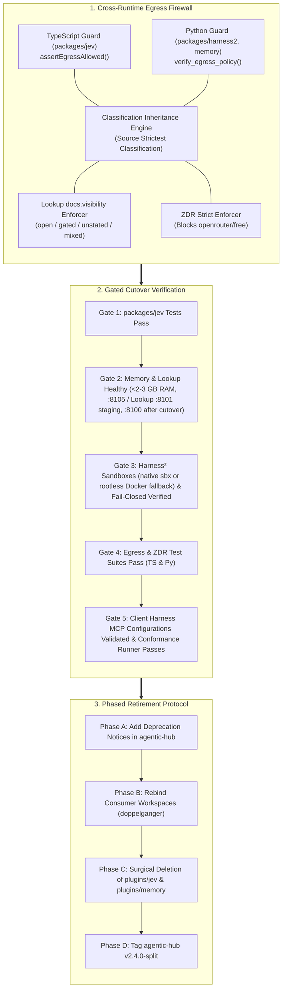

# RFC 005: Track 4 — Cross-Runtime Egress Gates & agentic-hub Retirement Protocol

- **RFC Number**: 005
- **Track**: Track 4
- **Status**: Proposed
- **Runtime**: Polyglot (TypeScript / Bun + Python 3.12 / uv + Shell)
- **License**: MIT
- **Target Subsystem**: Cross-runtime egress guards, client configs, and migration cutover tooling
- **Target Branch**: `feat/track4-egress-retirement`
- **Parent Blueprint**: [RFC 001: Cognitive Engine Architecture](001-harness2-jev-unified-cognitive-substrate.md)
- **Implementation Plan**: [Multi-Track Implementation Plan](../plans/2026-10-26-multi-track-implementation-plan.md)

---

## 1. Summary & Motivation

Establishes Track 4 of Cognitive Engine: implementing the cross-runtime outbound data egress firewall, enforcing Zero Data Retention (ZDR) compliance, and executing the safe retirement protocol for legacy plugins in `rockad/agentic-hub`.

To guarantee continuous agent availability and eliminate disruption during workspace migration, Track 4 operates under a strict **Zero-Retirement Prerequisite Policy**: no files or services will be decommissioned from `agentic-hub` or `doppelganger` until all verification gates pass.

---

## 2. Technical Scope & Architecture

### 2.1 Cross-Runtime Outbound Egress Firewall
Outbound egress rules must be enforced symmetrically across both runtimes:
- **TypeScript Runtime (`packages/jev/src/egress.ts`)**:
  - Enforces workspace boundaries and URL endpoint whitelisting before any LLM API call.
  - Intercepts free-tier offloading requests (`jev_execute_free`).
- **Python Runtime (`packages/harness2/core/egress.py`, `packages/lookup/`)**:
  - Validates model endpoints during candidate generation and reflection.
  - Ensures local microVM sandboxes (`sbx`) maintain network isolation.

### 2.2 Classification Inheritance Invariant
Directory path matching alone is insufficient when aggregating knowledge across shared notes and transcripts:
- Any content derived from memory notes, transcripts, or experience files inherits the **strictest classification** of all its sources.
- Records lacking explicit classification default to **restricted**.
- Derived prompts containing restricted content are barred from public or free-tier model endpoints.

### 2.3 Lookup Visibility Classification (`docs.visibility`)
`packages/lookup` extracts and propagates metadata tags:
- `open`: Publicly shareable; eligible for standard and free-tier processing.
- `gated`: Requires local or approved ZDR processing; requires user confirmation before external dissemination.
- `unstated`: Treated strictly as `gated` (fail-safe default).
- `mixed`: Contains both open and gated sources; inherits `gated` restrictions.

### 2.4 ZDR Strict Policy Enforcement
When operating under `zdr: strict`:
- Free-tier offloading (`openrouter/free`) is immediately disabled.
- Probing requests route exclusively to local inference (e.g. Ollama) or verified commercial Zero Data Retention endpoints.
- If no compliant ZDR endpoint is available, the request aborts fail-closed.

---

## 3. Gated agentic-hub Retirement Protocol

To ensure 100% developer continuity, migration executes through four distinct phases:

### Phase 1: Substrate Verification Gates (All Must Pass)
- [ ] `packages/jev` passes unit test suite (`bun test`) and schema validations with 0 errors.
- [ ] `packages/memory` runs natively on `127.0.0.1:8105/mcp` with resident memory verified under 2–3 GB RAM during sustained hybrid queries.
- [ ] `packages/lookup` runs natively on `127.0.0.1:8101/mcp` (staging; the legacy container holds `:8100`) and correctly filters search results by `docs.visibility`.
- [ ] `packages/lookup` indexes the same network-share sources as the legacy container with no host mount (RFC 001 D31), verified by document-count parity per source.
- [ ] `packages/lookup` real-Samba check on host `core`: optional live check using dedicated read-only account `ce-lookup-ro`, password generated and kept on core (0600), fetched into process env per run, never logged; needs the user's go. Status: not started.
- [ ] Every daemon (`:8105`, `:8101`, `:8115`, Harness²) passes `tools/mcp_conformance.py` (RFC 001 D30): loopback only, forged Host and foreign Origin refused, strict arguments, stateless.
- [ ] Gate 3: `packages/harness2` completes candidate probing inside local sandboxes (native `sbx` or ephemeral rootless Docker fallback) and confirms fail-closed behavior when neither runtime is available.
- [ ] Cross-runtime egress test suites pass identically under Bun and Python.
- [ ] Global configuration `~/.gemini/config/mcp_config.json` successfully registers `cognitive-engine` endpoints.

### Phase 2: Deprecation & Freezing
- Freeze active development in `agentic-hub/plugins/jev/` and `agentic-hub/plugins/memory/`.
- Add prominent deprecation banners to both directories directing users to `rockad/cognitive-engine`.

### Phase 3: Consumer Rebinding
- Note: until retirement, the legacy Recall container publishes `0.0.0.0:8110` (compose starts `basic-memory` with `--host 0.0.0.0`), and upstream states that mode has **no authentication**, so its notes can be read, changed or deleted by anything that can reach the port. Whether other machines can reach it depends on the WSL2 and Windows firewall setup and has not been tested. The whole legacy setup is retired at cutover, which ends the exposure; the native daemons bind `127.0.0.1` only.
- Stop the legacy Lookup container (`lookup-lookup-1`, `:8100`) and rebind native Lookup from `:8101` to `:8100`. This happens only after the share-source parity gate above; stopping the container earlier would drop the network-share sources.
- Update `doppelganger/.mcp.json` to point to native `cognitive-engine` MCP servers.
- Update user shell aliases and helper scripts (`jev`, `jev-mode`, `memory.sh`) to invoke `bin/engine`.
- Validate that daily operations in `doppelganger` function without Docker containers running.

### Phase 4: Surgical Retirement & Release Tagging
- Surgically remove `plugins/jev/` and `plugins/memory/` from `agentic-hub`.
- Remove legacy Docker Compose definitions (`docker-compose.yml` for memory).
- Update `agentic-hub/marketplace.json` to register only peripheral plugins (`chrome-devtools`, `gitea`, `google-workspace`, `local-transcribe`).
- Position `agentic-hub/README.md` as the peripheral-only marketplace.
- Tag and push release `v2.4.0-split` in `agentic-hub`.

---

## 4. Acceptance Criteria

- [ ] Outbound egress guards pass test suites in both TypeScript (`packages/jev`) and Python (`packages/harness2`).
- [ ] Content classification inheritance correctly identifies and restricts mixed-source content.
- [ ] `docs.visibility` enforcement prevents leak of gated documents.
- [ ] `zdr: strict` blocks all calls to `openrouter/free`.
- [ ] Consumer workspaces successfully switch to `bin/engine` with zero disruption.
- [ ] Legacy plugins are retired from `agentic-hub` only after full sign-off.
- [ ] Tag `v2.4.0-split` is published in `agentic-hub`.
